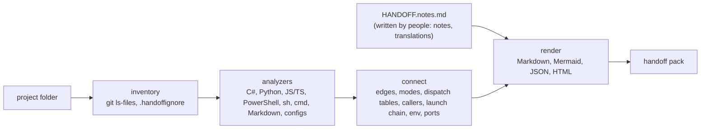

# HandOff247

**Hand Off 24-7 is a good-bye project for passing your existing projects to the next person.**
Point it at a project folder and it writes a *handoff pack*: diagrams, the structure, the comments that already
exist in the code, and how each tool in the project is connected to the others.
Your successor opens one page and sees how the program starts, which modes it has, who calls what, and where to begin reading.

```bash
python -m handoff247 /path/to/folder
```

That one command is the whole job on your last week: it creates the notes file with the questions only you can
answer, draws the diagrams, writes the pack, and prints a handover checklist of what is still open. If the folder
holds several projects, each gets its own pack and one index lists them all, starting with what would be lost when
your computer goes away.

- **No guessing.** Every statement in the pack comes from a file and links to the exact line. When a link is
  only an inference, it is labelled and drawn as a dashed arrow. When something is ambiguous, it is left out.
- **Nothing runs.** HandOff247 reads files; it never imports, builds or executes the project.
- **Nothing to install.** Python 3.10+ standard library only.
- **People add what code can't say.** A plain Markdown notes file holds the explanations: what the project is for,
  the first things a successor must do, known risks, and where credentials are kept (location only). Notes are merged into
  every page and survive regeneration.
- **It looks at what a clone will not carry.** Uncommitted and unpushed work, files Git ignores that exist only on
  your computer, personal folder paths written into code, the external hosts and secret-named variables a successor
  needs accounts for, TODO comments, and the tools to install.
- **An ontology, a graph and a wiki for AI assistants.** Everything found is also written as typed entities and
  relations (`ontology.json`), drawn as an interactive graph in the viewer, and laid out as a wiki of small interlinked
  pages with an `llms.txt` entry point, so the next person's assistant can answer questions about the project.
- **English output, whatever language the code is commented in.** Comments and headings written in another language
  get an English version from a table in the notes file; the pack marks them as translated and keeps the originals.

## See it

| Example | What it is |
|---|---|
| [examples/playbookos](examples/playbookos/README.md) | Pack for [PlayBookOS](https://github.com/unkkyuist/PlayBookOS) (C# + JS + Python + PowerShell, commented in Korean) |
| [docs/handoff](docs/handoff/README.md) | HandOff247 documenting itself |

GitHub renders the diagrams inline. For the interactive version, download a pack folder and open `index.html`
(click a box in any diagram to open that file's card; it loads Mermaid from jsDelivr).

For PlayBookOS, it found the following without being told anything about the project:

- 6 run modes in `Program.cs` (`serve` default, `server`, `cli`, `mcp`, `agent`, `worker`)
- one dispatch table, `Operations.Execute`, with 65 operations, and the handler file for each
- 6 HTTP routes, and that `POST /api/{operation}` forwards to that table
- 46 MCP tools mapped to their operation
- who calls into that one table: `wwwroot/app.js` through `api()` → `fetch('/api/…')` (plus 6 UI files that receive `api`
  as a parameter, marked *inferred*), 7 Python scripts through `dotnet PlayBook.dll cli <op>`, and the MCP tools in-process
- the launch chain `START_PLAYBOOK.cmd → playbook.ps1 (serve) → PlayBook.csproj`, the MCP client configs that start `mcp` mode,
  the env vars (`PLAYBOOK_HOME`, `PLAYBOOK_PORT`, …) with who reads and who sets them, ports, and the SQLite file `playbook.db`
- for the [handover page](examples/playbookos/HANDOVER.md): 11 of 14 checks ready, 12 absolute paths in its documents,
  8 external hosts, the .NET version and the commands its scripts start
- 73 distinct Korean comments and document headings (75 places), listed for translation by `handoff247 notes`; their
  English versions are in [examples/playbookos.notes.md](examples/playbookos.notes.md)

## Quick start

```bash
git clone https://github.com/unkkyuist/HandOff247
cd HandOff247
python -m handoff247 /path/to/project      # notes file + pack in /path/to/project/docs/handoff + checklist
```

Then answer the questions in `/path/to/project/HANDOFF.notes.md` and run the same command again. Repeat until the
checklist has nothing open that matters. Add `--open` to open the result in the browser.

```text
handover checklist: 9 of 13 ready
  [x] The project has a README
  [ ] Everything is committed (7 uncommitted change(s))
  [ ] The handover questions are answered (3/8 answered: missing Open work and next steps, …)
next: answer these in HANDOFF.notes.md, then run this again:
  ## Topic: Open work and next steps
```

The separate steps still exist when you want them:

```bash
python -m handoff247 notes /path/to/project          # only create or extend HANDOFF.notes.md
python -m handoff247 build /path/to/project -o /path/to/project/docs/handoff
python -m handoff247 check /path/to/project          # what is still open
```

Or install the command: `pip install .` then `handoff247 /path/to/folder`.

## A folder full of projects

Point the same command at the folder that holds your projects:

```bash
python -m handoff247 ~/work
```

It writes `~/work/handoff/index.html` (and `README.md`), one pack per project next to it, and a `notes` folder.

- **Before the computer goes away** comes first: projects that are not in Git, have no remote, have commits on no
  remote, stashes, uncommitted changes, or ignored settings and data files.
- A table of every project: what it is, languages, size, last commit, Git state, checklist score, notes written.
- A diagram of which projects contain paths into another project's folder (a relative `../other/run.sh`, or an absolute path under the folder you pointed at).
- Folders where no project was recognised, so nothing is silently skipped.

A sub-folder counts as a project when it is a Git repository, has a manifest (`package.json`, `pyproject.toml`,
`*.csproj`, …) or has code files at its top level; folders one level further down are checked too. Your projects are
not modified: a project that already has `HANDOFF.notes.md` uses it, the others get `handoff/notes/<project>.notes.md`.
A folder is treated as a set of projects when it has no manifest of its own or holds two or more Git repositories;
`--single` and `--workspace` override that. List folders to skip in `.handoffignore`.

## What is in a pack

| File | Contents |
|---|---|
| `README.md` | Start here: numbers at a glance, the **system map**, suggested reading order, successor checklist, risks, what is still undocumented, recent commits |
| `HANDOVER.md` | **Handover checklist** (ready / to do per check), Git state, TODO comments, files only on this computer, absolute paths, external hosts, secret-named variables, tools to install, authors, with your answers next to each |
| `RUNNING.md` | **Startup chain** (who starts whom), run modes, launch commands, environment variables (who reads, who sets), ports, runtime paths, build targets, packages, tests |
| `CONNECTIONS.md` | **Interface map**: every caller → HTTP / CLI process / MCP / in-process → dispatch table → handler; route, MCP tool, MCP client and operation tables |
| `CODEMAP.md` | File dependency map grouped by folder, shared foundations, component table (summary, depends on, used by) |
| `FILES.md` | One card per file: extracted comment, notes, public symbols with their doc comments, links in and out |
| `diagrams/*.mmd` | Mermaid sources of every diagram (paste into anything that renders Mermaid) |
| `handoff.json` | Everything above as data, for scripts and AI agents |
| `ontology.json` | The **ontology**: every entity (file, type, run mode, operation, route, MCP tool, environment variable, package, host, …) and every relation between them, each with the file and line it was observed at |
| `wiki/` | The **LLM wiki**: one small Markdown page per file, area, run mode, operation and MCP tool, list pages for the rest, an `index.md` catalog and `AGENTS.md` with the reading rules |
| `llms.txt`, `llms-full.txt` | Entry point for AI assistants in the [llms.txt](https://llmstxt.org) convention, and the whole wiki in one file |
| `index.html` | Single-file viewer with tabs, search, clickable diagrams, the **Graph** tab and the wiki |



## Ontology, graph and wiki

The same facts are available in three more shapes, all written by the one command. None of them adds a guess: they
are views of what the analysis observed.

**Ontology** — [`ontology.json`](examples/playbookos/ontology.json). 16 classes (Project, Area, File, Type, Run mode,
Sub-command, Dispatch table, Operation, HTTP route, MCP tool, Environment variable, Port, Package, External host,
Command-line tool, Person) and 24 relations (`contains`, `defines`, `imports`, `uses`, `runs`, `hasOperation`,
`handledBy`, `calls`, `invokes`, `forwardsTo`, `reads`, `sets`, `dependsOn`, …). A relation looks like this:

```json
{"s": "file:wwwroot/app.js", "p": "calls", "o": "op:asset.verify",
 "file": "wwwroot/app.js", "line": 77, "label": "api(), over HTTP"}
```

A relation that rests on an inference carries `"inferred"` with the reason. For PlayBookOS: 289 entities, 985 relations.

**Graph** — the *Graph* tab of `index.html`. Every entity is a mark and every relation a line. Colour is the kind of
thing, shape tells kinds of one colour apart, dashed lines are inferences. Click a mark to see its relations with
their file and line, type to find something, switch classes on and off in the legend, and jump from any mark to its
wiki page or file card. It needs no extra library.

**LLM wiki** — [`wiki/`](examples/playbookos/wiki/index.md), [`llms.txt`](examples/playbookos/llms.txt). Small pages
an assistant can read one at a time: each page is one thing, with what it points to and what points to it, and the
source line next to every statement. `wiki/AGENTS.md` tells the assistant how to read it, what *inferred* means, that
something missing was not found rather than absent, and where new knowledge goes: into your notes file, under the
heading of the thing it is about. The next run carries it into the pages, so the wiki is rebuilt, never hand-edited.
No language model is called to write it and no key is needed.

To use it, give your assistant the pack folder (or paste `llms-full.txt`) and ask.

## How "how the tools connect" is found

Most programs funnel work through a few places. HandOff247 looks for those places and follows them:

1. **Entry and modes.** The entry file (`Program.cs` top-level statements, `static Main`, `if __name__ == "__main__"`, package bins)
   and string comparisons on its first argument (`if (mode == "cli")`) become run modes, each with the line range it owns,
   the types it uses and what it opens (HTTP server, MCP over stdio/HTTP, background service).
2. **Dispatch tables.** A `switch` on string keys (C#, JS), a Python dict of functions, an `if/elif` chain or `match` statement with three or more keys.
   Each arm's handler is resolved to a file (`store.List()` → `Store` → `Store.cs`).
3. **Callers.** Every call that passes one of those keys (`api('list')`, `cli('save', …)`, `Call("ontology.search")`,
   `playbook.ps1 cli list` in a README code block) is traced to its wrapper function, and the wrapper tells the channel:
   it calls `fetch` (HTTP, matched to a server route), starts a process with a mode argument (CLI), or calls the table directly (in-process).
   A wrapper passed in as a parameter is reported as an *inference*.
4. **Interfaces.** ASP.NET minimal-API routes and `[Http*]` attributes, Flask/FastAPI/Express routes, `[McpServerTool]` methods,
   Python/TypeScript MCP tool registrations, and MCP client configs (`mcpServers` JSON, Codex `[mcp_servers]` TOML).
5. **Launch chain.** Command lines in `.cmd`/`.ps1`/`.sh`, `subprocess`/`Process.Start` calls, `package.json` scripts,
   Dockerfiles and CI steps, resolved to the project files and build outputs (`PlayBook.dll` → `PlayBook.csproj`) they start.
6. **Code map.** C# type references and constructor injection, Python and JS imports, HTML `<script src>`, Markdown links.

## The notes file

`handoff247 notes <project>` writes `HANDOFF.notes.md` with one heading per item:

```markdown
## Project
What it does, who uses it, current state.

## Topic: Successor checklist
## Topic: Known issues and risks
## Topic: Credentials and accounts      ← where they are kept, never the values
## Topic: Open work and next steps      ← half done, promised, what you would do next
## Topic: Deploy and release            ← how a change reaches users, how to roll back
## Topic: Routine operations            ← what is done by hand and how often
## Topic: Data and backups              ← where data lives, how to restore it
## Topic: People and contacts           ← who uses it, who to ask
## Mode: serve
## Area: scripts
## File: Program.cs
## Op: ontology.search                   ← optional, shown in the operations table
```

Write under any heading. Lines that still start with `TODO` count as undocumented.
Running `notes` again only **adds** headings for new files, modes and folders; it never changes existing text,
and it lists headings whose file no longer exists so you can tidy them by hand.

## What the handover page checks

Each answer sits next to what was found, so the page reads as one story per topic.

| Section | Found in the files and Git | Your answer |
|---|---|---|
| Ready to hand over? | README, start command, tests, license, remote, committed, pushed, local-only files, personal paths, secret patterns, notes written | – |
| Unfinished work | uncommitted files, commits on no remote, stashes, `TODO` / `FIXME` comments with file and line | Open work and next steps |
| Only on this computer | files Git ignores that are present (build output and caches left out), absolute paths in files | – |
| Accounts, services and secrets | host names in URLs (code vs documents), environment variables named like secrets, lines matching key or token patterns | Credentials and accounts |
| What to install | declared runtime versions, commands the scripts start | – |
| Deploy, routine, data | CI files, scheduled jobs, ignored data files | Deploy and release, Routine operations, Data and backups |
| People | authors in the Git history | People and contacts |

- The Git and ignored-file findings describe the checkout the pack was generated from. Run it on your own computer,
  not only in CI, because a fresh CI checkout has nothing uncommitted and nothing ignored.
- A line that matches a key or token pattern is reported by file, line and kind. The value is never copied into the pack.
- History figures are left out for shallow clones, where they would be wrong.

## Projects commented in another language

The pack's own headings and labels are English. A project's comments, docstrings and document headings are quoted as
written, so when they are in Korean, Japanese, Chinese, Russian and so on, `handoff247 notes` adds a table for them:

```markdown
## Translations
| Original | English |
|---|---|
| 프로젝트와 AI 작업을 관리하는 공통 원장. | A shared ledger for managing projects and AI work. |
| 설치와 구성 | TODO |
```

Fill the English column (by hand or with an assistant). On the next `build`, every page and the viewer show the
English, the comment is marked *translated*, and `handoff.json` keeps the original next to it.

- Only text in a non-Latin script is listed. Accented Latin text (French, German, Spanish, …) is left as written.
- An original must match the current text exactly (spacing aside). When a comment changes, the pack shows the new
  original instead of an outdated translation, and `notes` adds a row for it.
- File names and code identifiers are never translated; a successor has to type them exactly.
- `check` reports how many texts still have no English version, and the pack's README lists the count.

## Keep it current (the 24/7 part)

Use the repository as a GitHub Action to rebuild the pack on every push:

```yaml
# .github/workflows/handoff.yml in your project
name: Handoff pack
on:
  push:
    branches: [main]
permissions:
  contents: write
jobs:
  handoff:
    runs-on: ubuntu-latest
    steps:
      - uses: actions/checkout@v4
      - uses: unkkyuist/HandOff247@main
        with:
          output: docs/handoff
          min-notes: 0            # raise to fail the build when too little is documented
      - run: |
          git config user.name "handoff-bot"
          git config user.email "handoff-bot@users.noreply.github.com"
          git add docs/handoff
          git diff --cached --quiet || { git commit -m "Update handoff pack" && git push; }
```

The action stamps the pack with the last commit date, so an unchanged project produces an identical pack and no commit.

## Command reference

```text
handoff247 [go]   [FOLDER] [-o OUT] [--single | --workspace] [--date YYYY-MM-DD] [--exclude GLOB] [--open]
handoff247 build  [PROJECT] [-o OUT] [--notes FILE] [--name NAME]
                  [--links auto|relative|url|plain] [--link-base URL] [--date YYYY-MM-DD] [--exclude GLOB]
handoff247 notes  [PROJECT] [--notes FILE]
handoff247 check  [PROJECT] [--notes FILE] [--min PERCENT]
```

- `--links auto` links file:line references relatively when the pack is inside the project, to the GitHub blob at the exact
  commit when it is outside a GitHub checkout, and as plain text otherwise.
- `.handoffignore` in the project root (or `--exclude`) skips paths: `tests/fixtures/`, `*.min.js`, ….
  Files ignored by Git are skipped automatically, and so are folders holding an earlier pack.
- The default output folder of `build` is `./handoff/<project name>`. `go` writes to `<project>/docs/handoff`, or to
  `<folder>/handoff` for a folder of projects.

## Limits

- Python is parsed with `ast`; the other languages use a comment/string-aware lexer plus patterns. Code that builds
  names at runtime (reflection, DI containers, string concatenation) is not followed.
- Languages without an analyzer (Go, Rust, Java, …) are listed with line counts but not parsed yet.
- MCP tool names from the C# SDK are derived from method names and marked `*`; confirm with the client's `tools/list`.
- Diagrams are capped for readability (large folders collapse into one box; shared foundations lose their incoming arrows).
- The graph lays out every entity in the browser. Above about 1,200 entities it starts with types, packages,
  variables, ports, hosts and tools switched off; switch them on in the legend.
- A folder of projects gets a graph and a wiki per project. The index links them (`llms.txt`) but there is no single
  graph across projects yet.

## Development

```bash
python -m unittest discover -s tests
python -m handoff247 build . -o docs/handoff        # HandOff247's own pack
```

`tests/fixtures/mini` is a small fake app wired like PlayBookOS; every connection type the tool claims to find has an
assertion in `tests/test_handoff.py`. How the code is organised is in [docs/handoff](docs/handoff/README.md).

## License

[MIT](LICENSE)
