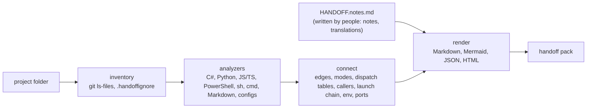

# HandOff247

**Hand Off 24-7 is a good-bye project for passing your existing projects to the next person.**
Point it at a project folder and it writes a *handoff pack*: diagrams, the structure, the comments that already
exist in the code, and how each tool in the project is connected to the others.
Your successor opens one page and sees how the program starts, which modes it has, who calls what, and where to begin reading.

```bash
python -m handoff247 /path/to/folder
```

That one command is the whole job on your last week: it creates the notes file with the questions only you can
answer, draws the diagrams, writes the pack, and prints a handover checklist of what is still open. If the folder
holds several projects, each gets its own pack and one index lists them all, starting with what would be lost when
your computer goes away.

- **No guessing.** Every statement in the pack comes from a file and links to the exact line. When a link is
  only an inference, it is labelled and drawn as a dashed arrow. When something is ambiguous, it is left out.
- **Nothing runs.** HandOff247 reads files; it never imports, builds or executes the project.
- **Nothing to install.** Python 3.10+ standard library only.
- **People add what code can't say.** A plain Markdown notes file holds the explanations: what the project is for,
  the first things a successor must do, known risks, and where credentials are kept (location only). Notes are merged into
  every page and survive regeneration.
- **It looks at what a clone will not carry.** Uncommitted and unpushed work, files Git ignores that exist only on
  your computer, personal folder paths written into code, the external hosts and secret-named variables a successor
  needs accounts for, TODO comments, and the tools to install.
- **It follows the application the way its users meet it.** Which kinds of user the code tells apart, what each of
  them sees, what every menu entry, button and field does, where one user's work is picked up by the next, and where
  an uploaded or generated file shows up. When a user says "the menu is not on my screen", you start from their words
  and arrive at the screen, the condition, the handler and the data. See [The application from its users' side](#the-application-from-its-users-side).
- **An ontology, a graph and a wiki for AI assistants.** Everything found is also written as typed entities and
  relations (`ontology.json`), drawn as an interactive graph in the viewer, and laid out as a wiki of small interlinked
  pages with an `llms.txt` entry point, so the next person's assistant can answer questions about the project.
- **Connect an AI agent and it knows the project.** `handoff247 mcp` is an MCP server: one call gives the agent a
  briefing of the whole project, and from there it can follow any user's flow, trace a request to the code, read every
  page and source line, and write the missing notes. `--summarize` asks the Codex CLI you are signed in to for short
  file descriptions, labelled as model-written.
- **English output, whatever language the code is commented in.** Comments and headings written in another language
  get an English version from a table in the notes file; the pack marks them as translated and keeps the originals.

## See it

| Example | What it is |
|---|---|
| [examples/playbookos](examples/playbookos/README.md) | Pack for [PlayBookOS](https://github.com/unkkyuist/PlayBookOS) (C# + JS + Python + PowerShell, commented in Korean) |
| [examples/newsroom](examples/newsroom/USERS.md) | Pack for a small web application with three kinds of user (the test fixture in `tests/fixtures/newsroom`): start at its [Who uses it](examples/newsroom/USERS.md) page |
| [docs/handoff](docs/handoff/README.md) | HandOff247 documenting itself |

GitHub renders the diagrams inline. For the interactive version, download a pack folder and open `index.html`
(click a box in any diagram to open that file's card; it loads Mermaid from jsDelivr).

For PlayBookOS, it found the following without being told anything about the project:

- 6 run modes in `Program.cs` (`serve` default, `server`, `cli`, `mcp`, `agent`, `worker`)
- one dispatch table, `Operations.Execute`, with 65 operations, and the handler file for each
- 6 HTTP routes, and that `POST /api/{operation}` forwards to that table
- 46 MCP tools mapped to their operation
- who calls into that one table: `wwwroot/app.js` through `api()` → `fetch('/api/…')` (plus 6 UI files that receive `api`
  as a parameter, marked *inferred*), 7 Python scripts through `dotnet PlayBook.dll cli <op>`, and the MCP tools in-process
- the launch chain `START_PLAYBOOK.cmd → playbook.ps1 (serve) → PlayBook.csproj`, the MCP client configs that start `mcp` mode,
  the env vars (`PLAYBOOK_HOME`, `PLAYBOOK_PORT`, …) with who reads and who sets them, ports, and the SQLite file `playbook.db`
- for the [handover page](examples/playbookos/HANDOVER.md): 11 of 14 checks ready, 12 absolute paths in its documents,
  8 external hosts, the .NET version and the commands its scripts start
- 73 distinct Korean comments and document headings (75 places), listed for translation by `handoff247 notes`; their
  English versions are in [examples/playbookos.notes.md](examples/playbookos.notes.md)

## Quick start

```bash
git clone https://github.com/unkkyuist/HandOff247
cd HandOff247
python -m handoff247 /path/to/project      # notes file + pack in /path/to/project/docs/handoff + checklist
```

Then answer the questions in `/path/to/project/HANDOFF.notes.md` and run the same command again. Repeat until the
checklist has nothing open that matters. Add `--open` to open the result in the browser.

```text
handover checklist: 9 of 13 ready
  [x] The project has a README
  [ ] Everything is committed (7 uncommitted change(s))
  [ ] The handover questions are answered (3/8 answered: missing Open work and next steps, …)
next: answer these in HANDOFF.notes.md, then run this again:
  ## Topic: Open work and next steps
```

The separate steps still exist when you want them:

```bash
python -m handoff247 notes /path/to/project          # only create or extend HANDOFF.notes.md
python -m handoff247 build /path/to/project -o /path/to/project/docs/handoff
python -m handoff247 check /path/to/project          # what is still open
```

Or install the command: `pip install .` then `handoff247 /path/to/folder`.

## A folder full of projects

Point the same command at the folder that holds your projects:

```bash
python -m handoff247 ~/work
```

It writes `~/work/handoff/index.html` (and `README.md`), one pack per project next to it, and a `notes` folder.

- **Before the computer goes away** comes first: projects that are not in Git, have no remote, have commits on no
  remote, stashes, uncommitted changes, or ignored settings and data files.
- A table of every project: what it is, languages, size, last commit, Git state, checklist score, notes written.
- A diagram of which projects contain paths into another project's folder (a relative `../other/run.sh`, or an absolute path under the folder you pointed at).
- Folders where no project was recognised, so nothing is silently skipped.

A sub-folder counts as a project when it is a Git repository, has a manifest (`package.json`, `pyproject.toml`,
`*.csproj`, …) or has code files at its top level; folders one level further down are checked too. Your projects are
not modified: a project that already has `HANDOFF.notes.md` uses it, the others get `handoff/notes/<project>.notes.md`.
A folder is treated as a set of projects when it has no manifest of its own or holds two or more Git repositories;
`--single` and `--workspace` override that. List folders to skip in `.handoffignore`.

## What is in a pack

| File | Contents |
|---|---|
| `README.md` | Start here: numbers at a glance, the **system map**, suggested reading order, successor checklist, risks, what is still undocumented, recent commits |
| `HANDOVER.md` | **Handover checklist** (ready / to do per check), Git state, TODO comments, files only on this computer, absolute paths, external hosts, secret-named variables, tools to install, authors, with your answers next to each |
| `USERS.md` | **Who uses it**: user types, the screens each of them sees, what every control leads to and what the code then does, hand-overs between user types, the words on the screens, data states, assets in context, shared code, and what was not verified |
| `RUNNING.md` | **Startup chain** (who starts whom), run modes, launch commands, environment variables (who reads, who sets), ports, runtime paths, build targets, packages, tests |
| `CONNECTIONS.md` | **Interface map**: every caller → HTTP / CLI process / MCP / in-process → dispatch table → handler; route, MCP tool, MCP client and operation tables |
| `CODEMAP.md` | File dependency map grouped by folder, shared foundations, component table (summary, depends on, used by) |
| `FILES.md` | One card per file: extracted comment, notes, public symbols with their doc comments, links in and out |
| `diagrams/*.mmd` | Mermaid sources of every diagram (paste into anything that renders Mermaid) |
| `handoff.json` | Everything above as data, for scripts and AI agents |
| `ontology.json` | The **ontology**: every entity (file, type, run mode, operation, route, MCP tool, environment variable, package, host, …) and every relation between them, each with the file and line it was observed at |
| `wiki/` | The **LLM wiki**: one small Markdown page per file, area, run mode, operation, MCP tool, user type, feature (route), screen, asset and data table, list pages for the rest, an `index.md` catalog and `AGENTS.md` with the reading rules |
| `llms.txt`, `llms-full.txt` | Entry point for AI assistants in the [llms.txt](https://llmstxt.org) convention, and the whole wiki in one file |
| `index.html` | Single-file viewer with tabs, search, clickable diagrams, the **Graph** tab and the wiki |



## The application from its users' side

The person who takes a project over gets asked things by the people who use it:

- "That menu is not on my screen."
- "I uploaded a file and it is not there in the next step."
- "I sent a review request and the reviewer cannot find it."
- "I changed it in the admin page and the public page still shows the old one."
- "Please let user type B use this too."
- "If I replace this image, what else changes?"

None of these name a file. They name a screen, a word on it, and who the person is. HandOff247 connects those to the
code, so you can explain how it works, tell someone how to use it, or change it.

> **The user types are the application's, not yours.** "Author", "editor", "admin type A" are kinds of user the
> analysed application tells apart. They are never access levels of the pack. You see every flow of every user type,
> and each flow links to the others, because a request usually crosses from one user type to the next.

### What it connects

All of it is read from the code and templates. Nothing here is a fixed sequence that every program is assumed to
follow; only what is found is connected.

| Thing | Found from |
|---|---|
| User types | Role checks on routes (`@require_role("editor")`, `[Authorize(Roles = "…")]`, Express role middleware) and in templates (``). A route with no check is listed under `anyone`, with the remark that a check in middleware would not be seen |
| Screens | Templates and HTML pages, the route that renders each, the layout it extends |
| Words on the screen | Links, buttons, field labels, headings, table columns, and messages the code shows. A text that comes from a locale file is listed in every language found, so a term is found by the word the user reads |
| What a control does | The link target or form action matched to a route, then the handler followed into the functions it calls |
| Conditions | The template condition a control sits in, the role check on the route, `if` branches in the handler, settings it reads |
| Data | Tables in SQL statements, and the literal column values ("states") that statements set or filter on |
| Hand-overs | One feature sets a state, another feature's query filters on it: `status = 'in_review'` is set by the author's "Send for review" and listed by the editor's review queue. Always marked *inferred* |
| Assets | Static files, uploads, generated files and external-storage calls: who provides it, what stores it, the data column tied to it, the route that delivers it, the screens it appears on |
| Shared code | A function that several features run exists once and lists all of them |

The [Newsroom example](examples/newsroom/USERS.md) shows every one of these. Its source is about 400 lines in
[`tests/fixtures/newsroom`](tests/fixtures/newsroom): authors write and upload a cover image, editors review and
publish, anyone reads the front page.

### Five ways in

Each has a page in the pack, a tab in the viewer, a command, and an MCP tool. They read the same model, so they
always agree.

**A. Start from a user type** → screens → features → code. In the pack: `USERS.md`, section *Flows by user type*, and
`wiki/users/<name>.md`. In the viewer: the **Users** tab; *Bring forward* highlights one user type and dims the rest
without removing them.

```bash
python -m handoff247 trace /path/to/project                 # the user types and what each can do
python -m handoff247 trace /path/to/project --user editor   # one user type's screens and controls, as JSON
```

**B. Start from words on a screen** → the control → the feature → code and data. In the pack: `USERS.md`, section
*Words on the screens*, and `wiki/terms.md`. In the viewer: type the word in the search box. The label and the
identifier are often different; both are shown (`"Headline"` on the screen is the form field `title`, read at
`app.py:67`).

```bash
python -m handoff247 trace /path/to/project Headline
```

**C. Start from an asset or a table** → where it comes from → where it is used → whose flow it is part of.
`wiki/assets/…` and `wiki/data/…`, or:

```bash
python -m handoff247 trace /path/to/project --asset cover      # an upload field, a file name or a path
python -m handoff247 trace /path/to/project --asset articles   # a table: who writes, who reads, which states
```

For an upload this gives the form control it is picked with, the handler that receives it, the line that stores it,
the column that keeps its name, the route that delivers it, the screens that show it, who sees those screens, and
therefore who notices when it is replaced or deleted. An asset with no reference found is reported as *no reference
found*, not as unused.

**D. Start from code** → the features that run it → the screens and user types that reach.

```bash
python -m handoff247 trace /path/to/project --impact db.py:49
python -m handoff247 trace /path/to/project --impact storage.py --symbol save_upload
python -m handoff247 trace /path/to/project --impact templates/base.html
```

Works for a handler, a function, a single line, a template, a stylesheet or script, a locale file and an asset.

**E. Start from what the user said** → candidate features → the normal flow → what to check.

```bash
python -m handoff247 trace /path/to/project "I sent it for review but the editor cannot find it" --user author
```

```text
1. "Send for review"  ->  POST /desk/<int:article_id>/submit
   who: author · code: app.py:75 submit
   started from: templates/desk.html
   matched button "Send for review" at templates/desk.html:16 (shown when a.status == 'draft')
   matched message "Sent to the editors" at app.py:81
   matched message "Only a draft can be sent for review" at app.py:78
   then: editor at templates/review.html, because articles.status = 'in_review' (inferred)
   then: editor at POST /review/<int:article_id>/publish, because articles.status = 'in_review' (inferred)

2. "Review queue"  ->  GET /review  [other user type]
   who: editor · code: app.py:89 review_queue
   started from: templates/base.html
   matched link "Review queue" at templates/base.html:17 (shown when user and user.role == 'editor')
   matched heading "Review queue" at templates/review.html:4
…
```

`--user` brings the requester's own features forward and marks the others `[other user type]`; it never removes
them. When the same words are on several screens, every candidate is listed with what tells them apart. Nothing is
picked because two names look alike. The request can be in any language the application's own texts are in: with a
Korean locale file, `검토 대기열에 안 보여요` finds the review queue.

Then open the candidate:

```bash
python -m handoff247 trace /path/to/project --feature "POST /review/<int:article_id>/publish"
```

### One feature in one place

A feature is one route. Its page (`wiki/features/…`, linked from every table in `USERS.md`) and `trace --feature`
hold everything needed to answer a request about it:

| Section | Contents |
|---|---|
| Started from | The link, button or script call on which screen, the condition it is shown under, who sees it |
| What the code does | Steps in the order of the handler, each with file and line and the call chain. A step under an `if` starts with *when* |
| Branches | Every condition in the handler and in the functions it calls, with what happens then |
| Hand-overs | Which user type picks the work up next, and from whom this feature receives it |
| Code | The handler and each function it runs, and how many other features share that function |
| Data and assets | Tables read and written, states set and filtered on, files stored, written or delivered |
| What to check | Settings, state conditions and outside dependencies the outcome depends on |
| Not verified | What the analysis could not see for this feature |

### Reading the answers

- **A condition in the code is not a diagnosis.** "The queue lists only rows with `status = 'in_review'`" is what
  the code does. Whether that is why one user's article is missing needs the live data or a log. Without them the
  answer is the list under *What to check* and the possible branches.
- ***inferred*** marks a conclusion: a hand-over through a shared column value, a condition that names the same
  column. Read both lines before you rely on it.
- **Not verified** is part of every answer. A link that matches no route, a translation key with no text, a handler
  in a language that is not followed, SQL built at run time: each is listed, not guessed.
- Something that is not listed was not found. That is not the same as not existing.

### What is followed

Templates: Jinja, Django, Twig, Nunjucks and Handlebars conditions; any `.html` page. Handlers: Python, through
`ast`, into the project functions they call, with SQL written as strings. For routes in JavaScript/TypeScript and C#
the role check on the route is read and the handler is reported as not analysed. A page that no route renders
(a single-page app) is listed with the API calls its scripts make.

## Ontology, graph and wiki

The same facts are available in three more shapes, all written by the one command. None of them adds a guess: they
are views of what the analysis observed.

**Ontology** — [`ontology.json`](examples/playbookos/ontology.json). 23 classes (Project, Area, File, Type, Run mode,
Sub-command, Dispatch table, Operation, HTTP route, MCP tool, Environment variable, Port, Package, External host,
Command-line tool, Person, User type, Screen, Screen term, Function, Data table, State, Asset) and 44 relations
(`contains`, `defines`, `imports`, `uses`, `runs`, `hasOperation`, `handledBy`, `calls`, `invokes`, `forwardsTo`,
`reads`, `sets`, `dependsOn`, `openTo`, `sees`, `shows`, `leadsTo`, `setsState`, `handsOverTo`, `showsAsset`, …).
A relation looks like this:

```json
{"s": "file:wwwroot/app.js", "p": "calls", "o": "op:asset.verify",
 "file": "wwwroot/app.js", "line": 77, "label": "api(), over HTTP"}
```

A relation that rests on an inference carries `"inferred"` with the reason. For PlayBookOS: 328 entities, 1,035
relations. For the Newsroom example: 114 entities, 316 relations.

**Graph** — the *Graph* tab of `index.html`. Every entity is a mark and every relation a line. Colour is the kind of
thing, shape tells kinds of one colour apart, dashed lines are inferences. Click a mark to see its relations with
their file and line, type to find something, switch classes on and off in the legend, and jump from any mark to its
wiki page or file card. It needs no extra library.

**LLM wiki** — [`wiki/`](examples/playbookos/wiki/index.md), [`llms.txt`](examples/playbookos/llms.txt). Small pages
an assistant can read one at a time: each page is one thing, with what it points to and what points to it, and the
source line next to every statement. `wiki/AGENTS.md` tells the assistant how to read it, what *inferred* means, that
something missing was not found rather than absent, and where new knowledge goes: into your notes file, under the
heading of the thing it is about. The next run carries it into the pages, so the wiki is rebuilt, never hand-edited.
By default no language model is called to write it and no key is needed.

To use it, give your assistant the pack folder (or paste `llms-full.txt`) and ask.

## Summaries written by Codex (optional)

```bash
python -m handoff247 /path/to/project --summarize
```

With `--summarize`, HandOff247 asks the [Codex CLI](https://github.com/openai/codex) you are already signed in to
(`codex login`; a ChatGPT business or enterprise sign-in works) for one to three sentences about every code file that
has no note yet. HandOff247 reads no API key and stores none.

- **Kept apart from what people write.** The text goes to `HANDOFF.summaries.json` next to the notes file, is shown with
  "Written by a language model (codex, date); not checked by a person" in the wiki, the file cards and the viewer, and
  marked *(model)* in lists. It never counts as a note in the handover checklist, and a file's note always wins.
- **Tied to the file.** Each summary stores a hash of the file it describes. When the file changes, the summary is not
  shown any more, and the next `--summarize` run writes a new one. Runs without the flag reuse the summaries still valid.
- **What is sent.** Each code file, the facts the analysis found about it, and nothing else. Codex runs `exec` in an
  empty temporary folder with a read-only sandbox and no saved session. Lines that look like keys, tokens or a password
  assignment are replaced with `[removed]` before anything leaves the computer.
- `--limit N` caps the files per run, `--jobs N` the requests at once (default 3), `--model` picks a Codex model.

For PlayBookOS, 63 files took 9 requests and about 50 seconds; the result is in
[examples/playbookos.summaries.json](examples/playbookos.summaries.json).

## MCP server: connect an AI agent to the whole project

```bash
python -m handoff247 mcp /path/to/project     # stdio MCP server; the folder is the default project for every tool
```

Register this once with your agent. The agent then works with the project as someone who has read all of it: it
gets a briefing in one call, follows any user's flow, traces a request from the user's words to the code, reads every
page and source line, and writes the missing notes. The project is analysed in memory when the first tool is called,
so no pack has to exist on disk, and nothing in the project is run.

### Set it up

HandOff247 has to be importable by the `python` your agent starts: either `pip install .` in the HandOff247 clone, or
set `PYTHONPATH` to the clone as shown below.

**Claude Code** (run inside the project you want to work on):

```bash
claude mcp add handoff247 -- python -m handoff247 mcp .
```

Without installing:

```bash
claude mcp add handoff247 -e PYTHONPATH=/path/to/HandOff247 -- python -m handoff247 mcp .
```

**Claude Desktop** and other clients that use an `mcpServers` JSON file:

```json
{
  "mcpServers": {
    "handoff247": {
      "command": "python",
      "args": ["-m", "handoff247", "mcp", "C:/work/my-project"],
      "env": { "PYTHONPATH": "C:/tools/HandOff247" }
    }
  }
}
```

**Codex** (`~/.codex/config.toml`):

```toml
[mcp_servers.handoff247]
command = "python"
args = ["-m", "handoff247", "mcp", "/path/to/project"]
env = { PYTHONPATH = "/path/to/HandOff247" }     # not needed after `pip install .`
```

The project folder is optional. Start the server without one and pass `project` (an absolute path) to each tool
instead; one server can then answer for several projects. Codex asks before it runs a tool that writes
(`handoff_write_note`, `handoff_build`); approve it, or start `codex exec --approve-for-me` for unattended runs.

### What the agent can do

Thirteen tools. Eleven only read.

| Tool | What it does |
|---|---|
| `handoff_overview` | **The first call.** What the project is (the previous owner's notes and the README), size and languages, how it starts, interfaces, settings, who uses it, data, assets, what is still unknown, and which tool to use for what |
| `handoff_users` | The user types of the application with their screens and actions. With `user`: one user type's whole flow, control by control, and who picks the work up next |
| `handoff_request` | Start from what a user said or from words on a screen. Returns candidate features with the matching control, its screen, the user types, the handler and the next user type. With `user`, the requester's own features come first and the others stay listed |
| `handoff_feature` | One feature in full: started from, what the code does step by step, branches, hand-overs, code, data, assets, what to check, not verified |
| `handoff_asset` | An image, upload field, generated file or table: where it comes from, what stores it, where it shows, who notices a change |
| `handoff_impact` | A file, function or line: which features run it, on which screens, for which user types, and who is affected next |
| `handoff_page` | Any page of the pack as text, rendered in memory: `README.md`, `USERS.md`, `RUNNING.md`, `wiki/AGENTS.md`, `wiki/users/<name>.md`, … Without a name it lists them |
| `handoff_search` | Finds entities of the ontology by name or summary |
| `handoff_entity` | One entity with all its relations, each with file and line, and the notes heading it belongs under |
| `handoff_source` | Numbered source lines of a project file (key-like lines replaced with `[removed]`) |
| `handoff_todo` | Every heading still without text: open handover questions (flagged *ask the user*), important files, run modes, folders, other files |
| `handoff_write_note` | Writes a note under one heading of the notes file |
| `handoff_build` | Writes or refreshes the pack on disk (and creates the notes file); returns the handover checklist |

When the server was started with a project folder, the pages of the pack are also offered as MCP resources
(`handoff://page/USERS.md`, …) for clients that attach context that way.

### What to say to the agent

Nothing special. The server's instructions tell it to start with `handoff_overview` and how to go on from there.
For example:

- "Read this project and tell me what it is, how to start it, and who uses it."
- "An editor says the Publish button does nothing. What can cause that?" The agent calls `handoff_request`, opens the
  feature with `handoff_feature`, and answers with the branches and settings to check, not with a guessed cause.
- "The authors want to see the editor's note on their own page too. Where do I change that, and who else is affected?"
  (`handoff_request`, `handoff_feature`, `handoff_impact`.)
- "If I delete `static/old-banner.png`, does anything break?" (`handoff_asset`.)
- "Write the missing notes for the files you can verify, and ask me the rest." (`handoff_todo`, `handoff_source`,
  `handoff_write_note`, `handoff_build`.)

### What the agent is told, and what it cannot do

- The user types belong to the analysed application. They are not access levels of the tools; the agent may read
  every flow.
- What the tools return is what the code does and under which condition. Without live data or logs the agent gives
  the points to check, not a cause.
- *inferred* marks a conclusion, and `not_verified` in every answer lists what the analysis could not see.
- Questions about people, accounts, credentials and deployment cannot be answered from code: the agent asks you.
- The only thing it can change is the notes file. `handoff_write_note` accepts only headings HandOff247 knows
  (`File:`, `Area:`, `Mode:`, `Op:`, `User:`, `Topic:`, `Project`), refuses to overwrite text already under a heading
  unless asked to replace it, refuses text that looks like a key, token or password, and ends every note with
  *Written by an AI agent through the HandOff247 MCP server on <date>; the owner has not confirmed it yet.*
- It reads the files of the project folder and nothing else, and it does not run them.

## How "how the tools connect" is found

Most programs funnel work through a few places. HandOff247 looks for those places and follows them:

1. **Entry and modes.** The entry file (`Program.cs` top-level statements, `static Main`, `if __name__ == "__main__"`, package bins)
   and string comparisons on its first argument (`if (mode == "cli")`) become run modes, each with the line range it owns,
   the types it uses and what it opens (HTTP server, MCP over stdio/HTTP, background service).
2. **Dispatch tables.** A `switch` on string keys (C#, JS), a Python dict of functions, an `if/elif` chain or `match` statement with three or more keys.
   Each arm's handler is resolved to a file (`store.List()` → `Store` → `Store.cs`).
3. **Callers.** Every call that passes one of those keys (`api('list')`, `cli('save', …)`, `Call("ontology.search")`,
   `playbook.ps1 cli list` in a README code block) is traced to its wrapper function, and the wrapper tells the channel:
   it calls `fetch` (HTTP, matched to a server route), starts a process with a mode argument (CLI), or calls the table directly (in-process).
   A wrapper passed in as a parameter is reported as an *inference*.
4. **Interfaces.** ASP.NET minimal-API routes and `[Http*]` attributes, Flask/FastAPI/Express routes, `[McpServerTool]` methods,
   Python/TypeScript MCP tool registrations, and MCP client configs (`mcpServers` JSON, Codex `[mcp_servers]` TOML).
5. **Launch chain.** Command lines in `.cmd`/`.ps1`/`.sh`, `subprocess`/`Process.Start` calls, `package.json` scripts,
   Dockerfiles and CI steps, resolved to the project files and build outputs (`PlayBook.dll` → `PlayBook.csproj`) they start.
6. **Code map.** C# type references and constructor injection, Python and JS imports, HTML `<script src>`, Markdown links.

## The notes file

`handoff247 notes <project>` writes `HANDOFF.notes.md` with one heading per item:

```markdown
## Project
What it does, who uses it, current state.

## Topic: Successor checklist
## Topic: Known issues and risks
## Topic: Credentials and accounts      ← where they are kept, never the values
## Topic: Open work and next steps      ← half done, promised, what you would do next
## Topic: Deploy and release            ← how a change reaches users, how to roll back
## Topic: Routine operations            ← what is done by hand and how often
## Topic: Data and backups              ← where data lives, how to restore it
## Topic: People and contacts           ← who uses it, who to ask
## Mode: serve
## Area: scripts
## File: Program.cs
## Op: ontology.search                   ← optional, shown in the operations table
```

Write under any heading. Lines that still start with `TODO` count as undocumented.
Running `notes` again only **adds** headings for new files, modes and folders; it never changes existing text,
and it lists headings whose file no longer exists so you can tidy them by hand.

## What the handover page checks

Each answer sits next to what was found, so the page reads as one story per topic.

| Section | Found in the files and Git | Your answer |
|---|---|---|
| Ready to hand over? | README, start command, tests, license, remote, committed, pushed, local-only files, personal paths, secret patterns, notes written | – |
| Unfinished work | uncommitted files, commits on no remote, stashes, `TODO` / `FIXME` comments with file and line | Open work and next steps |
| Only on this computer | files Git ignores that are present (build output and caches left out), absolute paths in files | – |
| Accounts, services and secrets | host names in URLs (code vs documents), environment variables named like secrets, lines matching key or token patterns | Credentials and accounts |
| What to install | declared runtime versions, commands the scripts start | – |
| Deploy, routine, data | CI files, scheduled jobs, ignored data files | Deploy and release, Routine operations, Data and backups |
| People | authors in the Git history | People and contacts |

- The Git and ignored-file findings describe the checkout the pack was generated from. Run it on your own computer,
  not only in CI, because a fresh CI checkout has nothing uncommitted and nothing ignored.
- A line that matches a key or token pattern is reported by file, line and kind. The value is never copied into the pack.
- History figures are left out for shallow clones, where they would be wrong.

## Projects commented in another language

The pack's own headings and labels are English. A project's comments, docstrings and document headings are quoted as
written, so when they are in Korean, Japanese, Chinese, Russian and so on, `handoff247 notes` adds a table for them:

```markdown
## Translations
| Original | English |
|---|---|
| 프로젝트와 AI 작업을 관리하는 공통 원장. | A shared ledger for managing projects and AI work. |
| 설치와 구성 | TODO |
```

Fill the English column (by hand or with an assistant). On the next `build`, every page and the viewer show the
English, the comment is marked *translated*, and `handoff.json` keeps the original next to it.

- Only text in a non-Latin script is listed. Accented Latin text (French, German, Spanish, …) is left as written.
- An original must match the current text exactly (spacing aside). When a comment changes, the pack shows the new
  original instead of an outdated translation, and `notes` adds a row for it.
- File names and code identifiers are never translated; a successor has to type them exactly.
- `check` reports how many texts still have no English version, and the pack's README lists the count.

## Keep it current (the 24/7 part)

Use the repository as a GitHub Action to rebuild the pack on every push:

```yaml
# .github/workflows/handoff.yml in your project
name: Handoff pack
on:
  push:
    branches: [main]
permissions:
  contents: write
jobs:
  handoff:
    runs-on: ubuntu-latest
    steps:
      - uses: actions/checkout@v4
      - uses: unkkyuist/HandOff247@main
        with:
          output: docs/handoff
          min-notes: 0            # raise to fail the build when too little is documented
      - run: |
          git config user.name "handoff-bot"
          git config user.email "handoff-bot@users.noreply.github.com"
          git add docs/handoff
          git diff --cached --quiet || { git commit -m "Update handoff pack" && git push; }
```

The action stamps the pack with the last commit date, so an unchanged project produces an identical pack and no commit.

## Command reference

```text
handoff247 [go]   [FOLDER] [-o OUT] [--single | --workspace] [--date YYYY-MM-DD] [--exclude GLOB] [--open]
                  [--summarize [--model M] [--jobs N] [--limit N]]
handoff247 build  [PROJECT] [-o OUT] [--notes FILE] [--name NAME]
                  [--links auto|relative|url|plain] [--link-base URL] [--date YYYY-MM-DD] [--exclude GLOB]
                  [--summarize [--model M] [--jobs N] [--limit N]]
handoff247 notes  [PROJECT] [--notes FILE]
handoff247 check  [PROJECT] [--notes FILE] [--min PERCENT]
handoff247 mcp    [PROJECT]
handoff247 trace  PROJECT [WORDS…] [--user TYPE] [--feature ID] [--asset NAME] [--impact PATH[:LINE] [--symbol NAME]]
                  [--limit N] [--json] [--notes FILE] [--exclude GLOB]
```

- `trace` prints an answer and writes nothing. With words it finds the features a request is about; `--user` alone
  prints that user type's flow; no arguments at all prints the user types. `--json` gives the full answer, the same
  one the MCP tool returns.

- For a folder of projects, `--summarize` keeps the summaries in `handoff/notes/<project>.summaries.json`, so the
  projects themselves are still not written to.

- `--links auto` links file:line references relatively when the pack is inside the project, to the GitHub blob at the exact
  commit when it is outside a GitHub checkout, and as plain text otherwise.
- `.handoffignore` in the project root (or `--exclude`) skips paths: `tests/fixtures/`, `*.min.js`, ….
  Files ignored by Git are skipped automatically, and so are folders holding an earlier pack.
- The default output folder of `build` is `./handoff/<project name>`. `go` writes to `<project>/docs/handoff`, or to
  `<folder>/handoff` for a folder of projects.

## Limits

- The user-context view follows **Python handlers** (Flask-style route decorators) and **SQL written as strings**.
  An ORM, Django URL patterns, and handlers in JavaScript, TypeScript or C# are not followed: those routes are listed
  with the role check found on the route itself, and the page says the handler was not analysed.
- A user type exists only where the code names a role. Access decided in middleware, in a base class, by the web
  server or by data (a permissions table) is not seen; such routes appear under `anyone` with that remark.
- A button of a single-page app that a script wires up has no target in the page. It is listed with *not determined*,
  and the API calls of the page's scripts are listed separately.
- Hand-overs are derived from column values written in the statements. A value that only exists at run time is not
  seen, and that two statements mean the same rows is not traced.
- Template conditions are read for Jinja, Django, Twig, Nunjucks and Handlebars. EJS, ERB and Razor pages are read
  for their terms and links without their conditions.

- Python is parsed with `ast`; the other languages use a comment/string-aware lexer plus patterns. Code that builds
  names at runtime (reflection, DI containers, string concatenation) is not followed.
- Languages without an analyzer (Go, Rust, Java, …) are listed with line counts but not parsed yet.
- MCP tool names from the C# SDK are derived from method names and marked `*`; confirm with the client's `tools/list`.
- Diagrams are capped for readability (large folders collapse into one box; shared foundations lose their incoming arrows).
- The graph lays out every entity in the browser. Above about 1,200 entities it starts with types, packages,
  variables, ports, hosts and tools switched off; switch them on in the legend.
- Model summaries can be wrong: they are labelled, never counted as notes, and dropped when their file changes, but
  nobody has checked them. Codex is the only engine so far.
- A folder of projects gets a graph and a wiki per project. The index links them (`llms.txt`) but there is no single
  graph across projects yet.

## Development

```bash
python -m unittest discover -s tests
python -m handoff247 build . -o docs/handoff        # HandOff247's own pack
python -m handoff247 trace tests/fixtures/newsroom  # the user types of the test application
```

`tests/fixtures/mini` is a small fake app wired like PlayBookOS; every connection type the tool claims to find has an
assertion in `tests/test_handoff.py`. `tests/fixtures/newsroom` is a small web application with three kinds of user;
`UserContextTests` follows one user's action through the code, the data and the upload it changes, the next user's
follow-up and the public page, and checks the lines the analysis points at in the fixture's own files. How the code is organised is in [docs/handoff](docs/handoff/README.md).

## License

[MIT](LICENSE)
