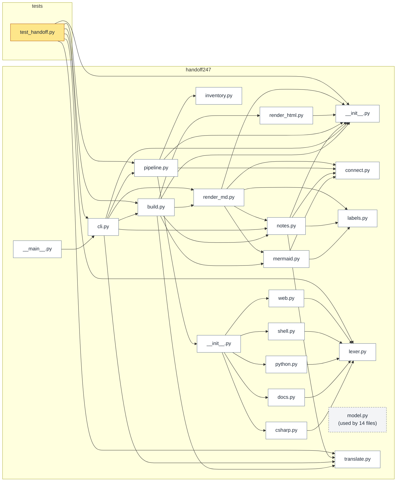
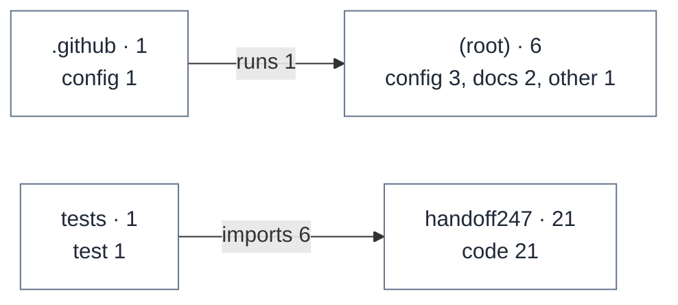

# Code map

Generated by HandOff247 0.2.0 from https://github.com/unkkyuist/HandOff247@d9b811a on 2026-11-09. Re-run to refresh; edit the notes file, not this page.

[← Back to start](README.md)

## Dependency map

Thick arrow = constructor injection or inheritance, thin = type/module use, dotted = loads. Grey dashed boxes are shared foundations used almost everywhere; their incoming arrows are omitted.

Mermaid source: diagrams/code.mmd

## Folder overview

Mermaid source: diagrams/areas.mmd

## Shared foundations

- [handoff247/model.py](../../handoff247/model.py) — used by 14 files — Data model shared by every analyzer and renderer.

## Components

### handoff247

> **Notes**
>
> The package. Data flows inventory → analyzers → connect → (mermaid, render_md, render_html) → build. pipeline.py wires the first three; cli.py and build.py the rest.

| File | lines | Summary | Depends on | Used by |
|---|---|---|---|---|
| [__init__.py](../../handoff247/__init__.py) | 5 | Holds `__version__`; the version is printed in every generated page. |  | build.py, cli.py, notes.py, pipeline.py, render_html.py, render_md.py … and 1 more |
| [__main__.py](../../handoff247/__main__.py) | 3 | Lets `python -m handoff247` run the CLI. | cli.py |  |
| [__init__.py](../../handoff247/analyzers/__init__.py) | 37 | Maps a file's language to its analyzer. An exception inside one analyzer marks only that file as "not parsed"; it never stops the run. | csharp.py, docs.py, model.py, python.py, shell.py, web.py | pipeline.py |
| [csharp.py](../../handoff247/analyzers/csharp.py) | 435 | The richest analyzer: types and primary-constructor dependencies, entry modes (`if (mode == "x")` in the entry file), `switch` dispatch tables with handler resolution, minimal-API | lexer.py, model.py | __init__.py |
| [docs.py](../../handoff247/analyzers/docs.py) | 211 | Markdown (summary, headings, relative links, code blocks for `<mode> <op>` usage), plus config formats: .csproj, package.json, pyproject, requirements, MCP client configs (`mcpServ | lexer.py, model.py | __init__.py |
| [python.py](../../handoff247/analyzers/python.py) | 281 | Uses `ast`, never imports the file. Finds argparse sub-commands, subprocess launches (rendered with `{variable}` placeholders), env reads/writes, dict/if-chain/match dispatch table | lexer.py, model.py | __init__.py |
| [shell.py](../../handoff247/analyzers/shell.py) | 178 | PowerShell, POSIX shell and batch: leading comment / .SYNOPSIS as summary, `$env:` / `export` / `set` variables, and command lines that launch something (dotnet, python, powershell | lexer.py, model.py | __init__.py |
| [web.py](../../handoff247/analyzers/web.py) | 138 | JavaScript/TypeScript (imports, exported functions with spans, `fetch` calls, Express routes, MCP registrations, `case` tables), HTML (`<script src>`, `<link>`, inline scripts) and | lexer.py, model.py | __init__.py |
| [build.py](../../handoff247/build.py) | 59 | Writes the pack: five Markdown pages, `diagrams/*.mmd`, `handoff.json` (its first key `"generator": "HandOff247"` is how later runs recognise and skip an old pack) and `index.html` | __init__.py, mermaid.py, model.py, notes.py, render_html.py, render_md.py … and 1 more | cli.py, test_handoff.py |
| [cli.py](../../handoff247/cli.py) | 112 | Three commands: `build`, `notes`, `check`. `check --min N` exits 1 when fewer than N% of files have notes, which is how CI can enforce documentation. | __init__.py, build.py, notes.py, pipeline.py, render_md.py, translate.py | __main__.py, test_handoff.py |
| [connect.py](../../handoff247/connect.py) | 677 | Turns per-file facts into edges and connection maps. The key idea: string keys of a dispatch table (`"list"`, `"ontology.search"`) are followed to every caller (`api('list')`, `cli | model.py | mermaid.py, notes.py, pipeline.py, render_md.py |
| [inventory.py](../../handoff247/inventory.py) | 252 | Lists files with `git ls-files` (so .gitignore applies), falls back to a directory walk, applies `.handoffignore` and skips folders that contain an earlier pack. | model.py | pipeline.py |
| [labels.py](../../handoff247/labels.py) | 178 | Every generated heading and label, in one table, so pages and diagrams use the same words. Extracted comments and notes never pass through it. |  | mermaid.py, notes.py, render_md.py |
| [lexer.py](../../handoff247/lexer.py) | 311 | Produces two views of C-like source with identical offsets: strings+comments blanked (for identifiers) and comments blanked (for literal patterns). Handles C# verbatim, interpolate |  | csharp.py, docs.py, python.py, shell.py, test_handoff.py, web.py |
| [mermaid.py](../../handoff247/mermaid.py) | 476 | Builds the five diagrams. `system` collapses launch scripts into one node when there are more than three; `code` hides incoming arrows of shared foundations (hubs) so the rest stay | connect.py, labels.py, model.py | build.py, render_md.py |
| [model.py](../../handoff247/model.py) | 91 | Dataclasses: FileInfo, Symbol, Fact, Edge, Project. A Fact is one observation with a file and line; everything in the pack traces back to one. |  | __init__.py, build.py, connect.py, csharp.py, docs.py, inventory.py … and 8 more |
| [notes.py](../../handoff247/notes.py) | 200 | Parses and extends the notes file. `update` only appends missing headings and missing Translations rows; it never rewrites existing text. Stale headings (for deleted files) are rep | __init__.py, connect.py, labels.py, model.py, translate.py | build.py, cli.py, render_md.py |
| [pipeline.py](../../handoff247/pipeline.py) | 20 | analyze_project(): inventory, per-file analysis, linking. | __init__.py, connect.py, inventory.py, model.py | cli.py, test_handoff.py |
| [render_html.py](../../handoff247/render_html.py) | 236 | The single-file viewer. It embeds the Markdown pages and loads marked, DOMPurify and Mermaid from jsDelivr at pinned versions. Diagram nodes are matched back to files through the ` | __init__.py | build.py |
| [render_md.py](../../handoff247/render_md.py) | 496 | The five Markdown pages. `Linker` decides how file:line references are linked: relative when the pack is inside the project, GitHub blob URLs at the exact commit when it is outside | __init__.py, connect.py, labels.py, mermaid.py, model.py, notes.py | build.py, cli.py |
| [translate.py](../../handoff247/translate.py) | 93 | Finds extracted prose with letters outside the Latin script (summaries, doc comments, Markdown headings, MCP tool descriptions, sub-command help, commit subjects) and swaps in the | model.py | build.py, cli.py, notes.py, test_handoff.py |

### tests

> **Notes**
>
> `test_handoff.py` plus `fixtures/mini`, a small fake app (C# + JS + Python + PowerShell + batch) wired the same way as PlayBookOS: three modes, one dispatch switch, HTTP route, MCP tools, launch scripts. Every connection type the tool claims to detect has an assertion here.

| File | lines | Summary | Depends on | Used by |
|---|---|---|---|---|
| [test_handoff.py](../../tests/test_handoff.py) | 271 | Runs the full pipeline on a copy of the fixture outside Git, so both file-listing paths are covered. | __init__.py, build.py, cli.py, lexer.py, pipeline.py, translate.py |  |

