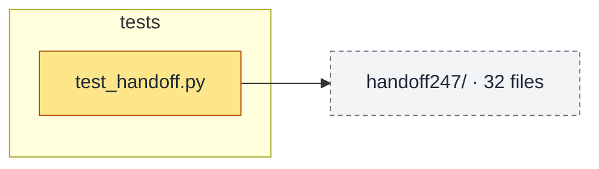
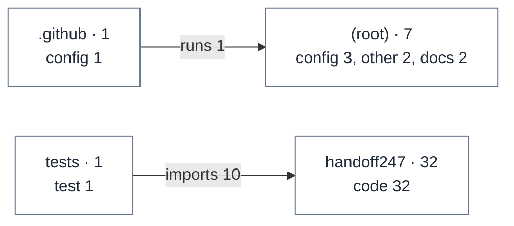

# Code map

Generated by HandOff247 0.6.0 from https://github.com/unkkyuist/HandOff247@f0caf56 on 2026-11-14. Re-run to refresh; edit the notes file, not this page.

[← Back to start](README.md)

## Dependency map

Thick arrow = constructor injection or inheritance, thin = type/module use, dotted = loads. Grey dashed boxes are shared foundations used almost everywhere; their incoming arrows are omitted.

Mermaid source: diagrams/code.mmd

## Folder overview

Mermaid source: diagrams/areas.mmd

## Shared foundations

- [handoff247/model.py](../../handoff247/model.py) — used by 20 files — Data model shared by every analyzer and renderer.

## Components

### handoff247

> **Notes**
>
> The package. Data flows inventory → analyzers → connect → (mermaid, render_md, render_html) → build. pipeline.py wires the first three; cli.py and build.py the rest.

| File | lines | Summary | Depends on | Used by |
|---|---|---|---|---|
| [__init__.py](../../handoff247/__init__.py) | 5 | Holds `__version__`; the version is printed in every generated page. |  | build.py, cli.py, journeys.py, mcp.py, notes.py, ontology.py … and 7 more |
| [__main__.py](../../handoff247/__main__.py) | 3 | Lets `python -m handoff247` run the CLI. | cli.py |  |
| [__init__.py](../../handoff247/analyzers/__init__.py) | 37 | Maps a file's language to its analyzer. An exception inside one analyzer marks only that file as "not parsed"; it never stops the run. | csharp.py, docs.py, model.py, python.py, shell.py, web.py | pipeline.py |
| [csharp.py](../../handoff247/analyzers/csharp.py) | 435 | The richest analyzer: types and primary-constructor dependencies, entry modes (`if (mode == "x")` in the entry file), `switch` dispatch tables with handler resolution, minimal-API | lexer.py, model.py | __init__.py |
| [docs.py](../../handoff247/analyzers/docs.py) | 211 | Markdown (summary, headings, relative links, code blocks for `<mode> <op>` usage), plus config formats: .csproj, package.json, pyproject, requirements, MCP client configs (`mcpServ | lexer.py, model.py | __init__.py |
| [python.py](../../handoff247/analyzers/python.py) | 282 | Uses `ast`, never imports the file. Finds argparse sub-commands, subprocess launches (rendered with `{variable}` placeholders), env reads/writes, dict/if-chain/match dispatch table | lexer.py, model.py | __init__.py |
| [shell.py](../../handoff247/analyzers/shell.py) | 178 | PowerShell, POSIX shell and batch: leading comment / .SYNOPSIS as summary, `$env:` / `export` / `set` variables, and command lines that launch something (dotnet, python, powershell | lexer.py, model.py | __init__.py |
| [web.py](../../handoff247/analyzers/web.py) | 138 | JavaScript/TypeScript (imports, exported functions with spans, `fetch` calls, Express routes, MCP registrations, `case` tables), HTML (`<script src>`, `<link>`, inline scripts) and | lexer.py, model.py | __init__.py |
| [build.py](../../handoff247/build.py) | 95 | Writes the pack: seven Markdown pages, `diagrams/*.mmd`, `handoff.json` (its first key `"generator": "HandOff247"` is how later runs recognise and skip an old pack), `ontology.json | __init__.py, mermaid.py, model.py, notes.py, ontology.py, render_html.py … and 3 more | cli.py, test_handoff.py, workspace.py |
| [cli.py](../../handoff247/cli.py) | 276 | Six commands: `go`, `build`, `notes`, `check`, `mcp`, `trace`. `trace` answers a question from the user's side (a request in words, a user type, a feature, an asset, a code file) w | __init__.py, build.py, explore.py, leaving.py, mcp.py, notes.py … and 5 more | __main__.py, mcp.py, test_handoff.py |
| [connect.py](../../handoff247/connect.py) | 677 | Turns per-file facts into edges and connection maps. The key idea: string keys of a dispatch table (`"list"`, `"ontology.search"`) are followed to every caller (`api('list')`, `cli | model.py | mermaid.py, notes.py, ontology.py, pipeline.py, render_md.py |
| [explore.py](../../handoff247/explore.py) | 718 | `Explorer` answers a successor's questions from the journeys model: `users`/`user_flow` (from a user type), `find` (from words on a screen or a user's request), `asset` (from an as | journeys.py | cli.py, mcp.py, mermaid.py, ontology.py, render_users.py, test_handoff.py … and 1 more |
| [handlers.py](../../handoff247/handlers.py) | 710 | What a route does. `PyIndex` follows a Python handler through `ast` into the project functions it calls (four levels deep) and records every effect with its file, line, call chain | model.py | journeys.py, test_handoff.py |
| [inventory.py](../../handoff247/inventory.py) | 254 | Lists files with `git ls-files` (so .gitignore applies), falls back to a directory walk, applies `.handoffignore` and skips folders that contain an earlier pack. | model.py | leaving.py, pipeline.py, workspace.py |
| [journeys.py](../../handoff247/journeys.py) | 671 | Joins screens.py and handlers.py into `project.links["journeys"]`: user types, screens, terms, features (one per route), data tables with states, assets, hand-overs, shared functio | __init__.py, handlers.py, model.py, screens.py | explore.py, pipeline.py, render_users.py, test_handoff.py |
| [labels.py](../../handoff247/labels.py) | 289 | Every generated heading and label, in one table, so pages and diagrams use the same words. Extracted comments and notes never pass through it. |  | mermaid.py, notes.py, render_md.py, render_users.py, wiki.py |
| [leaving.py](../../handoff247/leaving.py) | 383 | The handover findings: Git state (uncommitted, commits on no remote, stashes, authors), files Git ignores that are present, absolute paths, hosts in URLs, TODO comments, key and to | inventory.py, model.py | cli.py, mcp.py, pipeline.py, render_md.py, summarize.py, workspace.py |
| [lexer.py](../../handoff247/lexer.py) | 311 | Produces two views of C-like source with identical offsets: strings+comments blanked (for identifiers) and comments blanked (for literal patterns). Handles C# verbatim, interpolate |  | csharp.py, docs.py, python.py, shell.py, test_handoff.py, web.py |
| [mcp.py](../../handoff247/mcp.py) | 496 | The MCP server (`handoff247 mcp`): newline-delimited JSON-RPC on stdin/stdout, with `sys.stdout` pointed at stderr so stray prints cannot corrupt the protocol. Thirteen tools; only | __init__.py, cli.py, explore.py, leaving.py, mermaid.py, notes.py … and 6 more | cli.py |
| [mermaid.py](../../handoff247/mermaid.py) | 538 | Builds the six diagrams. `users_map` groups screens by who sees them and joins them through the states and files that pass work on. `system` collapses launch scripts into one node | connect.py, explore.py, labels.py, model.py | build.py, mcp.py, render_md.py, workspace.py |
| [model.py](../../handoff247/model.py) | 91 | Dataclasses: FileInfo, Symbol, Fact, Edge, Project. A Fact is one observation with a file and line; everything in the pack traces back to one. |  | __init__.py, build.py, connect.py, csharp.py, docs.py, handlers.py … and 14 more |
| [notes.py](../../handoff247/notes.py) | 206 | Parses and extends the notes file. `update` only appends missing headings and missing Translations rows; it never rewrites existing text. Stale headings (for deleted files) are rep | __init__.py, connect.py, labels.py, model.py, translate.py | build.py, cli.py, mcp.py, render_md.py, wiki.py, workspace.py |
| [ontology.py](../../handoff247/ontology.py) | 437 | Turns `project.links` and `project.edges` into typed entities and relations. It detects nothing itself; add a new kind of fact in an analyzer or in `connect.py` first, then map it | __init__.py, connect.py, explore.py, model.py | build.py, mcp.py |
| [pipeline.py](../../handoff247/pipeline.py) | 22 | analyze_project(): inventory, per-file analysis, linking. | __init__.py, connect.py, inventory.py, journeys.py, leaving.py, model.py | cli.py, mcp.py, test_handoff.py, workspace.py |
| [render_html.py](../../handoff247/render_html.py) | 597 | The single-file viewer. It embeds the Markdown pages and loads marked, DOMPurify and Mermaid from jsDelivr at pinned versions. Diagram nodes are matched back to files through the ` | __init__.py | build.py, workspace.py |
| [render_md.py](../../handoff247/render_md.py) | 663 | The Markdown pages except USERS.md (render_users.py writes that one); `handover()` puts each of the leaver's answers next to what `leaving.py` found. `Linker` decides how file:line | __init__.py, connect.py, labels.py, leaving.py, mermaid.py, model.py … and 2 more | build.py, cli.py, mcp.py, render_users.py, wiki.py, workspace.py |
| [render_users.py](../../handoff247/render_users.py) | 469 | Markdown for USERS.md and for the wiki pages of user types, features, screens, assets and data tables. `Ctx` holds how to link a source line and another page from where the text wi | explore.py, journeys.py, labels.py, render_md.py | render_md.py, wiki.py |
| [screens.py](../../handoff247/screens.py) | 439 | Reads templates and HTML pages as text: the visible terms (links, buttons, field labels, headings), the link target or form each belongs to, the `` conditions around it, th | model.py | journeys.py, test_handoff.py |
| [summarize.py](../../handoff247/summarize.py) | 325 | The optional `--summarize` step. It shells out to `codex exec` (read-only sandbox, empty temporary folder, `--ephemeral`, an output schema) with batches of files and their analysis | __init__.py, leaving.py, model.py | cli.py, mcp.py, workspace.py |
| [translate.py](../../handoff247/translate.py) | 93 | Finds extracted prose with letters outside the Latin script (summaries, doc comments, Markdown headings, MCP tool descriptions, sub-command help, commit subjects) and swaps in the | model.py | build.py, cli.py, mcp.py, notes.py, test_handoff.py |
| [wiki.py](../../handoff247/wiki.py) | 456 | Writes the ontology as Markdown pages plus `llms.txt` and `llms-full.txt`. `assign_pages` decides which page describes an entity (own page for files, areas, modes, operations and M | __init__.py, explore.py, labels.py, notes.py, render_md.py, render_users.py | build.py, mcp.py |
| [workspace.py](../../handoff247/workspace.py) | 350 | The folder-of-projects mode: finds projects one or two levels down, builds a pack for each, and writes the index (README.md, index.html, workspace.json, workspace.mmd). It does not | __init__.py, build.py, inventory.py, leaving.py, mermaid.py, notes.py … and 4 more | cli.py |

### tests

> **Notes**
>
> `test_handoff.py` plus two fixtures. `fixtures/newsroom` is a small Flask application with three user types (author, editor, anyone) used by `UserContextTests`: one user type's action, the code, the data and upload it changes, the next user type's follow-up and the public page are asserted end to end, and the lines the analysis points at are checked in the fixture's files. `fixtures/mini`, a small fake app (C# + JS + Python + PowerShell + batch) wired the same way as PlayBookOS: three modes, one dispatch switch, HTTP route, MCP tools, launch scripts. Every connection type the tool claims to detect has an assertion here.

| File | lines | Summary | Depends on | Used by |
|---|---|---|---|---|
| [test_handoff.py](../../tests/test_handoff.py) | 1061 | Runs the full pipeline on a copy of the fixture outside Git, so both file-listing paths are covered.  <!-- added by HandOff247 for new items --> | __init__.py, build.py, cli.py, explore.py, handlers.py, journeys.py … and 4 more |  |

