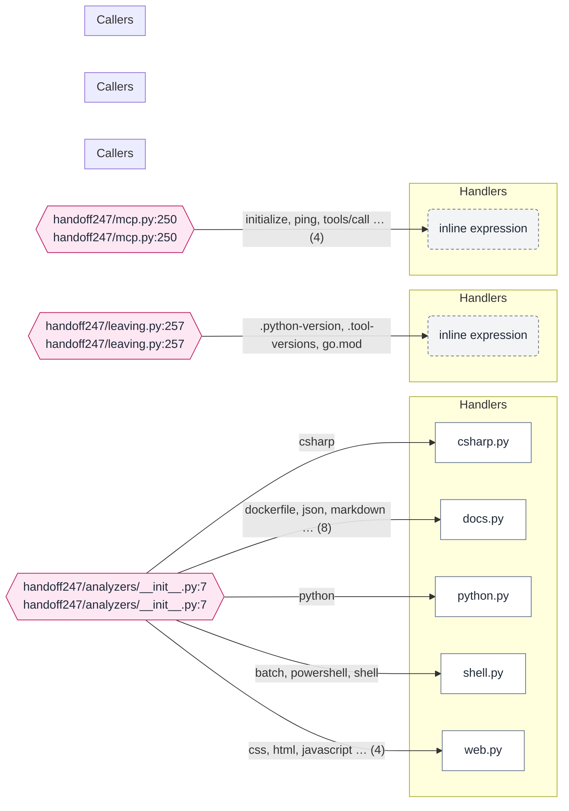

# How the tools connect

Generated by HandOff247 0.5.0 from https://github.com/unkkyuist/HandOff247@ffbe44f on 2026-11-10. Re-run to refresh; edit the notes file, not this page.

[← Back to start](README.md)

## Interface map

Callers on the left reach the dispatch table through HTTP, a CLI process or MCP; the table hands each operation to a handler on the right.

Mermaid source: diagrams/operations.mmd

## Dispatch tables: `handoff247/analyzers/__init__.py:7`

`handoff247/analyzers/__init__.py:7` in [handoff247/analyzers/__init__.py:7](../../handoff247/analyzers/__init__.py#L7) switches on `dict`. Every row below is one arm of that switch.

| Operation | Handler | Called by | MCP | Documented in | Notes |
|---|---|---|---|---|---|
| [csharp](../../handoff247/analyzers/__init__.py#L8) | `csharp.analyze` |  |  |  |  |
| [python](../../handoff247/analyzers/__init__.py#L9) | `python.analyze` |  |  |  |  |
| [javascript](../../handoff247/analyzers/__init__.py#L10) | `web.analyze_js` |  |  |  |  |
| [typescript](../../handoff247/analyzers/__init__.py#L11) | `web.analyze_js` |  |  |  |  |
| [html](../../handoff247/analyzers/__init__.py#L12) | `web.analyze_html` |  |  |  |  |
| [css](../../handoff247/analyzers/__init__.py#L13) | `web.analyze_css` |  |  |  |  |
| [powershell](../../handoff247/analyzers/__init__.py#L14) | `shell.analyze_powershell` |  |  |  |  |
| [shell](../../handoff247/analyzers/__init__.py#L15) | `shell.analyze_shell` |  |  |  |  |
| [batch](../../handoff247/analyzers/__init__.py#L16) | `shell.analyze_batch` |  |  |  |  |
| [markdown](../../handoff247/analyzers/__init__.py#L17) | `docs.analyze_markdown` |  |  |  |  |
| [text](../../handoff247/analyzers/__init__.py#L18) | `docs.analyze_text` |  |  |  |  |
| [json](../../handoff247/analyzers/__init__.py#L19) | `docs.analyze_json` |  |  |  |  |
| [toml](../../handoff247/analyzers/__init__.py#L20) | `docs.analyze_toml` |  |  |  |  |
| [requirements](../../handoff247/analyzers/__init__.py#L21) | `docs.analyze_requirements` |  |  |  |  |
| [msbuild](../../handoff247/analyzers/__init__.py#L22) | `docs.analyze_msbuild` |  |  |  |  |
| [dockerfile](../../handoff247/analyzers/__init__.py#L23) | `docs.analyze_dockerfile` |  |  |  |  |
| [yaml](../../handoff247/analyzers/__init__.py#L24) | `docs.analyze_yaml` |  |  |  |  |

## Dispatch tables: `handoff247/leaving.py:257`

`handoff247/leaving.py:257` in [handoff247/leaving.py:257](../../handoff247/leaving.py#L257) switches on `name`. Every row below is one arm of that switch.

| Operation | Handler | Called by | MCP | Documented in | Notes |
|---|---|---|---|---|---|
| [.python-version](../../handoff247/leaving.py#L257) |  |  |  |  |  |
| [.tool-versions](../../handoff247/leaving.py#L259) |  |  |  |  |  |
| [go.mod](../../handoff247/leaving.py#L264) |  |  |  |  |  |

## Dispatch tables: `handoff247/mcp.py:250`

`handoff247/mcp.py:250` in [handoff247/mcp.py:250](../../handoff247/mcp.py#L250) switches on `method`. Every row below is one arm of that switch.

| Operation | Handler | Called by | MCP | Documented in | Notes |
|---|---|---|---|---|---|
| [initialize](../../handoff247/mcp.py#L250) |  |  |  |  |  |
| [ping](../../handoff247/mcp.py#L256) |  |  |  |  |  |
| [tools/list](../../handoff247/mcp.py#L258) |  |  |  |  |  |
| [tools/call](../../handoff247/mcp.py#L260) |  |  |  |  |  |

