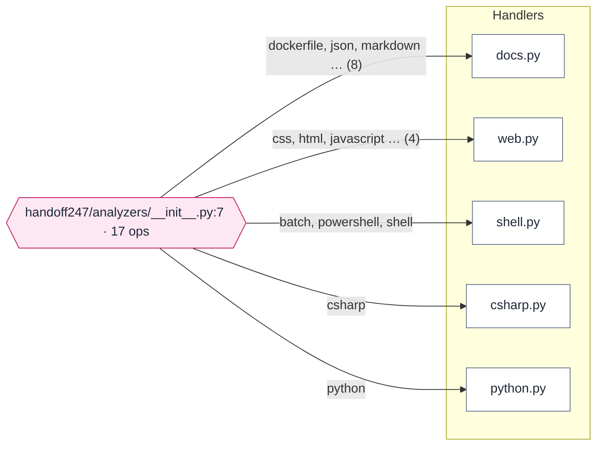

# Handoff: HandOff247

Generated by HandOff247 0.2.0 from https://github.com/unkkyuist/HandOff247@d9b811a on 2026-11-09. Re-run to refresh; edit the notes file, not this page.

> How to read this pack: everything without a 'Notes' label was found in the code and links to the line it came from. Notes were written by a person in `HANDOFF.notes.md`. Dashed arrows are inferences — check them before relying on them.

## At a glance

| files | lines | languages | operations |
|---|---|---|---|
| 29 | 5,171 | 1 | 17 |

Python 22 (4,760 lines)

## What this project is

> **Notes**
>
> HandOff247 reads a project folder and writes a handoff pack for the next person: diagrams, structure, extracted comments and a map of how the tools connect. It is static analysis only (it never imports or runs the target's code) and it is standard-library Python, so `python -m handoff247` works on any machine with Python 3.10+.
> Status: v0.2.0. The first real target was PlayBookOS (see examples/playbookos). C#, Python, JavaScript/TypeScript, PowerShell, shell and batch have analyzers; other languages are inventoried but not parsed. Output is English; a project's own comments and headings in another language get English versions from the notes file's `## Translations` table.

From [README.md](../../README.md): *Hand Off 24-7 is a good-bye project for passing your existing projects to the next person.*

## System map

Launch scripts start the program; each mode exposes interfaces; every caller ends up in the dispatch table, which hands work to the handler files.

Mermaid source: diagrams/system.mmd

## Pages

- [RUNNING.md](RUNNING.md) — How it runs — launch chain, modes, environment variables, ports, build and tests
- [CONNECTIONS.md](CONNECTIONS.md) — How the tools connect — operations, HTTP routes, MCP tools, callers
- [CODEMAP.md](CODEMAP.md) — Code map — which file depends on which
- [FILES.md](FILES.md) — File cards — one card per file with comments, symbols and links
- [index.html](index.html) — Interactive viewer (open index.html in a browser)

## Suggested reading order

1. [README.md](../../README.md) — **what the project says about itself**
2. [handoff247/analyzers/__init__.py](../../handoff247/analyzers/__init__.py) — **dispatch table: 17 operations** — Per-language analyzers.
3. [handoff247/model.py](../../handoff247/model.py) — **shared foundation used by 14 files** — Data model shared by every analyzer and renderer.
4. [handoff247/analyzers/docs.py](../../handoff247/analyzers/docs.py) — **handles 8 operations** — Markdown/text documents and configuration files (MSBuild, package.json, pyproject, requirements, MCP client configs, Dockerfile, GitHub workflows).
5. [handoff247/analyzers/web.py](../../handoff247/analyzers/web.py) — **handles 4 operations** — JavaScript/TypeScript, HTML and CSS analyzers.
6. [handoff247/analyzers/shell.py](../../handoff247/analyzers/shell.py) — **handles 3 operations** — PowerShell, POSIX shell and Windows batch analyzers (line based, no execution).
7. [handoff247/analyzers/csharp.py](../../handoff247/analyzers/csharp.py) — **handles 1 operations** — C# analyzer: types, members, constructor dependencies, entry modes, switch dispatch tables, ASP.NET minimal-API routes, MCP server tools, environment variables and process launches.
8. [handoff247/analyzers/python.py](../../handoff247/analyzers/python.py) — **handles 1 operations** — Python analyzer built on the standard ``ast`` module (no code is executed).

## Successor checklist

> **Notes**
>
> 1. Run the tests: `python -m unittest discover -s tests`.
> 2. Regenerate the examples after any analyzer change: `python -m handoff247 build <PlayBookOS checkout> --name PlayBookOS -o examples/playbookos --notes examples/playbookos.notes.md --date <date>`. If an analyzer change surfaces new Korean comments or headings, `check --notes examples/playbookos.notes.md` reports them; add their rows to the Translations table there. Read the diff of the generated pages: a change there is a change in what successors will be told.
> 3. Regenerate this pack: `python -m handoff247 build . -o docs/handoff --date <date>`.
> 4. Open `index.html` of a pack in a browser and check that every diagram renders (Mermaid errors show as red text in the page).

## Known issues and risks

> **Notes**
>
> - The rule that matters most: a wrong statement is worse than a missing one. When a pattern is ambiguous the analyzers leave it out; inferences (for example a wrapper passed in as a parameter) are labelled and drawn dashed. Keep it that way.
> - Analysis is regex/lexer based for everything except Python (which uses `ast`). Code built from runtime strings, reflection or dependency-injection containers is not followed.
> - MCP tool names from the C# SDK are derived from method names (snake_case, `Async` removed) and marked with * in the pack.
> - Mermaid labels must go through `mermaid.esc`; `*`, `_` and backticks are escaped because Mermaid otherwise formats them as Markdown.

## Credentials and accounts

> **Notes**
>
> None. The tool needs no keys. The GitHub Action only uses the workflow's own checkout.

## Recent commits

- `d9b811a` 2026-11-09 — HandOff247 v0.1.0: handoff pack generator

38 uncommitted change(s) when this pack was generated.

