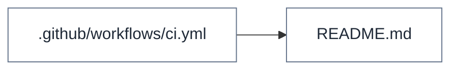

# How it runs

Generated by HandOff247 0.1.0 from HandOff247 on 2026-11-09. Re-run to refresh; edit the notes file, not this page.

[← Back to start](README.md)

## Startup chain

Who starts whom. Labels are the arguments passed on that line.

Mermaid source: diagrams/startup.mmd

## Ports and addresses

| Port | Where | Source |
|---|---|---|
| `5050` | [tests/test_handoff.py:110](../../tests/test_handoff.py#L110) | address literal |

## Tests and smoke scripts

| File | Summary | Modes |
|---|---|---|
| [tests/test_handoff.py](../../tests/test_handoff.py) | End-to-end and unit tests. |  |

## Script sub-commands

| File | Command | Description |
|---|---|---|
| [handoff247/cli.py:37](../../handoff247/cli.py#L37) | `build` | analyze the project and write the handoff pack |
| [handoff247/cli.py:44](../../handoff247/cli.py#L44) | `notes` | create the notes file or add headings for new files/modes/folders |
| [handoff247/cli.py:46](../../handoff247/cli.py#L46) | `check` | report what is still undocumented; non-zero exit below --min |

