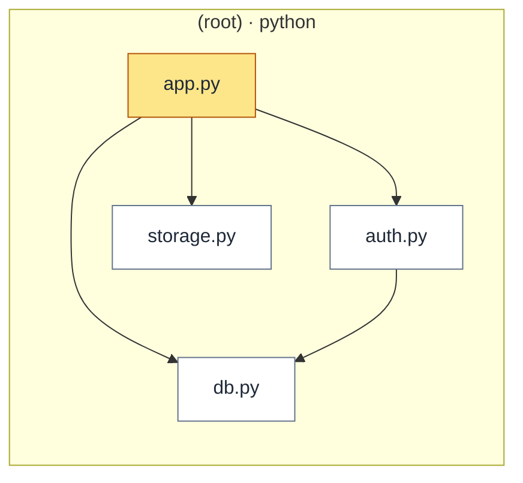
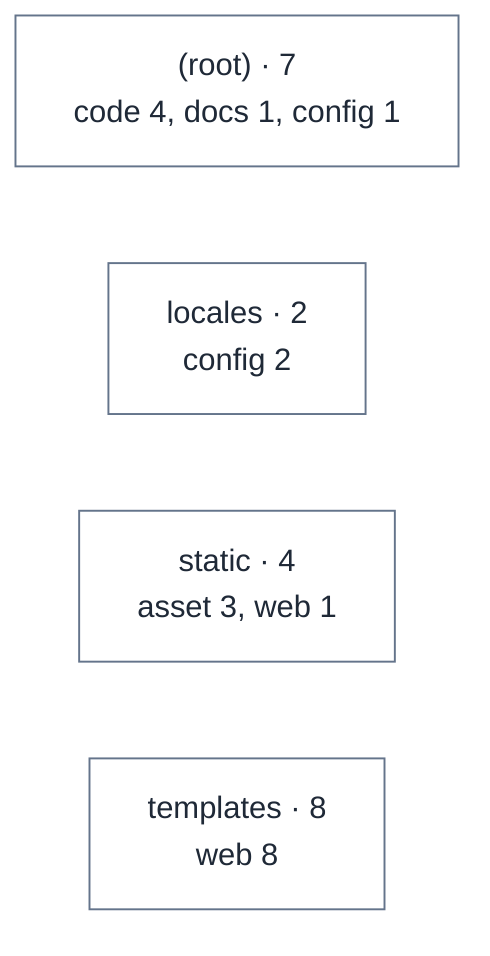

# Code map

Generated by HandOff247 0.6.0 from https://github.com/unkkyuist/HandOff247@3cdb94f on 2026-11-14. Re-run to refresh; edit the notes file, not this page.

[← Back to start](README.md)

## Dependency map

Thick arrow = constructor injection or inheritance, thin = type/module use, dotted = loads. Grey dashed boxes are shared foundations used almost everywhere; their incoming arrows are omitted.

Mermaid source: diagrams/code.mmd

## Folder overview

Mermaid source: diagrams/areas.mmd

## Components

### (root)

| File | lines | Summary | Depends on | Used by |
|---|---|---|---|---|
| [app.py](https://github.com/unkkyuist/HandOff247/blob/main/tests/fixtures/newsroom/app.py) | 130 | Newsroom: authors write articles, editors review and publish them, readers see the result. | auth.py, db.py, storage.py |  |
| [auth.py](https://github.com/unkkyuist/HandOff247/blob/main/tests/fixtures/newsroom/auth.py) | 26 | Who is signed in, and the role check used by the routes. | db.py | app.py |
| [db.py](https://github.com/unkkyuist/HandOff247/blob/main/tests/fixtures/newsroom/db.py) | 65 | SQLite access. |  | app.py, auth.py |
| [storage.py](https://github.com/unkkyuist/HandOff247/blob/main/tests/fixtures/newsroom/storage.py) | 27 | Files on disk: cover images that authors upload and the list that publishing writes. |  | app.py |

### static

| File | lines | Summary | Depends on | Used by |
|---|---|---|---|---|
| [site.css](https://github.com/unkkyuist/HandOff247/blob/main/tests/fixtures/newsroom/static/site.css) | 4 | Newsroom styles. |  |  |

### templates

| File | lines | Summary | Depends on | Used by |
|---|---|---|---|---|
| [article.html](https://github.com/unkkyuist/HandOff247/blob/main/tests/fixtures/newsroom/templates/article.html) | 12 |  |  |  |
| [base.html](https://github.com/unkkyuist/HandOff247/blob/main/tests/fixtures/newsroom/templates/base.html) | 29 | Newsroom |  |  |
| [desk.html](https://github.com/unkkyuist/HandOff247/blob/main/tests/fixtures/newsroom/templates/desk.html) | 23 |  |  |  |
| [edit.html](https://github.com/unkkyuist/HandOff247/blob/main/tests/fixtures/newsroom/templates/edit.html) | 14 |  |  |  |
| [home.html](https://github.com/unkkyuist/HandOff247/blob/main/tests/fixtures/newsroom/templates/home.html) | 14 |  |  |  |
| [login.html](https://github.com/unkkyuist/HandOff247/blob/main/tests/fixtures/newsroom/templates/login.html) | 10 |  |  |  |
| [review.html](https://github.com/unkkyuist/HandOff247/blob/main/tests/fixtures/newsroom/templates/review.html) | 10 |  |  |  |
| [review_detail.html](https://github.com/unkkyuist/HandOff247/blob/main/tests/fixtures/newsroom/templates/review_detail.html) | 17 |  |  |  |

