# Handoff: Newsroom

Generated by HandOff247 0.6.0 from https://github.com/unkkyuist/HandOff247@3cdb94f on 2026-11-14. Re-run to refresh; edit the notes file, not this page.

> How to read this pack: everything without a 'Notes' label was found in the code and links to the line it came from. Notes were written by a person in `examples/newsroom.notes.md`. Dashed arrows are inferences — check them before relying on them.

> Handover status: **9 of 13** checks ready — see [HANDOVER.md](HANDOVER.md).

## At a glance

| files | lines | languages | HTTP routes | env vars | user types | screens |
|---|---|---|---|---|---|---|
| 21 | 426 | 3 | 13 | 6 | 3 | 8 |

HTML 8 (129 lines) · Python 4 (248 lines) · CSS 1 (4 lines)

## What this project is

> **Notes**
>
> A small publishing application that exists only as a test fixture for HandOff247 (`tests/fixtures/newsroom`). Authors write articles and upload a cover image, editors review and publish them, and readers see the published articles on the front page. It is not deployed anywhere; the notes below are example text.

From [README.md](https://github.com/unkkyuist/HandOff247/blob/main/tests/fixtures/newsroom/README.md): *A small publishing application used as a test fixture: authors write articles and upload a cover image, editors review and publish them, and readers see the published articles on the front page.*

## System map

Launch scripts start the program; each mode exposes interfaces; every caller ends up in the dispatch table, which hands work to the handler files.

```mermaid
flowchart LR
  n1[/"HTTP routes ×13"/]:::iface
  classDef entry fill:#fde68a,stroke:#b45309,color:#1f2937
  classDef launcher fill:#e0e7ff,stroke:#4338ca,color:#1f2937
  classDef mode fill:#dcfce7,stroke:#15803d,color:#1f2937
  classDef iface fill:#cffafe,stroke:#0e7490,color:#1f2937
  classDef table fill:#fce7f3,stroke:#be185d,color:#1f2937
  classDef hub fill:#f3f4f6,stroke:#6b7280,color:#1f2937,stroke-dasharray:4 3
  classDef data fill:#fef3c7,stroke:#92400e,color:#1f2937
  classDef ext fill:#ffffff,stroke:#9ca3af,color:#374151,stroke-dasharray:2 2
  classDef test fill:#ede9fe,stroke:#6d28d9,color:#1f2937
  classDef file fill:#ffffff,stroke:#64748b,color:#1f2937
```

Mermaid source: diagrams/system.mmd

## Pages

- [HANDOVER.md](HANDOVER.md) — Handover checklist — what is ready, unfinished work, what exists only on one computer, accounts, people
- [USERS.md](USERS.md) — Who uses it — user types, their screens, what each control does, hand-overs between user types, assets in context
- [RUNNING.md](RUNNING.md) — How it runs — launch chain, modes, environment variables, ports, build and tests
- [CONNECTIONS.md](CONNECTIONS.md) — How the tools connect — operations, HTTP routes, MCP tools, callers
- [CODEMAP.md](CODEMAP.md) — Code map — which file depends on which
- [FILES.md](FILES.md) — File cards — one card per file with comments, symbols and links
- [index.html](index.html) — Interactive viewer with a graph of everything found (open index.html in a browser)
- [wiki/index.md](wiki/index.md) — Wiki for AI assistants — one small page per file, operation, tool and run mode, all interlinked
- [llms.txt](llms.txt) — Entry point for AI assistants (llms.txt convention); llms-full.txt is the whole wiki in one file
- [ontology.json](ontology.json) — The ontology as data — every entity and relation, with the file and line it was observed at

## Suggested reading order

1. [README.md](https://github.com/unkkyuist/HandOff247/blob/main/tests/fixtures/newsroom/README.md) — **what the project says about itself**

## Successor checklist

*TODO: First things a successor must do (accounts, machines, deploy steps, scheduled jobs).*

## Known issues and risks

> **Notes**
>
> Publishing refuses an article without a cover image while `NEWSROOM_COVER_REQUIRED` is `1` (the default). Editors usually report this as "the Publish button does nothing"; the message is shown on the review page.

## Credentials and accounts

*TODO: Where credentials and keys are kept (location only, never the values).*

