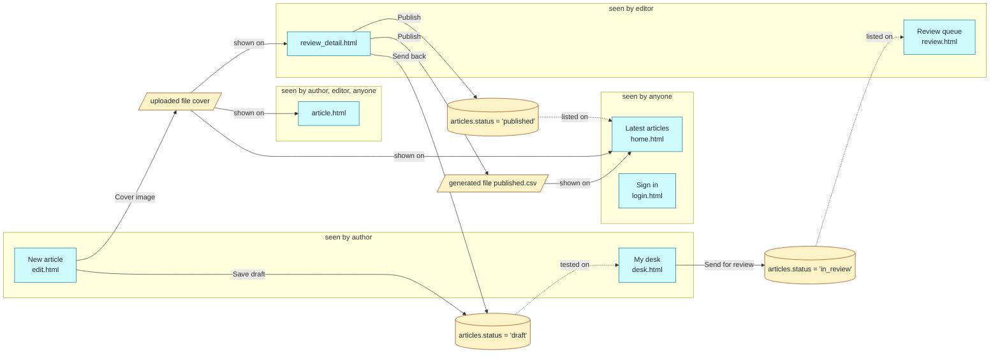

# Who uses it and what they see

Generated by HandOff247 0.6.0 from https://github.com/unkkyuist/HandOff247@3cdb94f on 2026-11-14. Re-run to refresh; edit the notes file, not this page.

[← Back to start](README.md)

> The user types on this page are the kinds of user the analysed application tells apart. They are not access levels of this pack: every flow is open to you, and each one links to the flows of the other user types. Start from a user type, from the words on a screen, from an asset or table, or from a code file.

## User types

Found from role checks on routes and in templates. A route without one is listed under `anyone`.

| User type | Kind | Told apart at | Screens | Features |
|---|---|---|---|---|
| [`author`](wiki/users/author.md) | role | [app.py:56](https://github.com/unkkyuist/HandOff247/blob/main/tests/fixtures/newsroom/app.py#L56), [app.py:62](https://github.com/unkkyuist/HandOff247/blob/main/tests/fixtures/newsroom/app.py#L62), [app.py:74](https://github.com/unkkyuist/HandOff247/blob/main/tests/fixtures/newsroom/app.py#L74) … | `desk.html`, `edit.html`, `article.html` | 4 |
| [`editor`](wiki/users/editor.md) | role | [app.py:88](https://github.com/unkkyuist/HandOff247/blob/main/tests/fixtures/newsroom/app.py#L88), [app.py:94](https://github.com/unkkyuist/HandOff247/blob/main/tests/fixtures/newsroom/app.py#L94), [app.py:100](https://github.com/unkkyuist/HandOff247/blob/main/tests/fixtures/newsroom/app.py#L100) … | `review.html`, `review_detail.html`, `article.html` | 5 |
| [`anyone`](wiki/users/anyone.md) | anyone (no role check found) | no role check found on these routes | `home.html`, `article.html`, `login.html` | 5 |

Screens grouped by who sees them. An arrow into a state is an action that sets it; an arrow out of a state is a screen that lists or tests it. Dashed arrows are inferences.

Mermaid source: diagrams/users.mmd

## Flows by user type

Per screen: what is on it, when it is shown, where it leads, what the code then does, and who picks the work up next.

### `author`

> **Notes**
>
> Reporters. They mostly ask why an article they sent is not on the front page yet: it is waiting in the editors' queue, or an editor sent it back with a note.

The code tells this user type apart at [app.py:56](https://github.com/unkkyuist/HandOff247/blob/main/tests/fixtures/newsroom/app.py#L56), [app.py:62](https://github.com/unkkyuist/HandOff247/blob/main/tests/fixtures/newsroom/app.py#L62), [app.py:74](https://github.com/unkkyuist/HandOff247/blob/main/tests/fixtures/newsroom/app.py#L74), [app.py:124](https://github.com/unkkyuist/HandOff247/blob/main/tests/fixtures/newsroom/app.py#L124), [templates/base.html:13](https://github.com/unkkyuist/HandOff247/blob/main/tests/fixtures/newsroom/templates/base.html#L13).

#### Screen "My desk" — [`templates/desk.html`](wiki/screens/templates__desk.html.md)

opened by [`GET /desk`](wiki/features/GET-__desk.md) ([app.py:57](https://github.com/unkkyuist/HandOff247/blob/main/tests/fixtures/newsroom/app.py#L57)); built on [`templates/base.html`](wiki/screens/templates__base.html.md).

| On the screen | Where | Shown when | Leads to | What the code does | Then |
|---|---|---|---|---|---|
| "New article" (link) | [templates/desk.html:5](https://github.com/unkkyuist/HandOff247/blob/main/tests/fixtures/newsroom/templates/desk.html#L5) |  | [`GET,POST /desk/new`](wiki/features/GET-POST-__desk__new.md) → [new_article](https://github.com/unkkyuist/HandOff247/blob/main/tests/fixtures/newsroom/app.py#L63) | shows `edit.html` |  |
| *(text set at run time)* (link) | [templates/desk.html:10](https://github.com/unkkyuist/HandOff247/blob/main/tests/fixtures/newsroom/templates/desk.html#L10) |  | [`GET /preview/<int:article_id>`](wiki/features/GET-__preview__-int-article_id.md) → [preview](https://github.com/unkkyuist/HandOff247/blob/main/tests/fixtures/newsroom/app.py#L125) | shows `article.html` |  |
| "Send for review" (button) | [templates/desk.html:16](https://github.com/unkkyuist/HandOff247/blob/main/tests/fixtures/newsroom/templates/desk.html#L16) | `a.status == 'draft'` | [`POST /desk/<int:article_id>/submit`](wiki/features/POST-__desk__-int-article_id-__submit.md) → [submit](https://github.com/unkkyuist/HandOff247/blob/main/tests/fixtures/newsroom/app.py#L75) | sets `articles.status = 'in_review'` | → [`editor`](wiki/users/editor.md): [`templates/review.html`](wiki/screens/templates__review.html.md) (`articles.status = 'in_review'`, *inferred*) → [`editor`](wiki/users/editor.md): [`POST /review/<int:article_id>/publish`](wiki/features/POST-__review__-int-article_id-__publish.md) (`articles.status = 'in_review'`, *inferred*) |
| "Front page" (link) | [templates/base.html:12](https://github.com/unkkyuist/HandOff247/blob/main/tests/fixtures/newsroom/templates/base.html#L12) *(layout)* |  | [`GET /`](wiki/features/GET-__.md) → [home](https://github.com/unkkyuist/HandOff247/blob/main/tests/fixtures/newsroom/app.py#L18) | lists rows with `status = 'published'`; shows `home.html` |  |
| "My desk" (link) | [templates/base.html:14](https://github.com/unkkyuist/HandOff247/blob/main/tests/fixtures/newsroom/templates/base.html#L14) *(layout)* | `user and user.role == 'author'` | [`GET /desk`](wiki/features/GET-__desk.md) → [desk](https://github.com/unkkyuist/HandOff247/blob/main/tests/fixtures/newsroom/app.py#L57) | shows `desk.html` |  |
| "Sign in" (link) | [templates/base.html:20](https://github.com/unkkyuist/HandOff247/blob/main/tests/fixtures/newsroom/templates/base.html#L20) *(layout)* | `not user` | [`GET,POST /login`](wiki/features/GET-POST-__login.md) → [login](https://github.com/unkkyuist/HandOff247/blob/main/tests/fixtures/newsroom/app.py#L42) | shows `login.html` |  |

#### Screen "New article" — [`templates/edit.html`](wiki/screens/templates__edit.html.md)

opened by [`GET,POST /desk/new`](wiki/features/GET-POST-__desk__new.md) ([app.py:63](https://github.com/unkkyuist/HandOff247/blob/main/tests/fixtures/newsroom/app.py#L63)); built on [`templates/base.html`](wiki/screens/templates__base.html.md).

| On the screen | Where | Shown when | Leads to | What the code does | Then |
|---|---|---|---|---|---|
| "Save draft" (button) | [templates/edit.html:12](https://github.com/unkkyuist/HandOff247/blob/main/tests/fixtures/newsroom/templates/edit.html#L12) |  | [`GET,POST /desk/new`](wiki/features/GET-POST-__desk__new.md) → [new_article](https://github.com/unkkyuist/HandOff247/blob/main/tests/fixtures/newsroom/app.py#L63) | sets `articles.status = 'draft'`; stores the uploaded file | → [`author`](wiki/users/author.md): [`templates/desk.html`](wiki/screens/templates__desk.html.md) (`articles.status = 'draft'`, *inferred*) → [`author`](wiki/users/author.md): [`POST /desk/<int:article_id>/submit`](wiki/features/POST-__desk__-int-article_id-__submit.md) (`articles.status = 'draft'`, *inferred*) |
| "Front page" (link) | [templates/base.html:12](https://github.com/unkkyuist/HandOff247/blob/main/tests/fixtures/newsroom/templates/base.html#L12) *(layout)* |  | [`GET /`](wiki/features/GET-__.md) → [home](https://github.com/unkkyuist/HandOff247/blob/main/tests/fixtures/newsroom/app.py#L18) | lists rows with `status = 'published'`; shows `home.html` |  |
| "My desk" (link) | [templates/base.html:14](https://github.com/unkkyuist/HandOff247/blob/main/tests/fixtures/newsroom/templates/base.html#L14) *(layout)* | `user and user.role == 'author'` | [`GET /desk`](wiki/features/GET-__desk.md) → [desk](https://github.com/unkkyuist/HandOff247/blob/main/tests/fixtures/newsroom/app.py#L57) | shows `desk.html` |  |
| "Sign in" (link) | [templates/base.html:20](https://github.com/unkkyuist/HandOff247/blob/main/tests/fixtures/newsroom/templates/base.html#L20) *(layout)* | `not user` | [`GET,POST /login`](wiki/features/GET-POST-__login.md) → [login](https://github.com/unkkyuist/HandOff247/blob/main/tests/fixtures/newsroom/app.py#L42) | shows `login.html` |  |

Fields: "Headline" → `title`; "Text" → `body`; "Cover image" → `cover`.

#### Screen — [`templates/article.html`](wiki/screens/templates__article.html.md)

opened by [`GET /preview/<int:article_id>`](wiki/features/GET-__preview__-int-article_id.md) ([app.py:125](https://github.com/unkkyuist/HandOff247/blob/main/tests/fixtures/newsroom/app.py#L125)); built on [`templates/base.html`](wiki/screens/templates__base.html.md); also seen by [`editor`](wiki/users/editor.md), [`anyone`](wiki/users/anyone.md).

| On the screen | Where | Shown when | Leads to | What the code does | Then |
|---|---|---|---|---|---|
| "Front page" (link) | [templates/base.html:12](https://github.com/unkkyuist/HandOff247/blob/main/tests/fixtures/newsroom/templates/base.html#L12) *(layout)* |  | [`GET /`](wiki/features/GET-__.md) → [home](https://github.com/unkkyuist/HandOff247/blob/main/tests/fixtures/newsroom/app.py#L18) | lists rows with `status = 'published'`; shows `home.html` |  |
| "My desk" (link) | [templates/base.html:14](https://github.com/unkkyuist/HandOff247/blob/main/tests/fixtures/newsroom/templates/base.html#L14) *(layout)* | `user and user.role == 'author'` | [`GET /desk`](wiki/features/GET-__desk.md) → [desk](https://github.com/unkkyuist/HandOff247/blob/main/tests/fixtures/newsroom/app.py#L57) | shows `desk.html` |  |
| "Sign in" (link) | [templates/base.html:20](https://github.com/unkkyuist/HandOff247/blob/main/tests/fixtures/newsroom/templates/base.html#L20) *(layout)* | `not user` | [`GET,POST /login`](wiki/features/GET-POST-__login.md) → [login](https://github.com/unkkyuist/HandOff247/blob/main/tests/fixtures/newsroom/app.py#L42) | shows `login.html` |  |

Shows: [`upload:cover`](wiki/assets/upload-cover.md).

Actions that show no page of their own:

- [`POST /desk/<int:article_id>/submit`](wiki/features/POST-__desk__-int-article_id-__submit.md) — "Send for review" — [app.py:75](https://github.com/unkkyuist/HandOff247/blob/main/tests/fixtures/newsroom/app.py#L75) — sets `articles.status = 'in_review'`

### `editor`

> **Notes**
>
> The news desk. They mostly ask about articles that will not publish and about cover images that do not show.

The code tells this user type apart at [app.py:88](https://github.com/unkkyuist/HandOff247/blob/main/tests/fixtures/newsroom/app.py#L88), [app.py:94](https://github.com/unkkyuist/HandOff247/blob/main/tests/fixtures/newsroom/app.py#L94), [app.py:100](https://github.com/unkkyuist/HandOff247/blob/main/tests/fixtures/newsroom/app.py#L100), [app.py:115](https://github.com/unkkyuist/HandOff247/blob/main/tests/fixtures/newsroom/app.py#L115), [app.py:124](https://github.com/unkkyuist/HandOff247/blob/main/tests/fixtures/newsroom/app.py#L124), [templates/base.html:16](https://github.com/unkkyuist/HandOff247/blob/main/tests/fixtures/newsroom/templates/base.html#L16).

#### Screen "Review queue" — [`templates/review.html`](wiki/screens/templates__review.html.md)

opened by [`GET /review`](wiki/features/GET-__review.md) ([app.py:89](https://github.com/unkkyuist/HandOff247/blob/main/tests/fixtures/newsroom/app.py#L89)); built on [`templates/base.html`](wiki/screens/templates__base.html.md).

| On the screen | Where | Shown when | Leads to | What the code does | Then |
|---|---|---|---|---|---|
| *(text set at run time)* (link) | [templates/review.html:7](https://github.com/unkkyuist/HandOff247/blob/main/tests/fixtures/newsroom/templates/review.html#L7) |  | [`GET /review/<int:article_id>`](wiki/features/GET-__review__-int-article_id.md) → [review_detail](https://github.com/unkkyuist/HandOff247/blob/main/tests/fixtures/newsroom/app.py#L95) | shows `review_detail.html` |  |
| "Front page" (link) | [templates/base.html:12](https://github.com/unkkyuist/HandOff247/blob/main/tests/fixtures/newsroom/templates/base.html#L12) *(layout)* |  | [`GET /`](wiki/features/GET-__.md) → [home](https://github.com/unkkyuist/HandOff247/blob/main/tests/fixtures/newsroom/app.py#L18) | lists rows with `status = 'published'`; shows `home.html` |  |
| "Review queue" (link) | [templates/base.html:17](https://github.com/unkkyuist/HandOff247/blob/main/tests/fixtures/newsroom/templates/base.html#L17) *(layout)* | `user and user.role == 'editor'` | [`GET /review`](wiki/features/GET-__review.md) → [review_queue](https://github.com/unkkyuist/HandOff247/blob/main/tests/fixtures/newsroom/app.py#L89) | lists rows with `status = 'in_review'`; shows `review.html` |  |
| "Sign in" (link) | [templates/base.html:20](https://github.com/unkkyuist/HandOff247/blob/main/tests/fixtures/newsroom/templates/base.html#L20) *(layout)* | `not user` | [`GET,POST /login`](wiki/features/GET-POST-__login.md) → [login](https://github.com/unkkyuist/HandOff247/blob/main/tests/fixtures/newsroom/app.py#L42) | shows `login.html` |  |

#### Screen — [`templates/review_detail.html`](wiki/screens/templates__review_detail.html.md)

opened by [`GET /review/<int:article_id>`](wiki/features/GET-__review__-int-article_id.md) ([app.py:95](https://github.com/unkkyuist/HandOff247/blob/main/tests/fixtures/newsroom/app.py#L95)); built on [`templates/base.html`](wiki/screens/templates__base.html.md).

| On the screen | Where | Shown when | Leads to | What the code does | Then |
|---|---|---|---|---|---|
| "Open the preview" (link) | [templates/review_detail.html:8](https://github.com/unkkyuist/HandOff247/blob/main/tests/fixtures/newsroom/templates/review_detail.html#L8) |  | [`GET /preview/<int:article_id>`](wiki/features/GET-__preview__-int-article_id.md) → [preview](https://github.com/unkkyuist/HandOff247/blob/main/tests/fixtures/newsroom/app.py#L125) | shows `article.html` |  |
| "Publish" (button) | [templates/review_detail.html:10](https://github.com/unkkyuist/HandOff247/blob/main/tests/fixtures/newsroom/templates/review_detail.html#L10) |  | [`POST /review/<int:article_id>/publish`](wiki/features/POST-__review__-int-article_id-__publish.md) → [publish](https://github.com/unkkyuist/HandOff247/blob/main/tests/fixtures/newsroom/app.py#L101) | sets `articles.status = 'published'`; writes a file | → [`anyone`](wiki/users/anyone.md): [`templates/home.html`](wiki/screens/templates__home.html.md) (`articles.status = 'published'`, *inferred*) → [`anyone`](wiki/users/anyone.md): [`GET /articles/<int:article_id>`](wiki/features/GET-__articles__-int-article_id.md) (`articles.status = 'published'`, *inferred*) |
| "Send back" (button) | [templates/review_detail.html:15](https://github.com/unkkyuist/HandOff247/blob/main/tests/fixtures/newsroom/templates/review_detail.html#L15) |  | [`POST /review/<int:article_id>/return`](wiki/features/POST-__review__-int-article_id-__return.md) → [send_back](https://github.com/unkkyuist/HandOff247/blob/main/tests/fixtures/newsroom/app.py#L116) | sets `articles.status = 'draft'` | → [`author`](wiki/users/author.md): [`templates/desk.html`](wiki/screens/templates__desk.html.md) (`articles.status = 'draft'`, *inferred*) → [`author`](wiki/users/author.md): [`POST /desk/<int:article_id>/submit`](wiki/features/POST-__desk__-int-article_id-__submit.md) (`articles.status = 'draft'`, *inferred*) |
| "Front page" (link) | [templates/base.html:12](https://github.com/unkkyuist/HandOff247/blob/main/tests/fixtures/newsroom/templates/base.html#L12) *(layout)* |  | [`GET /`](wiki/features/GET-__.md) → [home](https://github.com/unkkyuist/HandOff247/blob/main/tests/fixtures/newsroom/app.py#L18) | lists rows with `status = 'published'`; shows `home.html` |  |
| "Review queue" (link) | [templates/base.html:17](https://github.com/unkkyuist/HandOff247/blob/main/tests/fixtures/newsroom/templates/base.html#L17) *(layout)* | `user and user.role == 'editor'` | [`GET /review`](wiki/features/GET-__review.md) → [review_queue](https://github.com/unkkyuist/HandOff247/blob/main/tests/fixtures/newsroom/app.py#L89) | lists rows with `status = 'in_review'`; shows `review.html` |  |
| "Sign in" (link) | [templates/base.html:20](https://github.com/unkkyuist/HandOff247/blob/main/tests/fixtures/newsroom/templates/base.html#L20) *(layout)* | `not user` | [`GET,POST /login`](wiki/features/GET-POST-__login.md) → [login](https://github.com/unkkyuist/HandOff247/blob/main/tests/fixtures/newsroom/app.py#L42) | shows `login.html` |  |

Fields: "Reason for the author" → `reason`.

Shows: [`upload:cover`](wiki/assets/upload-cover.md).

#### Screen — [`templates/article.html`](wiki/screens/templates__article.html.md)

opened by [`GET /preview/<int:article_id>`](wiki/features/GET-__preview__-int-article_id.md) ([app.py:125](https://github.com/unkkyuist/HandOff247/blob/main/tests/fixtures/newsroom/app.py#L125)); built on [`templates/base.html`](wiki/screens/templates__base.html.md); also seen by [`author`](wiki/users/author.md), [`anyone`](wiki/users/anyone.md).

| On the screen | Where | Shown when | Leads to | What the code does | Then |
|---|---|---|---|---|---|
| "Front page" (link) | [templates/base.html:12](https://github.com/unkkyuist/HandOff247/blob/main/tests/fixtures/newsroom/templates/base.html#L12) *(layout)* |  | [`GET /`](wiki/features/GET-__.md) → [home](https://github.com/unkkyuist/HandOff247/blob/main/tests/fixtures/newsroom/app.py#L18) | lists rows with `status = 'published'`; shows `home.html` |  |
| "Review queue" (link) | [templates/base.html:17](https://github.com/unkkyuist/HandOff247/blob/main/tests/fixtures/newsroom/templates/base.html#L17) *(layout)* | `user and user.role == 'editor'` | [`GET /review`](wiki/features/GET-__review.md) → [review_queue](https://github.com/unkkyuist/HandOff247/blob/main/tests/fixtures/newsroom/app.py#L89) | lists rows with `status = 'in_review'`; shows `review.html` |  |
| "Sign in" (link) | [templates/base.html:20](https://github.com/unkkyuist/HandOff247/blob/main/tests/fixtures/newsroom/templates/base.html#L20) *(layout)* | `not user` | [`GET,POST /login`](wiki/features/GET-POST-__login.md) → [login](https://github.com/unkkyuist/HandOff247/blob/main/tests/fixtures/newsroom/app.py#L42) | shows `login.html` |  |

Shows: [`upload:cover`](wiki/assets/upload-cover.md).

Actions that show no page of their own:

- [`POST /review/<int:article_id>/publish`](wiki/features/POST-__review__-int-article_id-__publish.md) — "Publish" — [app.py:101](https://github.com/unkkyuist/HandOff247/blob/main/tests/fixtures/newsroom/app.py#L101) — sets `articles.status = 'published'`; writes a file
- [`POST /review/<int:article_id>/return`](wiki/features/POST-__review__-int-article_id-__return.md) — "Send back" — [app.py:116](https://github.com/unkkyuist/HandOff247/blob/main/tests/fixtures/newsroom/app.py#L116) — sets `articles.status = 'draft'`

Receives from other user types (*inferred*):

- from [`author`](wiki/users/author.md): "Send for review" ([`POST /desk/<int:article_id>/submit`](wiki/features/POST-__desk__-int-article_id-__submit.md)), because `articles.status = 'in_review'` — set at [db.py:49](https://github.com/unkkyuist/HandOff247/blob/main/tests/fixtures/newsroom/db.py#L49) *(through `db.send_for_review`)*, read at [db.py:53](https://github.com/unkkyuist/HandOff247/blob/main/tests/fixtures/newsroom/db.py#L53) *(through `db.waiting_for_review`)*

### `anyone` — anyone (no role check found)

No role check was found on the routes below. A check made in middleware, a base class or the web server would not be seen.

#### Screen "Latest articles" — [`templates/home.html`](wiki/screens/templates__home.html.md)

opened by [`GET /`](wiki/features/GET-__.md) ([app.py:18](https://github.com/unkkyuist/HandOff247/blob/main/tests/fixtures/newsroom/app.py#L18)); built on [`templates/base.html`](wiki/screens/templates__base.html.md).

| On the screen | Where | Shown when | Leads to | What the code does | Then |
|---|---|---|---|---|---|
| *(text set at run time)* (link) | [templates/home.html:10](https://github.com/unkkyuist/HandOff247/blob/main/tests/fixtures/newsroom/templates/home.html#L10) |  | [`GET /articles/<int:article_id>`](wiki/features/GET-__articles__-int-article_id.md) → [article](https://github.com/unkkyuist/HandOff247/blob/main/tests/fixtures/newsroom/app.py#L24) | shows `article.html` |  |
| "Download the list" (link) | [templates/home.html:13](https://github.com/unkkyuist/HandOff247/blob/main/tests/fixtures/newsroom/templates/home.html#L13) |  | [`GET /published.csv`](wiki/features/GET-__published.csv.md) → [published_list](https://github.com/unkkyuist/HandOff247/blob/main/tests/fixtures/newsroom/app.py#L37) | sends a file |  |
| "Front page" (link) | [templates/base.html:12](https://github.com/unkkyuist/HandOff247/blob/main/tests/fixtures/newsroom/templates/base.html#L12) *(layout)* |  | [`GET /`](wiki/features/GET-__.md) → [home](https://github.com/unkkyuist/HandOff247/blob/main/tests/fixtures/newsroom/app.py#L18) | lists rows with `status = 'published'`; shows `home.html` |  |
| "My desk" (link) | [templates/base.html:14](https://github.com/unkkyuist/HandOff247/blob/main/tests/fixtures/newsroom/templates/base.html#L14) *(layout)* | `user and user.role == 'author'` | [`GET /desk`](wiki/features/GET-__desk.md) → [desk](https://github.com/unkkyuist/HandOff247/blob/main/tests/fixtures/newsroom/app.py#L57) *needs author* | shows `desk.html` |  |
| "Review queue" (link) | [templates/base.html:17](https://github.com/unkkyuist/HandOff247/blob/main/tests/fixtures/newsroom/templates/base.html#L17) *(layout)* | `user and user.role == 'editor'` | [`GET /review`](wiki/features/GET-__review.md) → [review_queue](https://github.com/unkkyuist/HandOff247/blob/main/tests/fixtures/newsroom/app.py#L89) *needs editor* | lists rows with `status = 'in_review'`; shows `review.html` |  |
| "Sign in" (link) | [templates/base.html:20](https://github.com/unkkyuist/HandOff247/blob/main/tests/fixtures/newsroom/templates/base.html#L20) *(layout)* | `not user` | [`GET,POST /login`](wiki/features/GET-POST-__login.md) → [login](https://github.com/unkkyuist/HandOff247/blob/main/tests/fixtures/newsroom/app.py#L42) | shows `login.html` |  |

Shows: [`upload:cover`](wiki/assets/upload-cover.md), [`generated:published.csv`](wiki/assets/generated-published.csv.md).

#### Screen — [`templates/article.html`](wiki/screens/templates__article.html.md)

opened by [`GET /articles/<int:article_id>`](wiki/features/GET-__articles__-int-article_id.md) ([app.py:24](https://github.com/unkkyuist/HandOff247/blob/main/tests/fixtures/newsroom/app.py#L24)); built on [`templates/base.html`](wiki/screens/templates__base.html.md); also seen by [`author`](wiki/users/author.md), [`editor`](wiki/users/editor.md).

| On the screen | Where | Shown when | Leads to | What the code does | Then |
|---|---|---|---|---|---|
| "Front page" (link) | [templates/base.html:12](https://github.com/unkkyuist/HandOff247/blob/main/tests/fixtures/newsroom/templates/base.html#L12) *(layout)* |  | [`GET /`](wiki/features/GET-__.md) → [home](https://github.com/unkkyuist/HandOff247/blob/main/tests/fixtures/newsroom/app.py#L18) | lists rows with `status = 'published'`; shows `home.html` |  |
| "My desk" (link) | [templates/base.html:14](https://github.com/unkkyuist/HandOff247/blob/main/tests/fixtures/newsroom/templates/base.html#L14) *(layout)* | `user and user.role == 'author'` | [`GET /desk`](wiki/features/GET-__desk.md) → [desk](https://github.com/unkkyuist/HandOff247/blob/main/tests/fixtures/newsroom/app.py#L57) *needs author* | shows `desk.html` |  |
| "Review queue" (link) | [templates/base.html:17](https://github.com/unkkyuist/HandOff247/blob/main/tests/fixtures/newsroom/templates/base.html#L17) *(layout)* | `user and user.role == 'editor'` | [`GET /review`](wiki/features/GET-__review.md) → [review_queue](https://github.com/unkkyuist/HandOff247/blob/main/tests/fixtures/newsroom/app.py#L89) *needs editor* | lists rows with `status = 'in_review'`; shows `review.html` |  |
| "Sign in" (link) | [templates/base.html:20](https://github.com/unkkyuist/HandOff247/blob/main/tests/fixtures/newsroom/templates/base.html#L20) *(layout)* | `not user` | [`GET,POST /login`](wiki/features/GET-POST-__login.md) → [login](https://github.com/unkkyuist/HandOff247/blob/main/tests/fixtures/newsroom/app.py#L42) | shows `login.html` |  |

Shows: [`upload:cover`](wiki/assets/upload-cover.md).

#### Screen "Sign in" — [`templates/login.html`](wiki/screens/templates__login.html.md)

opened by [`GET,POST /login`](wiki/features/GET-POST-__login.md) ([app.py:42](https://github.com/unkkyuist/HandOff247/blob/main/tests/fixtures/newsroom/app.py#L42)); built on [`templates/base.html`](wiki/screens/templates__base.html.md).

| On the screen | Where | Shown when | Leads to | What the code does | Then |
|---|---|---|---|---|---|
| "Continue" (button) | [templates/login.html:8](https://github.com/unkkyuist/HandOff247/blob/main/tests/fixtures/newsroom/templates/login.html#L8) |  | [`GET,POST /login`](wiki/features/GET-POST-__login.md) → [login](https://github.com/unkkyuist/HandOff247/blob/main/tests/fixtures/newsroom/app.py#L42) | shows `login.html` |  |
| "Front page" (link) | [templates/base.html:12](https://github.com/unkkyuist/HandOff247/blob/main/tests/fixtures/newsroom/templates/base.html#L12) *(layout)* |  | [`GET /`](wiki/features/GET-__.md) → [home](https://github.com/unkkyuist/HandOff247/blob/main/tests/fixtures/newsroom/app.py#L18) | lists rows with `status = 'published'`; shows `home.html` |  |
| "My desk" (link) | [templates/base.html:14](https://github.com/unkkyuist/HandOff247/blob/main/tests/fixtures/newsroom/templates/base.html#L14) *(layout)* | `user and user.role == 'author'` | [`GET /desk`](wiki/features/GET-__desk.md) → [desk](https://github.com/unkkyuist/HandOff247/blob/main/tests/fixtures/newsroom/app.py#L57) *needs author* | shows `desk.html` |  |
| "Review queue" (link) | [templates/base.html:17](https://github.com/unkkyuist/HandOff247/blob/main/tests/fixtures/newsroom/templates/base.html#L17) *(layout)* | `user and user.role == 'editor'` | [`GET /review`](wiki/features/GET-__review.md) → [review_queue](https://github.com/unkkyuist/HandOff247/blob/main/tests/fixtures/newsroom/app.py#L89) *needs editor* | lists rows with `status = 'in_review'`; shows `review.html` |  |
| "Sign in" (link) | [templates/base.html:20](https://github.com/unkkyuist/HandOff247/blob/main/tests/fixtures/newsroom/templates/base.html#L20) *(layout)* | `not user` | [`GET,POST /login`](wiki/features/GET-POST-__login.md) → [login](https://github.com/unkkyuist/HandOff247/blob/main/tests/fixtures/newsroom/app.py#L42) | shows `login.html` |  |

Fields: "Work e-mail" → `email`.

Actions that show no page of their own:

- [`GET /uploads/<path:name>`](wiki/features/GET-__uploads__-path-name.md) — uploaded — [app.py:32](https://github.com/unkkyuist/HandOff247/blob/main/tests/fixtures/newsroom/app.py#L32) — sends a file
- [`GET /published.csv`](wiki/features/GET-__published.csv.md) — "Download the list" — [app.py:37](https://github.com/unkkyuist/HandOff247/blob/main/tests/fixtures/newsroom/app.py#L37) — sends a file

Receives from other user types (*inferred*):

- from [`editor`](wiki/users/editor.md): "Publish" ([`POST /review/<int:article_id>/publish`](wiki/features/POST-__review__-int-article_id-__publish.md)), because `articles.status = 'published'` — set at [db.py:57](https://github.com/unkkyuist/HandOff247/blob/main/tests/fixtures/newsroom/db.py#L57) *(through `db.publish_article`)*, read at [db.py:65](https://github.com/unkkyuist/HandOff247/blob/main/tests/fixtures/newsroom/db.py#L65) *(through `db.published_articles`)*

## Hand-overs between features

*Inferred.* One feature sets a column value and another feature's query filters on the same value. That the same rows are meant was not traced; read both lines before relying on it.

| From | Action | State | To | Where it shows up | Evidence |
|---|---|---|---|---|---|
| [`editor`](wiki/users/editor.md) | "Publish" [`POST /review/<int:article_id>/publish`](wiki/features/POST-__review__-int-article_id-__publish.md) | `articles.status = 'published'` | [`anyone`](wiki/users/anyone.md) | [`templates/home.html`](wiki/screens/templates__home.html.md) [`GET /`](wiki/features/GET-__.md) | set [db.py:57](https://github.com/unkkyuist/HandOff247/blob/main/tests/fixtures/newsroom/db.py#L57) *(through `db.publish_article`)* read [db.py:65](https://github.com/unkkyuist/HandOff247/blob/main/tests/fixtures/newsroom/db.py#L65) *(through `db.published_articles`)* |
| [`author`](wiki/users/author.md) | "Send for review" [`POST /desk/<int:article_id>/submit`](wiki/features/POST-__desk__-int-article_id-__submit.md) | `articles.status = 'in_review'` | [`editor`](wiki/users/editor.md) | [`templates/review.html`](wiki/screens/templates__review.html.md) [`GET /review`](wiki/features/GET-__review.md) | set [db.py:49](https://github.com/unkkyuist/HandOff247/blob/main/tests/fixtures/newsroom/db.py#L49) *(through `db.send_for_review`)* read [db.py:53](https://github.com/unkkyuist/HandOff247/blob/main/tests/fixtures/newsroom/db.py#L53) *(through `db.waiting_for_review`)* |

## Features

One per route. Each links to its own page: started from, what the code does, branches, hand-overs, data, assets, what to check, what was not verified.

| Feature | Called | User types | Started from | Handler | What it does |
|---|---|---|---|---|---|
| [`GET /`](wiki/features/GET-__.md) | "Front page" | [`anyone`](wiki/users/anyone.md) | `base.html` | [home](https://github.com/unkkyuist/HandOff247/blob/main/tests/fixtures/newsroom/app.py#L18) | lists rows with `status = 'published'`; shows `home.html` |
| [`GET /articles/<int:article_id>`](wiki/features/GET-__articles__-int-article_id.md) | article | [`anyone`](wiki/users/anyone.md) | `home.html` | [article](https://github.com/unkkyuist/HandOff247/blob/main/tests/fixtures/newsroom/app.py#L24) | shows `article.html` |
| [`GET /uploads/<path:name>`](wiki/features/GET-__uploads__-path-name.md) | uploaded | [`anyone`](wiki/users/anyone.md) |  | [uploaded](https://github.com/unkkyuist/HandOff247/blob/main/tests/fixtures/newsroom/app.py#L32) | sends a file |
| [`GET /published.csv`](wiki/features/GET-__published.csv.md) | "Download the list" | [`anyone`](wiki/users/anyone.md) | `home.html` | [published_list](https://github.com/unkkyuist/HandOff247/blob/main/tests/fixtures/newsroom/app.py#L37) | sends a file |
| [`GET,POST /login`](wiki/features/GET-POST-__login.md) | "Continue" / "Sign in" | [`anyone`](wiki/users/anyone.md) | `base.html`, `login.html` | [login](https://github.com/unkkyuist/HandOff247/blob/main/tests/fixtures/newsroom/app.py#L42) | shows `login.html` |
| [`GET /desk`](wiki/features/GET-__desk.md) | "My desk" | [`author`](wiki/users/author.md) | `base.html` | [desk](https://github.com/unkkyuist/HandOff247/blob/main/tests/fixtures/newsroom/app.py#L57) | shows `desk.html` |
| [`GET,POST /desk/new`](wiki/features/GET-POST-__desk__new.md) | "New article" / "Save draft" | [`author`](wiki/users/author.md) | `desk.html`, `edit.html` | [new_article](https://github.com/unkkyuist/HandOff247/blob/main/tests/fixtures/newsroom/app.py#L63) | sets `articles.status = 'draft'`; stores the uploaded file |
| [`POST /desk/<int:article_id>/submit`](wiki/features/POST-__desk__-int-article_id-__submit.md) | "Send for review" | [`author`](wiki/users/author.md) | `desk.html` | [submit](https://github.com/unkkyuist/HandOff247/blob/main/tests/fixtures/newsroom/app.py#L75) | sets `articles.status = 'in_review'` |
| [`GET /review`](wiki/features/GET-__review.md) | "Review queue" | [`editor`](wiki/users/editor.md) | `base.html` | [review_queue](https://github.com/unkkyuist/HandOff247/blob/main/tests/fixtures/newsroom/app.py#L89) | lists rows with `status = 'in_review'`; shows `review.html` |
| [`GET /review/<int:article_id>`](wiki/features/GET-__review__-int-article_id.md) | review_detail | [`editor`](wiki/users/editor.md) | `review.html` | [review_detail](https://github.com/unkkyuist/HandOff247/blob/main/tests/fixtures/newsroom/app.py#L95) | shows `review_detail.html` |
| [`POST /review/<int:article_id>/publish`](wiki/features/POST-__review__-int-article_id-__publish.md) | "Publish" | [`editor`](wiki/users/editor.md) | `review_detail.html` | [publish](https://github.com/unkkyuist/HandOff247/blob/main/tests/fixtures/newsroom/app.py#L101) | sets `articles.status = 'published'`; writes a file |
| [`POST /review/<int:article_id>/return`](wiki/features/POST-__review__-int-article_id-__return.md) | "Send back" | [`editor`](wiki/users/editor.md) | `review_detail.html` | [send_back](https://github.com/unkkyuist/HandOff247/blob/main/tests/fixtures/newsroom/app.py#L116) | sets `articles.status = 'draft'` |
| [`GET /preview/<int:article_id>`](wiki/features/GET-__preview__-int-article_id.md) | "Open the preview" | [`author`](wiki/users/author.md), [`editor`](wiki/users/editor.md) | `desk.html`, `review_detail.html` | [preview](https://github.com/unkkyuist/HandOff247/blob/main/tests/fixtures/newsroom/app.py#L125) | shows `article.html` |

## Words on the screens

Start here when someone describes a screen in their own words. The text is what the user reads; a text that comes from a locale file is listed with every language found.

| Text on the screen | Kind | Where | Seen by | Shown when | Leads to | Implemented at |
|---|---|---|---|---|---|---|
| "Add a cover image before publishing" | message | [app.py:107](https://github.com/unkkyuist/HandOff247/blob/main/tests/fixtures/newsroom/app.py#L107) | [`editor`](wiki/users/editor.md) |  | [`POST /review/<int:article_id>/publish`](wiki/features/POST-__review__-int-article_id-__publish.md) | [publish](https://github.com/unkkyuist/HandOff247/blob/main/tests/fixtures/newsroom/app.py#L101) |
| "Continue" | button | [templates/login.html:8](https://github.com/unkkyuist/HandOff247/blob/main/tests/fixtures/newsroom/templates/login.html#L8) | [`anyone`](wiki/users/anyone.md) |  | [`GET,POST /login`](wiki/features/GET-POST-__login.md) | [login](https://github.com/unkkyuist/HandOff247/blob/main/tests/fixtures/newsroom/app.py#L42) |
| "Cover image" | field | [templates/edit.html:10](https://github.com/unkkyuist/HandOff247/blob/main/tests/fixtures/newsroom/templates/edit.html#L10) | [`author`](wiki/users/author.md) |  | [`GET,POST /desk/new`](wiki/features/GET-POST-__desk__new.md) | `cover` read at [app.py:65](https://github.com/unkkyuist/HandOff247/blob/main/tests/fixtures/newsroom/app.py#L65) |
| "Download the list" | link | [templates/home.html:13](https://github.com/unkkyuist/HandOff247/blob/main/tests/fixtures/newsroom/templates/home.html#L13) | [`anyone`](wiki/users/anyone.md) |  | [`GET /published.csv`](wiki/features/GET-__published.csv.md) | [published_list](https://github.com/unkkyuist/HandOff247/blob/main/tests/fixtures/newsroom/app.py#L37) |
| "Draft saved" | message | [app.py:68](https://github.com/unkkyuist/HandOff247/blob/main/tests/fixtures/newsroom/app.py#L68) | [`author`](wiki/users/author.md) |  | [`GET,POST /desk/new`](wiki/features/GET-POST-__desk__new.md) | [new_article](https://github.com/unkkyuist/HandOff247/blob/main/tests/fixtures/newsroom/app.py#L63) |
| "Editor's note" | column | [templates/desk.html:7](https://github.com/unkkyuist/HandOff247/blob/main/tests/fixtures/newsroom/templates/desk.html#L7) | [`author`](wiki/users/author.md) |  |  |  |
| "Front page" | link | [templates/base.html:12](https://github.com/unkkyuist/HandOff247/blob/main/tests/fixtures/newsroom/templates/base.html#L12) | [`author`](wiki/users/author.md), [`editor`](wiki/users/editor.md), [`anyone`](wiki/users/anyone.md) |  | [`GET /`](wiki/features/GET-__.md) | [home](https://github.com/unkkyuist/HandOff247/blob/main/tests/fixtures/newsroom/app.py#L18) |
| "Headline" | column | [templates/desk.html:7](https://github.com/unkkyuist/HandOff247/blob/main/tests/fixtures/newsroom/templates/desk.html#L7) | [`author`](wiki/users/author.md) |  |  |  |
| "Headline" | field | [templates/edit.html:6](https://github.com/unkkyuist/HandOff247/blob/main/tests/fixtures/newsroom/templates/edit.html#L6) | [`author`](wiki/users/author.md) |  | [`GET,POST /desk/new`](wiki/features/GET-POST-__desk__new.md) | `title` read at [app.py:67](https://github.com/unkkyuist/HandOff247/blob/main/tests/fixtures/newsroom/app.py#L67) |
| "Latest articles" | heading | [templates/home.html:4](https://github.com/unkkyuist/HandOff247/blob/main/tests/fixtures/newsroom/templates/home.html#L4) | [`anyone`](wiki/users/anyone.md) |  |  |  |
| "My desk" | link | [templates/base.html:14](https://github.com/unkkyuist/HandOff247/blob/main/tests/fixtures/newsroom/templates/base.html#L14) | [`author`](wiki/users/author.md) | `user and user.role == 'author'` | [`GET /desk`](wiki/features/GET-__desk.md) | [desk](https://github.com/unkkyuist/HandOff247/blob/main/tests/fixtures/newsroom/app.py#L57) |
| "My desk" | heading | [templates/desk.html:4](https://github.com/unkkyuist/HandOff247/blob/main/tests/fixtures/newsroom/templates/desk.html#L4) | [`author`](wiki/users/author.md) |  |  |  |
| "New article" | link | [templates/desk.html:5](https://github.com/unkkyuist/HandOff247/blob/main/tests/fixtures/newsroom/templates/desk.html#L5) | [`author`](wiki/users/author.md) |  | [`GET,POST /desk/new`](wiki/features/GET-POST-__desk__new.md) | [new_article](https://github.com/unkkyuist/HandOff247/blob/main/tests/fixtures/newsroom/app.py#L63) |
| "New article" | heading | [templates/edit.html:4](https://github.com/unkkyuist/HandOff247/blob/main/tests/fixtures/newsroom/templates/edit.html#L4) | [`author`](wiki/users/author.md) |  |  |  |
| "Newsroom" | title | [templates/base.html:5](https://github.com/unkkyuist/HandOff247/blob/main/tests/fixtures/newsroom/templates/base.html#L5) | [`author`](wiki/users/author.md), [`editor`](wiki/users/editor.md), [`anyone`](wiki/users/anyone.md) |  |  |  |
| "Only a draft can be sent for review" | message | [app.py:78](https://github.com/unkkyuist/HandOff247/blob/main/tests/fixtures/newsroom/app.py#L78) | [`author`](wiki/users/author.md) |  | [`POST /desk/<int:article_id>/submit`](wiki/features/POST-__desk__-int-article_id-__submit.md) | [submit](https://github.com/unkkyuist/HandOff247/blob/main/tests/fixtures/newsroom/app.py#L75) |
| "Only an article in review can be published" | message | [app.py:104](https://github.com/unkkyuist/HandOff247/blob/main/tests/fixtures/newsroom/app.py#L104) | [`editor`](wiki/users/editor.md) |  | [`POST /review/<int:article_id>/publish`](wiki/features/POST-__review__-int-article_id-__publish.md) | [publish](https://github.com/unkkyuist/HandOff247/blob/main/tests/fixtures/newsroom/app.py#L101) |
| "Open the preview" | link | [templates/review_detail.html:8](https://github.com/unkkyuist/HandOff247/blob/main/tests/fixtures/newsroom/templates/review_detail.html#L8) | [`editor`](wiki/users/editor.md) |  | [`GET /preview/<int:article_id>`](wiki/features/GET-__preview__-int-article_id.md) | [preview](https://github.com/unkkyuist/HandOff247/blob/main/tests/fixtures/newsroom/app.py#L125) |
| "Publish" / "게시" | button | [templates/review_detail.html:10](https://github.com/unkkyuist/HandOff247/blob/main/tests/fixtures/newsroom/templates/review_detail.html#L10) text: [locales/en.json:6](https://github.com/unkkyuist/HandOff247/blob/main/tests/fixtures/newsroom/locales/en.json#L6) | [`editor`](wiki/users/editor.md) |  | [`POST /review/<int:article_id>/publish`](wiki/features/POST-__review__-int-article_id-__publish.md) | [publish](https://github.com/unkkyuist/HandOff247/blob/main/tests/fixtures/newsroom/app.py#L101) |
| "Reason for the author" | field | [templates/review_detail.html:13](https://github.com/unkkyuist/HandOff247/blob/main/tests/fixtures/newsroom/templates/review_detail.html#L13) | [`editor`](wiki/users/editor.md) |  | [`POST /review/<int:article_id>/return`](wiki/features/POST-__review__-int-article_id-__return.md) | `reason` read at [app.py:117](https://github.com/unkkyuist/HandOff247/blob/main/tests/fixtures/newsroom/app.py#L117) |
| "Review queue" / "검토 대기열" | link | [templates/base.html:17](https://github.com/unkkyuist/HandOff247/blob/main/tests/fixtures/newsroom/templates/base.html#L17) text: [locales/en.json:3](https://github.com/unkkyuist/HandOff247/blob/main/tests/fixtures/newsroom/locales/en.json#L3) | [`editor`](wiki/users/editor.md) | `user and user.role == 'editor'` | [`GET /review`](wiki/features/GET-__review.md) | [review_queue](https://github.com/unkkyuist/HandOff247/blob/main/tests/fixtures/newsroom/app.py#L89) |
| "Review queue" / "검토 대기열" | heading | [templates/review.html:4](https://github.com/unkkyuist/HandOff247/blob/main/tests/fixtures/newsroom/templates/review.html#L4) text: [locales/en.json:3](https://github.com/unkkyuist/HandOff247/blob/main/tests/fixtures/newsroom/locales/en.json#L3) | [`editor`](wiki/users/editor.md) |  |  |  |
| "Save draft" | button | [templates/edit.html:12](https://github.com/unkkyuist/HandOff247/blob/main/tests/fixtures/newsroom/templates/edit.html#L12) | [`author`](wiki/users/author.md) |  | [`GET,POST /desk/new`](wiki/features/GET-POST-__desk__new.md) | [new_article](https://github.com/unkkyuist/HandOff247/blob/main/tests/fixtures/newsroom/app.py#L63) |
| "Send back" | button | [templates/review_detail.html:15](https://github.com/unkkyuist/HandOff247/blob/main/tests/fixtures/newsroom/templates/review_detail.html#L15) | [`editor`](wiki/users/editor.md) |  | [`POST /review/<int:article_id>/return`](wiki/features/POST-__review__-int-article_id-__return.md) | [send_back](https://github.com/unkkyuist/HandOff247/blob/main/tests/fixtures/newsroom/app.py#L116) |
| "Send for review" | button | [templates/desk.html:16](https://github.com/unkkyuist/HandOff247/blob/main/tests/fixtures/newsroom/templates/desk.html#L16) | [`author`](wiki/users/author.md) | `a.status == 'draft'` | [`POST /desk/<int:article_id>/submit`](wiki/features/POST-__desk__-int-article_id-__submit.md) | [submit](https://github.com/unkkyuist/HandOff247/blob/main/tests/fixtures/newsroom/app.py#L75) |
| "Sent to the editors" | message | [app.py:81](https://github.com/unkkyuist/HandOff247/blob/main/tests/fixtures/newsroom/app.py#L81) | [`author`](wiki/users/author.md) |  | [`POST /desk/<int:article_id>/submit`](wiki/features/POST-__desk__-int-article_id-__submit.md) | [submit](https://github.com/unkkyuist/HandOff247/blob/main/tests/fixtures/newsroom/app.py#L75) |
| "Sign in" | link | [templates/base.html:20](https://github.com/unkkyuist/HandOff247/blob/main/tests/fixtures/newsroom/templates/base.html#L20) | [`author`](wiki/users/author.md), [`editor`](wiki/users/editor.md), [`anyone`](wiki/users/anyone.md) | `not user` | [`GET,POST /login`](wiki/features/GET-POST-__login.md) | [login](https://github.com/unkkyuist/HandOff247/blob/main/tests/fixtures/newsroom/app.py#L42) |
| "Sign in" | heading | [templates/login.html:4](https://github.com/unkkyuist/HandOff247/blob/main/tests/fixtures/newsroom/templates/login.html#L4) | [`anyone`](wiki/users/anyone.md) |  |  |  |
| "State" | column | [templates/desk.html:7](https://github.com/unkkyuist/HandOff247/blob/main/tests/fixtures/newsroom/templates/desk.html#L7) | [`author`](wiki/users/author.md) |  |  |  |
| "Text" | field | [templates/edit.html:8](https://github.com/unkkyuist/HandOff247/blob/main/tests/fixtures/newsroom/templates/edit.html#L8) | [`author`](wiki/users/author.md) |  | [`GET,POST /desk/new`](wiki/features/GET-POST-__desk__new.md) | `body` read at [app.py:67](https://github.com/unkkyuist/HandOff247/blob/main/tests/fixtures/newsroom/app.py#L67) |
| "Unknown e-mail address" | message | [app.py:46](https://github.com/unkkyuist/HandOff247/blob/main/tests/fixtures/newsroom/app.py#L46) | [`anyone`](wiki/users/anyone.md) |  | [`GET,POST /login`](wiki/features/GET-POST-__login.md) | [login](https://github.com/unkkyuist/HandOff247/blob/main/tests/fixtures/newsroom/app.py#L42) |
| "Work e-mail" | field | [templates/login.html:6](https://github.com/unkkyuist/HandOff247/blob/main/tests/fixtures/newsroom/templates/login.html#L6) | [`anyone`](wiki/users/anyone.md) |  | [`GET,POST /login`](wiki/features/GET-POST-__login.md) | `email` read at [app.py:44](https://github.com/unkkyuist/HandOff247/blob/main/tests/fixtures/newsroom/app.py#L44) |

## Data and states

### [`articles`](wiki/data/articles.md)

Defined at [schema.sql:7](https://github.com/unkkyuist/HandOff247/blob/main/tests/fixtures/newsroom/schema.sql#L7).

Columns: `id`, `author_id`, `title`, `body`, `cover`, `status`, `review_note`, `published_at`.

**Written by**

- [`author`](wiki/users/author.md): "New article" / "Save draft" ([`GET,POST /desk/new`](wiki/features/GET-POST-__desk__new.md)) — [db.py:44](https://github.com/unkkyuist/HandOff247/blob/main/tests/fixtures/newsroom/db.py#L44) *(through `db.create_article`)*
- [`author`](wiki/users/author.md): "Send for review" ([`POST /desk/<int:article_id>/submit`](wiki/features/POST-__desk__-int-article_id-__submit.md)) — [db.py:49](https://github.com/unkkyuist/HandOff247/blob/main/tests/fixtures/newsroom/db.py#L49) *(through `db.send_for_review`)*
- [`editor`](wiki/users/editor.md): "Publish" ([`POST /review/<int:article_id>/publish`](wiki/features/POST-__review__-int-article_id-__publish.md)) — [db.py:57](https://github.com/unkkyuist/HandOff247/blob/main/tests/fixtures/newsroom/db.py#L57) *(through `db.publish_article`)*
- [`editor`](wiki/users/editor.md): "Send back" ([`POST /review/<int:article_id>/return`](wiki/features/POST-__review__-int-article_id-__return.md)) — [db.py:61](https://github.com/unkkyuist/HandOff247/blob/main/tests/fixtures/newsroom/db.py#L61) *(through `db.return_to_author`)*

**Read by**

- [`anyone`](wiki/users/anyone.md): "Front page" ([`GET /`](wiki/features/GET-__.md)) — [db.py:65](https://github.com/unkkyuist/HandOff247/blob/main/tests/fixtures/newsroom/db.py#L65) *(through `db.published_articles`)*
- [`anyone`](wiki/users/anyone.md): article ([`GET /articles/<int:article_id>`](wiki/features/GET-__articles__-int-article_id.md)) — [db.py:35](https://github.com/unkkyuist/HandOff247/blob/main/tests/fixtures/newsroom/db.py#L35) *(through `db.get_article`)*
- [`author`](wiki/users/author.md): "My desk" ([`GET /desk`](wiki/features/GET-__desk.md)) — [db.py:40](https://github.com/unkkyuist/HandOff247/blob/main/tests/fixtures/newsroom/db.py#L40) *(through `db.articles_of`)*
- [`author`](wiki/users/author.md): "Send for review" ([`POST /desk/<int:article_id>/submit`](wiki/features/POST-__desk__-int-article_id-__submit.md)) — [db.py:35](https://github.com/unkkyuist/HandOff247/blob/main/tests/fixtures/newsroom/db.py#L35) *(through `db.get_article`)*
- [`editor`](wiki/users/editor.md): "Review queue" ([`GET /review`](wiki/features/GET-__review.md)) — [db.py:53](https://github.com/unkkyuist/HandOff247/blob/main/tests/fixtures/newsroom/db.py#L53) *(through `db.waiting_for_review`)*
- [`editor`](wiki/users/editor.md): review_detail ([`GET /review/<int:article_id>`](wiki/features/GET-__review__-int-article_id.md)) — [db.py:35](https://github.com/unkkyuist/HandOff247/blob/main/tests/fixtures/newsroom/db.py#L35) *(through `db.get_article`)*
- [`editor`](wiki/users/editor.md): "Publish" ([`POST /review/<int:article_id>/publish`](wiki/features/POST-__review__-int-article_id-__publish.md)) — [db.py:35](https://github.com/unkkyuist/HandOff247/blob/main/tests/fixtures/newsroom/db.py#L35) *(through `db.get_article`)*
- [`editor`](wiki/users/editor.md): "Publish" ([`POST /review/<int:article_id>/publish`](wiki/features/POST-__review__-int-article_id-__publish.md)) — [db.py:65](https://github.com/unkkyuist/HandOff247/blob/main/tests/fixtures/newsroom/db.py#L65) *(through `db.published_articles`)*
- [`author`](wiki/users/author.md), [`editor`](wiki/users/editor.md): "Open the preview" ([`GET /preview/<int:article_id>`](wiki/features/GET-__preview__-int-article_id.md)) — [db.py:35](https://github.com/unkkyuist/HandOff247/blob/main/tests/fixtures/newsroom/db.py#L35) *(through `db.get_article`)*

**States**

A value that one feature sets and another filters on is where work passes from one user type to the next.

| Value | Set by | Listed by (query filter) | Tested in a condition (same column and value, not traced) |
|---|---|---|---|
| `status = 'published'` | [`editor`](wiki/users/editor.md): "Publish" — [db.py:57](https://github.com/unkkyuist/HandOff247/blob/main/tests/fixtures/newsroom/db.py#L57) *(through `db.publish_article`)* | [`anyone`](wiki/users/anyone.md): "Front page" — [db.py:65](https://github.com/unkkyuist/HandOff247/blob/main/tests/fixtures/newsroom/db.py#L65) *(through `db.published_articles`)* [`editor`](wiki/users/editor.md): "Publish" — [db.py:65](https://github.com/unkkyuist/HandOff247/blob/main/tests/fixtures/newsroom/db.py#L65) *(through `db.published_articles`)* | `row is None or row['status'] != 'published'` — [app.py:26](https://github.com/unkkyuist/HandOff247/blob/main/tests/fixtures/newsroom/app.py#L26) |
| `status = 'draft'` | [`author`](wiki/users/author.md): "New article" / "Save draft" — [db.py:44](https://github.com/unkkyuist/HandOff247/blob/main/tests/fixtures/newsroom/db.py#L44) *(through `db.create_article`)* [`editor`](wiki/users/editor.md): "Send back" — [db.py:61](https://github.com/unkkyuist/HandOff247/blob/main/tests/fixtures/newsroom/db.py#L61) *(through `db.return_to_author`)* |  | `a.status == 'draft'` — [templates/desk.html:16](https://github.com/unkkyuist/HandOff247/blob/main/tests/fixtures/newsroom/templates/desk.html#L16) `row['status'] != 'draft'` — [app.py:77](https://github.com/unkkyuist/HandOff247/blob/main/tests/fixtures/newsroom/app.py#L77) |
| `status = 'in_review'` | [`author`](wiki/users/author.md): "Send for review" — [db.py:49](https://github.com/unkkyuist/HandOff247/blob/main/tests/fixtures/newsroom/db.py#L49) *(through `db.send_for_review`)* | [`editor`](wiki/users/editor.md): "Review queue" — [db.py:53](https://github.com/unkkyuist/HandOff247/blob/main/tests/fixtures/newsroom/db.py#L53) *(through `db.waiting_for_review`)* | `row['status'] != 'in_review'` — [app.py:103](https://github.com/unkkyuist/HandOff247/blob/main/tests/fixtures/newsroom/app.py#L103) |

**Not verified**

- access through an ORM or SQL built at run time is not seen

### [`users`](wiki/data/users.md)

Defined at [schema.sql:1](https://github.com/unkkyuist/HandOff247/blob/main/tests/fixtures/newsroom/schema.sql#L1).

Columns: `id`, `email`, `role`.

**Read by**

- [`anyone`](wiki/users/anyone.md): "Continue" / "Sign in" ([`GET,POST /login`](wiki/features/GET-POST-__login.md)) — [db.py:30](https://github.com/unkkyuist/HandOff247/blob/main/tests/fixtures/newsroom/db.py#L30) *(through `db.find_user`)*
- [`author`](wiki/users/author.md): "My desk" ([`GET /desk`](wiki/features/GET-__desk.md)) — [db.py:25](https://github.com/unkkyuist/HandOff247/blob/main/tests/fixtures/newsroom/db.py#L25) *(through `require_role → current_user → db.get_user`)*
- [`author`](wiki/users/author.md): "New article" / "Save draft" ([`GET,POST /desk/new`](wiki/features/GET-POST-__desk__new.md)) — [db.py:25](https://github.com/unkkyuist/HandOff247/blob/main/tests/fixtures/newsroom/db.py#L25) *(through `require_role → current_user → db.get_user`)*
- [`author`](wiki/users/author.md): "Send for review" ([`POST /desk/<int:article_id>/submit`](wiki/features/POST-__desk__-int-article_id-__submit.md)) — [db.py:25](https://github.com/unkkyuist/HandOff247/blob/main/tests/fixtures/newsroom/db.py#L25) *(through `require_role → current_user → db.get_user`)*
- [`editor`](wiki/users/editor.md): "Review queue" ([`GET /review`](wiki/features/GET-__review.md)) — [db.py:25](https://github.com/unkkyuist/HandOff247/blob/main/tests/fixtures/newsroom/db.py#L25) *(through `require_role → current_user → db.get_user`)*
- [`editor`](wiki/users/editor.md): review_detail ([`GET /review/<int:article_id>`](wiki/features/GET-__review__-int-article_id.md)) — [db.py:25](https://github.com/unkkyuist/HandOff247/blob/main/tests/fixtures/newsroom/db.py#L25) *(through `require_role → current_user → db.get_user`)*
- [`editor`](wiki/users/editor.md): "Publish" ([`POST /review/<int:article_id>/publish`](wiki/features/POST-__review__-int-article_id-__publish.md)) — [db.py:25](https://github.com/unkkyuist/HandOff247/blob/main/tests/fixtures/newsroom/db.py#L25) *(through `require_role → current_user → db.get_user`)*
- [`editor`](wiki/users/editor.md): "Send back" ([`POST /review/<int:article_id>/return`](wiki/features/POST-__review__-int-article_id-__return.md)) — [db.py:25](https://github.com/unkkyuist/HandOff247/blob/main/tests/fixtures/newsroom/db.py#L25) *(through `require_role → current_user → db.get_user`)*
- [`author`](wiki/users/author.md), [`editor`](wiki/users/editor.md): "Open the preview" ([`GET /preview/<int:article_id>`](wiki/features/GET-__preview__-int-article_id.md)) — [db.py:25](https://github.com/unkkyuist/HandOff247/blob/main/tests/fixtures/newsroom/db.py#L25) *(through `require_role → current_user → db.get_user`)*

**Not verified**

- access through an ORM or SQL built at run time is not seen

## Assets in context

Where each asset comes from, what stores it, what data it is tied to, where it appears and who would notice a change.

| Asset | Kind | Registered or changed by | Stored or written by | Linked data | Appears on (seen by) | Replacing or deleting it affects | Not verified |
|---|---|---|---|---|---|---|---|
| [`upload:cover`](wiki/assets/upload-cover.md) | uploaded | [`author`](wiki/users/author.md): "New article" / "Save draft" — [app.py:65](https://github.com/unkkyuist/HandOff247/blob/main/tests/fixtures/newsroom/app.py#L65) | `os.path.join(UPLOAD_DIR, name)` — [storage.py:17](https://github.com/unkkyuist/HandOff247/blob/main/tests/fixtures/newsroom/storage.py#L17) *(through `storage.save_upload`)* | [`articles`](wiki/data/articles.md).`cover` — [db.py:44](https://github.com/unkkyuist/HandOff247/blob/main/tests/fixtures/newsroom/db.py#L44) *(through `db.create_article`)* | [`templates/article.html`](wiki/screens/templates__article.html.md) (author, editor, anyone) [`templates/home.html`](wiki/screens/templates__home.html.md) (anyone) [`templates/review_detail.html`](wiki/screens/templates__review_detail.html.md) (editor) | anyone, author, editor |  |
| [`generated:published.csv`](wiki/assets/generated-published.csv.md) | generated | [`editor`](wiki/users/editor.md): "Publish" — [storage.py:23](https://github.com/unkkyuist/HandOff247/blob/main/tests/fixtures/newsroom/storage.py#L23) *(through `storage.write_published_list`)* | `os.path.join(EXPORT_DIR, 'published.csv')` — [storage.py:23](https://github.com/unkkyuist/HandOff247/blob/main/tests/fixtures/newsroom/storage.py#L23) *(through `storage.write_published_list`)* |  | [`templates/home.html`](wiki/screens/templates__home.html.md) (anyone) | anyone |  |
| [`static/logo.svg`](wiki/assets/static__logo.svg.md) | static | ships with the project |  |  | [`templates/base.html`](wiki/screens/templates__base.html.md) (author, editor, anyone) [`templates/review_detail.html`](wiki/screens/templates__review_detail.html.md) (editor) [`templates/review.html`](wiki/screens/templates__review.html.md) (editor) [`templates/login.html`](wiki/screens/templates__login.html.md) (anyone) [`templates/home.html`](wiki/screens/templates__home.html.md) (anyone) [`templates/edit.html`](wiki/screens/templates__edit.html.md) (author) … and 2 more | anyone, author, editor |  |
| [`static/old-banner.png`](wiki/assets/static__old-banner.png.md) | static | ships with the project |  |  |  | *no use found* | no reference was found; a path built at run time would not be seen |
| [`static/paper.png`](wiki/assets/static__paper.png.md) | static | ships with the project |  |  | [`templates/base.html`](wiki/screens/templates__base.html.md) (author, editor, anyone) [`templates/review_detail.html`](wiki/screens/templates__review_detail.html.md) (editor) [`templates/review.html`](wiki/screens/templates__review.html.md) (editor) [`templates/login.html`](wiki/screens/templates__login.html.md) (anyone) [`templates/home.html`](wiki/screens/templates__home.html.md) (anyone) [`templates/edit.html`](wiki/screens/templates__edit.html.md) (author) … and 2 more | anyone, author, editor |  |

## Shared code

Functions that more than one feature runs. Each is modelled once; a change reaches every user type listed.

| Function | Defined at | Features that run it | User types reached |
|---|---|---|---|
| `connect` | [db.py:8](https://github.com/unkkyuist/HandOff247/blob/main/tests/fixtures/newsroom/db.py#L8) | 11 | [`anyone`](wiki/users/anyone.md), [`author`](wiki/users/author.md), [`editor`](wiki/users/editor.md) |
| `query` | [db.py:14](https://github.com/unkkyuist/HandOff247/blob/main/tests/fixtures/newsroom/db.py#L14) | 11 | [`anyone`](wiki/users/anyone.md), [`author`](wiki/users/author.md), [`editor`](wiki/users/editor.md) |
| `current_user` | [auth.py:9](https://github.com/unkkyuist/HandOff247/blob/main/tests/fixtures/newsroom/auth.py#L9) | 8 | [`author`](wiki/users/author.md), [`editor`](wiki/users/editor.md) |
| `require_role` | [auth.py:14](https://github.com/unkkyuist/HandOff247/blob/main/tests/fixtures/newsroom/auth.py#L14) | 8 | [`author`](wiki/users/author.md), [`editor`](wiki/users/editor.md) |
| `get_user` | [db.py:24](https://github.com/unkkyuist/HandOff247/blob/main/tests/fixtures/newsroom/db.py#L24) | 8 | [`author`](wiki/users/author.md), [`editor`](wiki/users/editor.md) |
| `get_article` | [db.py:34](https://github.com/unkkyuist/HandOff247/blob/main/tests/fixtures/newsroom/db.py#L34) | 5 | [`anyone`](wiki/users/anyone.md), [`author`](wiki/users/author.md), [`editor`](wiki/users/editor.md) |
| `execute` | [db.py:19](https://github.com/unkkyuist/HandOff247/blob/main/tests/fixtures/newsroom/db.py#L19) | 4 | [`author`](wiki/users/author.md), [`editor`](wiki/users/editor.md) |
| `published_articles` | [db.py:64](https://github.com/unkkyuist/HandOff247/blob/main/tests/fixtures/newsroom/db.py#L64) | 2 | [`anyone`](wiki/users/anyone.md), [`editor`](wiki/users/editor.md) |

Shared screens (layouts and partials): [`templates/base.html`](wiki/screens/templates__base.html.md) is part of 7 screen(s).

## Not verified by the analysis

What could not be connected is listed instead of guessed.

- No specific gap was recorded for this project. The general limits still apply: only Python handlers are followed, an ORM is not read, and code that builds names at run time is not seen.

*This is what the code does and under which conditions, read without running it. It does not tell which condition applied to this user: check the live data, settings and logs at the points listed under `check`.*

