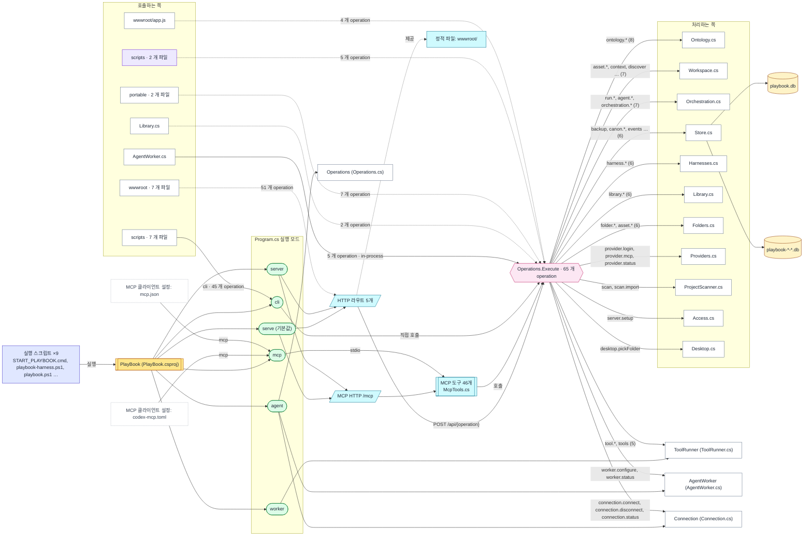

# 인수인계: PlayBookOS

HandOff247 0.1.0이 2026-11-09에 https://github.com/unkkyuist/PlayBookOS@7153e47 기준으로 생성했습니다. 이 페이지를 직접 고치지 말고 노트 파일을 고친 뒤 다시 생성하세요.

> 읽는 법: '노트' 표시가 없는 내용은 모두 코드에서 찾은 것이며 근거 줄로 연결됩니다. 노트는 사람이 `examples/playbookos.notes.ko.md`에 쓴 설명입니다. 점선 화살표는 추론이므로 믿기 전에 확인하세요.

## 한눈에 보기

| 파일 | 줄 | 언어 | 실행 모드 | operation | HTTP 라우트 | MCP 도구 | 환경변수 |
|---|---|---|---|---|---|---|---|
| 97 | 9,665 | 8 | 6 | 65 | 6 | 46 | 8 |

Python 20 (3,559 줄) · C# 18 (2,740 줄) · JavaScript 11 (1,283 줄) · PowerShell 7 (194 줄) · Batch 5 (17 줄) · HTML 2 (41 줄) · Shell 1 (9 줄) · CSS 1 (47 줄)

## 이 프로젝트는

> **노트**
>
> PlayBook OS는 프로젝트·레퍼런스·AI 작업을 함께 기록하는 공통 원장입니다. 웹 화면, JSON CLI, MCP(stdio/HTTP)가 모두 같은 operation과 같은 SQLite DB를 씁니다 (README.md).
> 사용자별 권한이나 테넌트 분리가 없는, 소유자가 신뢰하는 작업 공간용 서비스입니다 (README.en.md "Verification and scope").

[README.en.md](https://github.com/unkkyuist/PlayBookOS/blob/7153e47ec28a0b1933c24404db08a43a468b6c14/README.en.md)에서 발췌: *Manage projects, shared references and AI work through one revisioned ledger.*

## 전체 구조도

실행 스크립트가 프로그램을 띄우고, 모드마다 열리는 인터페이스가 다릅니다. 호출은 모두 분기표(dispatch table)로 모이고, 분기표가 처리 파일로 일을 넘깁니다.

Mermaid 원문: diagrams/system.mmd

## 페이지

- [RUNNING.md](RUNNING.md) — 실행 방법 — 실행 순서, 모드, 환경변수, 포트, 빌드·테스트
- [CONNECTIONS.md](CONNECTIONS.md) — 도구 연결 — operation, HTTP 라우트, MCP 도구, 호출하는 쪽
- [CODEMAP.md](CODEMAP.md) — 코드 지도 — 파일 간 의존 관계
- [FILES.md](FILES.md) — 파일 카드 — 파일마다 설명·심볼·연결
- [index.html](index.html) — 대화형 보기 (index.html을 브라우저로 열기)

## 추천 읽기 순서

1. [README.en.md](https://github.com/unkkyuist/PlayBookOS/blob/7153e47ec28a0b1933c24404db08a43a468b6c14/README.en.md) — **프로젝트 소개 문서**
2. [Program.cs](https://github.com/unkkyuist/PlayBookOS/blob/7153e47ec28a0b1933c24404db08a43a468b6c14/Program.cs) — **진입점, 실행 모드를 고름**
3. [Operations.cs](https://github.com/unkkyuist/PlayBookOS/blob/7153e47ec28a0b1933c24404db08a43a468b6c14/Operations.cs) — **분기표: operation 65개**
4. [START_PLAYBOOK.cmd](https://github.com/unkkyuist/PlayBookOS/blob/7153e47ec28a0b1933c24404db08a43a468b6c14/START_PLAYBOOK.cmd) — **사람이 실행하는 스크립트**
5. [playbook-harness.ps1](https://github.com/unkkyuist/PlayBookOS/blob/7153e47ec28a0b1933c24404db08a43a468b6c14/playbook-harness.ps1) — **사람이 실행하는 스크립트**
6. [Domain.cs](https://github.com/unkkyuist/PlayBookOS/blob/7153e47ec28a0b1933c24404db08a43a468b6c14/Domain.cs) — **17개 파일이 쓰는 공통 기반**
7. [Store.cs](https://github.com/unkkyuist/PlayBookOS/blob/7153e47ec28a0b1933c24404db08a43a468b6c14/Store.cs) — **12개 파일이 쓰는 공통 기반**
8. [wwwroot/i18n.js](https://github.com/unkkyuist/PlayBookOS/blob/7153e47ec28a0b1933c24404db08a43a468b6c14/wwwroot/i18n.js) — **10개 파일이 쓰는 공통 기반**
9. [McpTools.cs](https://github.com/unkkyuist/PlayBookOS/blob/7153e47ec28a0b1933c24404db08a43a468b6c14/McpTools.cs) — **MCP 도구 정의**
10. [Ontology.cs](https://github.com/unkkyuist/PlayBookOS/blob/7153e47ec28a0b1933c24404db08a43a468b6c14/Ontology.cs) — **operation 8개 처리**
11. [Workspace.cs](https://github.com/unkkyuist/PlayBookOS/blob/7153e47ec28a0b1933c24404db08a43a468b6c14/Workspace.cs) — **operation 7개 처리**
12. [Orchestration.cs](https://github.com/unkkyuist/PlayBookOS/blob/7153e47ec28a0b1933c24404db08a43a468b6c14/Orchestration.cs) — **operation 7개 처리**

## 후임자 체크리스트

> **노트**
>
> 1. .NET 10 SDK를 설치하고 `dotnet build -c Release` 뒤 `.\playbook.ps1 serve`로 띄운 다음 http://127.0.0.1:7331 을 엽니다.
> 2. GUI·CLI·MCP 모두 같은 `PLAYBOOK_HOME`을 가리켜야 합니다. 다르면 각자 다른 DB를 봅니다.
> 3. 비즈니스 로직을 바꾸면 `python scripts/smoke.py`를 돌립니다 (릴리스 전에는 folders·ontology·central 스모크도).
> 4. 이 프로젝트의 작업은 PlayBook 안의 프로젝트 ID `playbook`으로 기록합니다 (AGENTS.md).

## 알려진 문제와 위험

> **노트**
>
> - 모든 변경은 `expectedRevision`을 보내야 합니다. 충돌하면 무작정 다시 보내지 말고 최신 기록을 읽어 합칩니다 (README.md).
> - macOS 실행은 검증되지 않았습니다. 크로스 빌드만으로는 근거가 되지 않습니다 (AGENTS.md).
> - v0.2.0에서 Claude 실제 모델 실행은 검증되지 않았습니다. docs/RELEASE-0.2.0.md를 보세요.

## 인증 정보와 계정

> **노트**
>
> HTTP·MCP 키는 `PLAYBOOK_HOME/api-key`에 있습니다 (`serve`를 처음 실행할 때 만들어짐). `data/`, 도구 인증 정보, 로그, API 키는 커밋하지 않습니다 (AGENTS.md).

## 아직 설명이 없는 곳

`examples/playbookos.notes.ko.md`에 적어 주세요 (`handoff247 notes`를 실행하면 제목이 추가됩니다).

- [Program.cs](https://github.com/unkkyuist/PlayBookOS/blob/7153e47ec28a0b1933c24404db08a43a468b6c14/Program.cs)
- [START_PLAYBOOK.cmd](https://github.com/unkkyuist/PlayBookOS/blob/7153e47ec28a0b1933c24404db08a43a468b6c14/START_PLAYBOOK.cmd)
- [playbook-harness.ps1](https://github.com/unkkyuist/PlayBookOS/blob/7153e47ec28a0b1933c24404db08a43a468b6c14/playbook-harness.ps1)
- [Domain.cs](https://github.com/unkkyuist/PlayBookOS/blob/7153e47ec28a0b1933c24404db08a43a468b6c14/Domain.cs)
- [wwwroot/i18n.js](https://github.com/unkkyuist/PlayBookOS/blob/7153e47ec28a0b1933c24404db08a43a468b6c14/wwwroot/i18n.js)
- [McpTools.cs](https://github.com/unkkyuist/PlayBookOS/blob/7153e47ec28a0b1933c24404db08a43a468b6c14/McpTools.cs)
- [Ontology.cs](https://github.com/unkkyuist/PlayBookOS/blob/7153e47ec28a0b1933c24404db08a43a468b6c14/Ontology.cs)
- [Workspace.cs](https://github.com/unkkyuist/PlayBookOS/blob/7153e47ec28a0b1933c24404db08a43a468b6c14/Workspace.cs)
- [Orchestration.cs](https://github.com/unkkyuist/PlayBookOS/blob/7153e47ec28a0b1933c24404db08a43a468b6c14/Orchestration.cs)
- [Harnesses.cs](https://github.com/unkkyuist/PlayBookOS/blob/7153e47ec28a0b1933c24404db08a43a468b6c14/Harnesses.cs)
- [START_GRAPHIFY.cmd](https://github.com/unkkyuist/PlayBookOS/blob/7153e47ec28a0b1933c24404db08a43a468b6c14/START_GRAPHIFY.cmd)
- [Start-PlayBook-Desktop.ps1](https://github.com/unkkyuist/PlayBookOS/blob/7153e47ec28a0b1933c24404db08a43a468b6c14/Start-PlayBook-Desktop.ps1)
- [graphify.ps1](https://github.com/unkkyuist/PlayBookOS/blob/7153e47ec28a0b1933c24404db08a43a468b6c14/graphify.ps1)
- [playbook.ps1](https://github.com/unkkyuist/PlayBookOS/blob/7153e47ec28a0b1933c24404db08a43a468b6c14/playbook.ps1)
- [playbook.sh](https://github.com/unkkyuist/PlayBookOS/blob/7153e47ec28a0b1933c24404db08a43a468b6c14/playbook.sh)
- [portable/INSTALL_PLAYBOOK.cmd](https://github.com/unkkyuist/PlayBookOS/blob/7153e47ec28a0b1933c24404db08a43a468b6c14/portable/INSTALL_PLAYBOOK.cmd)
- [portable/Install-PlayBook.ps1](https://github.com/unkkyuist/PlayBookOS/blob/7153e47ec28a0b1933c24404db08a43a468b6c14/portable/Install-PlayBook.ps1)
- [portable/START_PLAYBOOK.cmd](https://github.com/unkkyuist/PlayBookOS/blob/7153e47ec28a0b1933c24404db08a43a468b6c14/portable/START_PLAYBOOK.cmd)
- [portable/STOP_PLAYBOOK.cmd](https://github.com/unkkyuist/PlayBookOS/blob/7153e47ec28a0b1933c24404db08a43a468b6c14/portable/STOP_PLAYBOOK.cmd)
- [portable/Start-PlayBook.ps1](https://github.com/unkkyuist/PlayBookOS/blob/7153e47ec28a0b1933c24404db08a43a468b6c14/portable/Start-PlayBook.ps1)

## 최근 커밋

- `7153e47` 2026-11-07 — Add project flowchart panel, curated Graphify specs and desktop launcher
- `f0a2812` 2026-10-29 — Add reviewed AI guidance workflow with paired trials
- `7813ce7` 2026-10-18 — Add reliable MCP audit logs and Oz support bundles
- `ca98380` 2026-10-18 — Add Graphify integration and Oz macOS Claude Code distribution
- `ec10b93` 2026-10-07 — Release PlayBook OS 0.2.0 with portable workspace and AI orchestration

