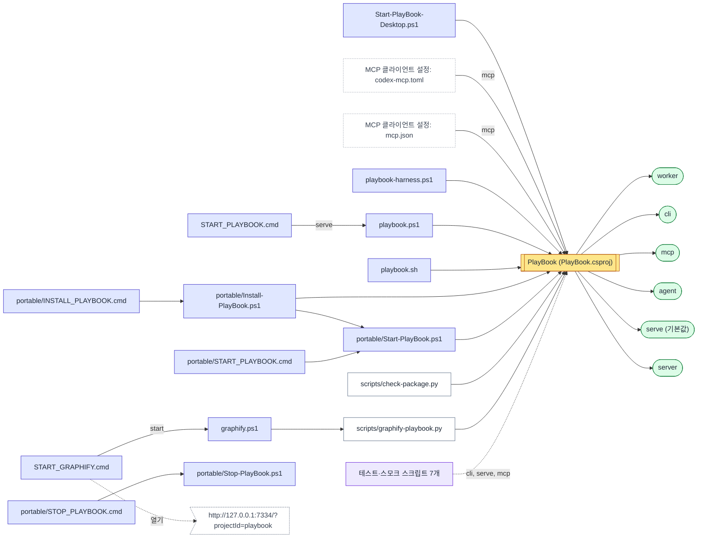

# 실행 방법과 실행 구조

HandOff247 0.1.0이 2026-11-09에 https://github.com/unkkyuist/PlayBookOS@7153e47 기준으로 생성했습니다. 이 페이지를 직접 고치지 말고 노트 파일을 고친 뒤 다시 생성하세요.

[← 처음으로](README.md)

## 실행 순서

누가 누구를 실행하는지. 화살표 글자는 그 줄에서 넘기는 인자입니다.

Mermaid 원문: diagrams/startup.mmd

## 실행 모드

[Program.cs](https://github.com/unkkyuist/PlayBookOS/blob/7153e47ec28a0b1933c24404db08a43a468b6c14/Program.cs)은 첫 번째 인자(`mode`)로 모드를 고릅니다.

| 모드 | 위치 | 사용 | 여는 것 | 노트 |
|---|---|---|---|---|
| `worker` | [Program.cs:19–19](https://github.com/unkkyuist/PlayBookOS/blob/7153e47ec28a0b1933c24404db08a43a468b6c14/Program.cs#L19) | ToolRunner |  |  |
| `cli` | [Program.cs:20–32](https://github.com/unkkyuist/PlayBookOS/blob/7153e47ec28a0b1933c24404db08a43a468b6c14/Program.cs#L20) | Json, Operations | → Operations.Execute | 프로세스 하나에 operation 하나: `PlayBook.dll cli <operation> <JSON \| @파일 \| ->`. 오류는 stderr에 JSON으로 나오고 종료 코드는 1입니다. |
| `mcp` | [Program.cs:33–40](https://github.com/unkkyuist/PlayBookOS/blob/7153e47ec28a0b1933c24404db08a43a468b6c14/Program.cs#L33) | McpTools | MCP over stdio |  |
| `agent` | [Program.cs:41–48](https://github.com/unkkyuist/PlayBookOS/blob/7153e47ec28a0b1933c24404db08a43a468b6c14/Program.cs#L41) | AgentWorker, Connection, Operations | background service |  |
| `serve` (기본값) | [Program.cs:49–112](https://github.com/unkkyuist/PlayBookOS/blob/7153e47ec28a0b1933c24404db08a43a468b6c14/Program.cs#L49) | Access, AgentWorker, Connection, DomainError, Json, Library … 외 4개 | MCP over HTTP, HTTP server, background service, HTTP 라우트 6개, → Operations.Execute | 평소에 쓰는 모드입니다. 웹 화면, `/api/{operation}`, `/mcp`의 HTTP MCP, 로컬 AI 워커가 함께 뜹니다. |
| `server` | [Program.cs:49–112](https://github.com/unkkyuist/PlayBookOS/blob/7153e47ec28a0b1933c24404db08a43a468b6c14/Program.cs#L49) | Access, AgentWorker, Connection, DomainError, Json, Library … 외 4개 | MCP over HTTP, HTTP server, background service, HTTP 라우트 6개, → Operations.Execute | 여러 PC가 함께 쓰는 중앙 서버입니다. 별도의 `PLAYBOOK_HOME`이 필요하고, 먼저 `cli server.setup`으로 계정을 만들어야 합니다. |

## 실행 명령

| 위치 | 명령 | 실행 |
|---|---|---|
| [START_GRAPHIFY.cmd:3](https://github.com/unkkyuist/PlayBookOS/blob/7153e47ec28a0b1933c24404db08a43a468b6c14/START_GRAPHIFY.cmd#L3) | `powershell -NoProfile -ExecutionPolicy Bypass -File "%~dp0graphify.ps1" start` | [graphify.ps1](https://github.com/unkkyuist/PlayBookOS/blob/7153e47ec28a0b1933c24404db08a43a468b6c14/graphify.ps1) → `start` |
| [START_GRAPHIFY.cmd:5](https://github.com/unkkyuist/PlayBookOS/blob/7153e47ec28a0b1933c24404db08a43a468b6c14/START_GRAPHIFY.cmd#L5) | `start "" "http://127.0.0.1:7334/?projectId=playbook"` |  |
| [START_PLAYBOOK.cmd:3](https://github.com/unkkyuist/PlayBookOS/blob/7153e47ec28a0b1933c24404db08a43a468b6c14/START_PLAYBOOK.cmd#L3) | `powershell -NoProfile -ExecutionPolicy Bypass -File "%~dp0playbook.ps1" serve` | [playbook.ps1](https://github.com/unkkyuist/PlayBookOS/blob/7153e47ec28a0b1933c24404db08a43a468b6c14/playbook.ps1) → `serve` |
| [Start-PlayBook-Desktop.ps1:34](https://github.com/unkkyuist/PlayBookOS/blob/7153e47ec28a0b1933c24404db08a43a468b6c14/Start-PlayBook-Desktop.ps1#L34) | `Start-Process $url }` |  |
| [graphify.ps1:5](https://github.com/unkkyuist/PlayBookOS/blob/7153e47ec28a0b1933c24404db08a43a468b6c14/graphify.ps1#L5) | `python (Join-Path $PSScriptRoot 'scripts\graphify-playbook.py') @Arguments` | [scripts/graphify-playbook.py](https://github.com/unkkyuist/PlayBookOS/blob/7153e47ec28a0b1933c24404db08a43a468b6c14/scripts/graphify-playbook.py) |
| [playbook-harness.ps1:12](https://github.com/unkkyuist/PlayBookOS/blob/7153e47ec28a0b1933c24404db08a43a468b6c14/playbook-harness.ps1#L12) | `dotnet $harnessDll @Arguments` |  |
| [playbook.ps1:10](https://github.com/unkkyuist/PlayBookOS/blob/7153e47ec28a0b1933c24404db08a43a468b6c14/playbook.ps1#L10) | `dotnet $appDll @Arguments` |  |
| [playbook.sh:9](https://github.com/unkkyuist/PlayBookOS/blob/7153e47ec28a0b1933c24404db08a43a468b6c14/playbook.sh#L9) | `exec dotnet "$root/bin/Release/net10.0/PlayBook.dll" "$@"` | [PlayBook.csproj](https://github.com/unkkyuist/PlayBookOS/blob/7153e47ec28a0b1933c24404db08a43a468b6c14/PlayBook.csproj) |
| [portable/INSTALL_PLAYBOOK.cmd:2](https://github.com/unkkyuist/PlayBookOS/blob/7153e47ec28a0b1933c24404db08a43a468b6c14/portable/INSTALL_PLAYBOOK.cmd#L2) | `powershell.exe -NoProfile -STA -ExecutionPolicy Bypass -File "%~dp0Install-PlayBook.ps1" %*` | [portable/Install-PlayBook.ps1](https://github.com/unkkyuist/PlayBookOS/blob/7153e47ec28a0b1933c24404db08a43a468b6c14/portable/Install-PlayBook.ps1) |
| [portable/Install-PlayBook.ps1:67](https://github.com/unkkyuist/PlayBookOS/blob/7153e47ec28a0b1933c24404db08a43a468b6c14/portable/Install-PlayBook.ps1#L67) | `& $exe cli connection.configure ('@' + $requestPath)` |  |
| [portable/Install-PlayBook.ps1:81](https://github.com/unkkyuist/PlayBookOS/blob/7153e47ec28a0b1933c24404db08a43a468b6c14/portable/Install-PlayBook.ps1#L81) | `& (Join-Path $target 'Start-PlayBook.ps1') }` | [portable/Start-PlayBook.ps1](https://github.com/unkkyuist/PlayBookOS/blob/7153e47ec28a0b1933c24404db08a43a468b6c14/portable/Start-PlayBook.ps1) |
| [portable/START_PLAYBOOK.cmd:2](https://github.com/unkkyuist/PlayBookOS/blob/7153e47ec28a0b1933c24404db08a43a468b6c14/portable/START_PLAYBOOK.cmd#L2) | `powershell.exe -NoProfile -ExecutionPolicy Bypass -File "%~dp0Start-PlayBook.ps1" %*` | [portable/Start-PlayBook.ps1](https://github.com/unkkyuist/PlayBookOS/blob/7153e47ec28a0b1933c24404db08a43a468b6c14/portable/Start-PlayBook.ps1) |
| [portable/STOP_PLAYBOOK.cmd:2](https://github.com/unkkyuist/PlayBookOS/blob/7153e47ec28a0b1933c24404db08a43a468b6c14/portable/STOP_PLAYBOOK.cmd#L2) | `powershell.exe -NoProfile -ExecutionPolicy Bypass -File "%~dp0Stop-PlayBook.ps1"` | [portable/Stop-PlayBook.ps1](https://github.com/unkkyuist/PlayBookOS/blob/7153e47ec28a0b1933c24404db08a43a468b6c14/portable/Stop-PlayBook.ps1) |
| [portable/Start-PlayBook.ps1:40](https://github.com/unkkyuist/PlayBookOS/blob/7153e47ec28a0b1933c24404db08a43a468b6c14/portable/Start-PlayBook.ps1#L40) | `Start-Process $url }` |  |

## 환경변수

읽기 = 코드가 값을 읽는 곳, 설정 = 스크립트·런처가 실행 전에 값을 넣는 곳.

| 이름 | 읽는 곳 | 설정하는 곳 |
|---|---|---|
| `CLAUDE_CONFIG_DIR` | [portable/oz/install.py:387](https://github.com/unkkyuist/PlayBookOS/blob/7153e47ec28a0b1933c24404db08a43a468b6c14/portable/oz/install.py#L387), [portable/oz/install.py:386](https://github.com/unkkyuist/PlayBookOS/blob/7153e47ec28a0b1933c24404db08a43a468b6c14/portable/oz/install.py#L386), [portable/oz/install.py:388](https://github.com/unkkyuist/PlayBookOS/blob/7153e47ec28a0b1933c24404db08a43a468b6c14/portable/oz/install.py#L388) |  |
| `PLAYBOOK_BIND` | [Program.cs:58](https://github.com/unkkyuist/PlayBookOS/blob/7153e47ec28a0b1933c24404db08a43a468b6c14/Program.cs#L58) (`127.0.0.1`) |  |
| `PLAYBOOK_HOME` | [Program.cs:6](https://github.com/unkkyuist/PlayBookOS/blob/7153e47ec28a0b1933c24404db08a43a468b6c14/Program.cs#L6), [Start-PlayBook-Desktop.ps1:19](https://github.com/unkkyuist/PlayBookOS/blob/7153e47ec28a0b1933c24404db08a43a468b6c14/Start-PlayBook-Desktop.ps1#L19), [graphify.ps1:3](https://github.com/unkkyuist/PlayBookOS/blob/7153e47ec28a0b1933c24404db08a43a468b6c14/graphify.ps1#L3), [playbook-harness.ps1:3](https://github.com/unkkyuist/PlayBookOS/blob/7153e47ec28a0b1933c24404db08a43a468b6c14/playbook-harness.ps1#L3) … 외 7개 | [Providers.cs:120](https://github.com/unkkyuist/PlayBookOS/blob/7153e47ec28a0b1933c24404db08a43a468b6c14/Providers.cs#L120), [Start-PlayBook-Desktop.ps1:21](https://github.com/unkkyuist/PlayBookOS/blob/7153e47ec28a0b1933c24404db08a43a468b6c14/Start-PlayBook-Desktop.ps1#L21) = `$DataHome`, [Start-PlayBook-Desktop.ps1:25](https://github.com/unkkyuist/PlayBookOS/blob/7153e47ec28a0b1933c24404db08a43a468b6c14/Start-PlayBook-Desktop.ps1#L25) = `$previousHome`, [graphify.ps1:3](https://github.com/unkkyuist/PlayBookOS/blob/7153e47ec28a0b1933c24404db08a43a468b6c14/graphify.ps1#L3) = `Join-Path $PSScriptRoot` … 외 11개 |
| `PLAYBOOK_PORT` | [Program.cs:57](https://github.com/unkkyuist/PlayBookOS/blob/7153e47ec28a0b1933c24404db08a43a468b6c14/Program.cs#L57) (`7331`), [Start-PlayBook-Desktop.ps1:19](https://github.com/unkkyuist/PlayBookOS/blob/7153e47ec28a0b1933c24404db08a43a468b6c14/Start-PlayBook-Desktop.ps1#L19), [playbook-harness.ps1:4](https://github.com/unkkyuist/PlayBookOS/blob/7153e47ec28a0b1933c24404db08a43a468b6c14/playbook-harness.ps1#L4), [portable/Start-PlayBook.ps1:25](https://github.com/unkkyuist/PlayBookOS/blob/7153e47ec28a0b1933c24404db08a43a468b6c14/portable/Start-PlayBook.ps1#L25) | [Start-PlayBook-Desktop.ps1:21](https://github.com/unkkyuist/PlayBookOS/blob/7153e47ec28a0b1933c24404db08a43a468b6c14/Start-PlayBook-Desktop.ps1#L21) = `[string]$port`, [Start-PlayBook-Desktop.ps1:25](https://github.com/unkkyuist/PlayBookOS/blob/7153e47ec28a0b1933c24404db08a43a468b6c14/Start-PlayBook-Desktop.ps1#L25) = `$previousPort`, [playbook-harness.ps1:4](https://github.com/unkkyuist/PlayBookOS/blob/7153e47ec28a0b1933c24404db08a43a468b6c14/playbook-harness.ps1#L4) = `7335`, [portable/Start-PlayBook.ps1:27](https://github.com/unkkyuist/PlayBookOS/blob/7153e47ec28a0b1933c24404db08a43a468b6c14/portable/Start-PlayBook.ps1#L27) = `[string]$selectedPort` … 외 2개 |
| `PLAYBOOK_PUBLIC_URL` | [Program.cs:74](https://github.com/unkkyuist/PlayBookOS/blob/7153e47ec28a0b1933c24404db08a43a468b6c14/Program.cs#L74) |  |
| `PLAYBOOK_RUN_ID` | [Harnesses.cs:170](https://github.com/unkkyuist/PlayBookOS/blob/7153e47ec28a0b1933c24404db08a43a468b6c14/Harnesses.cs#L170), [Operations.cs:13](https://github.com/unkkyuist/PlayBookOS/blob/7153e47ec28a0b1933c24404db08a43a468b6c14/Operations.cs#L13), [Operations.cs:109](https://github.com/unkkyuist/PlayBookOS/blob/7153e47ec28a0b1933c24404db08a43a468b6c14/Operations.cs#L109) | [Providers.cs:121](https://github.com/unkkyuist/PlayBookOS/blob/7153e47ec28a0b1933c24404db08a43a468b6c14/Providers.cs#L121) |
| `PLAYBOOK_TEST_DLL` | [scripts/central-smoke.py:20](https://github.com/unkkyuist/PlayBookOS/blob/7153e47ec28a0b1933c24404db08a43a468b6c14/scripts/central-smoke.py#L20), [scripts/folders-smoke.py:9](https://github.com/unkkyuist/PlayBookOS/blob/7153e47ec28a0b1933c24404db08a43a468b6c14/scripts/folders-smoke.py#L9), [scripts/harness-smoke.py:20](https://github.com/unkkyuist/PlayBookOS/blob/7153e47ec28a0b1933c24404db08a43a468b6c14/scripts/harness-smoke.py#L20), [scripts/ontology-smoke.py:25](https://github.com/unkkyuist/PlayBookOS/blob/7153e47ec28a0b1933c24404db08a43a468b6c14/scripts/ontology-smoke.py#L25) … 외 2개 |  |
| `PYTHONIOENCODING` |  | [graphify.ps1:4](https://github.com/unkkyuist/PlayBookOS/blob/7153e47ec28a0b1933c24404db08a43a468b6c14/graphify.ps1#L4) = `utf-8` |
| `LOCALAPPDATA` (시스템) | [portable/Install-PlayBook.ps1:18](https://github.com/unkkyuist/PlayBookOS/blob/7153e47ec28a0b1933c24404db08a43a468b6c14/portable/Install-PlayBook.ps1#L18) |  |
| `PATH` (시스템) | [Providers.cs:18](https://github.com/unkkyuist/PlayBookOS/blob/7153e47ec28a0b1933c24404db08a43a468b6c14/Providers.cs#L18), [Providers.cs:25](https://github.com/unkkyuist/PlayBookOS/blob/7153e47ec28a0b1933c24404db08a43a468b6c14/Providers.cs#L25) |  |
| `ProgramFiles` (시스템) | [scripts/package-oz-mac.py:128](https://github.com/unkkyuist/PlayBookOS/blob/7153e47ec28a0b1933c24404db08a43a468b6c14/scripts/package-oz-mac.py#L128) |  |

## 포트와 주소

| 포트 | 위치 | 근거 |
|---|---|---|
| `5072` | [Properties/launchSettings.json:2](https://github.com/unkkyuist/PlayBookOS/blob/7153e47ec28a0b1933c24404db08a43a468b6c14/Properties/launchSettings.json#L2) | listen address |
| `7165` | [Properties/launchSettings.json:2](https://github.com/unkkyuist/PlayBookOS/blob/7153e47ec28a0b1933c24404db08a43a468b6c14/Properties/launchSettings.json#L2) | listen address |
| `7331` | [Program.cs:57](https://github.com/unkkyuist/PlayBookOS/blob/7153e47ec28a0b1933c24404db08a43a468b6c14/Program.cs#L57) | PLAYBOOK_PORT default |
| `7331` | [scripts/graphify-playbook.py:297](https://github.com/unkkyuist/PlayBookOS/blob/7153e47ec28a0b1933c24404db08a43a468b6c14/scripts/graphify-playbook.py#L297) | address literal |
| `7334` | [START_GRAPHIFY.cmd:5](https://github.com/unkkyuist/PlayBookOS/blob/7153e47ec28a0b1933c24404db08a43a468b6c14/START_GRAPHIFY.cmd#L5) | address literal |
| `7335` | [playbook-harness.ps1:4](https://github.com/unkkyuist/PlayBookOS/blob/7153e47ec28a0b1933c24404db08a43a468b6c14/playbook-harness.ps1#L4) | PLAYBOOK_PORT set |

## 코드가 경로를 만드는 파일·폴더

Path.Combine / os.path.join / Join-Path에 들어간 글자 그대로의 부분입니다. 실행 중 데이터·로그·설정이 놓이는 곳입니다.

| 경로 | 위치 |
|---|---|
| `$stamp-server-error.log` | [Start-PlayBook-Desktop.ps1:23](https://github.com/unkkyuist/PlayBookOS/blob/7153e47ec28a0b1933c24404db08a43a468b6c14/Start-PlayBook-Desktop.ps1#L23), [portable/Start-PlayBook.ps1:29](https://github.com/unkkyuist/PlayBookOS/blob/7153e47ec28a0b1933c24404db08a43a468b6c14/portable/Start-PlayBook.ps1#L29) |
| `$stamp-server.log` | [Start-PlayBook-Desktop.ps1:23](https://github.com/unkkyuist/PlayBookOS/blob/7153e47ec28a0b1933c24404db08a43a468b6c14/Start-PlayBook-Desktop.ps1#L23), [portable/Start-PlayBook.ps1:29](https://github.com/unkkyuist/PlayBookOS/blob/7153e47ec28a0b1933c24404db08a43a468b6c14/portable/Start-PlayBook.ps1#L29) |
| `Assets` | [ProjectScanner.cs:33](https://github.com/unkkyuist/PlayBookOS/blob/7153e47ec28a0b1933c24404db08a43a468b6c14/ProjectScanner.cs#L33) |
| `PLAYBOOK.md` | [Workspace.cs:249](https://github.com/unkkyuist/PlayBookOS/blob/7153e47ec28a0b1933c24404db08a43a468b6c14/Workspace.cs#L249), [scripts/smoke.py:82](https://github.com/unkkyuist/PlayBookOS/blob/7153e47ec28a0b1933c24404db08a43a468b6c14/scripts/smoke.py#L82) |
| `PlayBook OS.lnk` | [portable/Install-PlayBook.ps1:73](https://github.com/unkkyuist/PlayBookOS/blob/7153e47ec28a0b1933c24404db08a43a468b6c14/portable/Install-PlayBook.ps1#L73) |
| `PlayBook.csproj` | [Start-PlayBook-Desktop.ps1:11](https://github.com/unkkyuist/PlayBookOS/blob/7153e47ec28a0b1933c24404db08a43a468b6c14/Start-PlayBook-Desktop.ps1#L11), [playbook-harness.ps1:8](https://github.com/unkkyuist/PlayBookOS/blob/7153e47ec28a0b1933c24404db08a43a468b6c14/playbook-harness.ps1#L8), [playbook.ps1:6](https://github.com/unkkyuist/PlayBookOS/blob/7153e47ec28a0b1933c24404db08a43a468b6c14/playbook.ps1#L6) |
| `PlayBook.dll` | [playbook-harness.ps1:6](https://github.com/unkkyuist/PlayBookOS/blob/7153e47ec28a0b1933c24404db08a43a468b6c14/playbook-harness.ps1#L6) |
| `PlayBook.exe` | [portable/Install-PlayBook.ps1:59](https://github.com/unkkyuist/PlayBookOS/blob/7153e47ec28a0b1933c24404db08a43a468b6c14/portable/Install-PlayBook.ps1#L59), [portable/Start-PlayBook.ps1:6](https://github.com/unkkyuist/PlayBookOS/blob/7153e47ec28a0b1933c24404db08a43a468b6c14/portable/Start-PlayBook.ps1#L6) |
| `PlayBookOS` | [portable/Install-PlayBook.ps1:18](https://github.com/unkkyuist/PlayBookOS/blob/7153e47ec28a0b1933c24404db08a43a468b6c14/portable/Install-PlayBook.ps1#L18) |
| `Programs` | [portable/Install-PlayBook.ps1:18](https://github.com/unkkyuist/PlayBookOS/blob/7153e47ec28a0b1933c24404db08a43a468b6c14/portable/Install-PlayBook.ps1#L18) |
| `ProjectSettings` | [ProjectScanner.cs:33](https://github.com/unkkyuist/PlayBookOS/blob/7153e47ec28a0b1933c24404db08a43a468b6c14/ProjectScanner.cs#L33), [ProjectScanner.cs:65](https://github.com/unkkyuist/PlayBookOS/blob/7153e47ec28a0b1933c24404db08a43a468b6c14/ProjectScanner.cs#L65) |
| `Start-PlayBook.ps1` | [portable/Install-PlayBook.ps1:75](https://github.com/unkkyuist/PlayBookOS/blob/7153e47ec28a0b1933c24404db08a43a468b6c14/portable/Install-PlayBook.ps1#L75), [portable/Install-PlayBook.ps1:81](https://github.com/unkkyuist/PlayBookOS/blob/7153e47ec28a0b1933c24404db08a43a468b6c14/portable/Install-PlayBook.ps1#L81) |
| `agent-runs` | [AgentWorker.cs:67](https://github.com/unkkyuist/PlayBookOS/blob/7153e47ec28a0b1933c24404db08a43a468b6c14/AgentWorker.cs#L67), [AgentWorker.cs:81](https://github.com/unkkyuist/PlayBookOS/blob/7153e47ec28a0b1933c24404db08a43a468b6c14/AgentWorker.cs#L81) |
| `api-key` | [Program.cs:64](https://github.com/unkkyuist/PlayBookOS/blob/7153e47ec28a0b1933c24404db08a43a468b6c14/Program.cs#L64) |
| `artifacts/harness-runtime` | [playbook-harness.ps1:5](https://github.com/unkkyuist/PlayBookOS/blob/7153e47ec28a0b1933c24404db08a43a468b6c14/playbook-harness.ps1#L5) |
| `assets / shared` | [Workspace.cs:86](https://github.com/unkkyuist/PlayBookOS/blob/7153e47ec28a0b1933c24404db08a43a468b6c14/Workspace.cs#L86) |
| `backups` | [Store.cs:178](https://github.com/unkkyuist/PlayBookOS/blob/7153e47ec28a0b1933c24404db08a43a468b6c14/Store.cs#L178) |
| `bin` | [Providers.cs:35](https://github.com/unkkyuist/PlayBookOS/blob/7153e47ec28a0b1933c24404db08a43a468b6c14/Providers.cs#L35) |
| `bin\Release\net10.0\PlayBook.dll` | [playbook.ps1:4](https://github.com/unkkyuist/PlayBookOS/blob/7153e47ec28a0b1933c24404db08a43a468b6c14/playbook.ps1#L4) |
| `bin\Release\net10.0\PlayBook.exe` | [Start-PlayBook-Desktop.ps1:6](https://github.com/unkkyuist/PlayBookOS/blob/7153e47ec28a0b1933c24404db08a43a468b6c14/Start-PlayBook-Desktop.ps1#L6) |
| `client.json` | [Connection.cs:19](https://github.com/unkkyuist/PlayBookOS/blob/7153e47ec28a0b1933c24404db08a43a468b6c14/Connection.cs#L19) |
| `context.json` | [Workspace.cs:248](https://github.com/unkkyuist/PlayBookOS/blob/7153e47ec28a0b1933c24404db08a43a468b6c14/Workspace.cs#L248), [scripts/smoke.py:82](https://github.com/unkkyuist/PlayBookOS/blob/7153e47ec28a0b1933c24404db08a43a468b6c14/scripts/smoke.py#L82) |
| `data` | [Program.cs:6](https://github.com/unkkyuist/PlayBookOS/blob/7153e47ec28a0b1933c24404db08a43a468b6c14/Program.cs#L6), [Start-PlayBook-Desktop.ps1:5](https://github.com/unkkyuist/PlayBookOS/blob/7153e47ec28a0b1933c24404db08a43a468b6c14/Start-PlayBook-Desktop.ps1#L5), [graphify.ps1:3](https://github.com/unkkyuist/PlayBookOS/blob/7153e47ec28a0b1933c24404db08a43a468b6c14/graphify.ps1#L3) … 외 5개 |
| `data\desktop-process.json` | [portable/Install-PlayBook.ps1:30](https://github.com/unkkyuist/PlayBookOS/blob/7153e47ec28a0b1933c24404db08a43a468b6c14/portable/Install-PlayBook.ps1#L30) |
| `desktop-process.json` | [Start-PlayBook-Desktop.ps1:24](https://github.com/unkkyuist/PlayBookOS/blob/7153e47ec28a0b1933c24404db08a43a468b6c14/Start-PlayBook-Desktop.ps1#L24), [portable/Start-PlayBook.ps1:30](https://github.com/unkkyuist/PlayBookOS/blob/7153e47ec28a0b1933c24404db08a43a468b6c14/portable/Start-PlayBook.ps1#L30), [portable/Stop-PlayBook.ps1:3](https://github.com/unkkyuist/PlayBookOS/blob/7153e47ec28a0b1933c24404db08a43a468b6c14/portable/Stop-PlayBook.ps1#L3) |
| `events.jsonl` | [AgentWorker.cs:82](https://github.com/unkkyuist/PlayBookOS/blob/7153e47ec28a0b1933c24404db08a43a468b6c14/AgentWorker.cs#L82) |
| `exports` | [Workspace.cs:217](https://github.com/unkkyuist/PlayBookOS/blob/7153e47ec28a0b1933c24404db08a43a468b6c14/Workspace.cs#L217) |
| `folder-plans` | [Folders.cs:26](https://github.com/unkkyuist/PlayBookOS/blob/7153e47ec28a0b1933c24404db08a43a468b6c14/Folders.cs#L26) |
| `handoff-error.txt` | [AgentWorker.cs:179](https://github.com/unkkyuist/PlayBookOS/blob/7153e47ec28a0b1933c24404db08a43a468b6c14/AgentWorker.cs#L179) |
| `install-manifest.json` | [portable/Install-PlayBook.ps1:27](https://github.com/unkkyuist/PlayBookOS/blob/7153e47ec28a0b1933c24404db08a43a468b6c14/portable/Install-PlayBook.ps1#L27), [portable/Install-PlayBook.ps1:58](https://github.com/unkkyuist/PlayBookOS/blob/7153e47ec28a0b1933c24404db08a43a468b6c14/portable/Install-PlayBook.ps1#L58) |
| `library` | [Library.cs:10](https://github.com/unkkyuist/PlayBookOS/blob/7153e47ec28a0b1933c24404db08a43a468b6c14/Library.cs#L10) |
| `mcp.json` | [Providers.cs:113](https://github.com/unkkyuist/PlayBookOS/blob/7153e47ec28a0b1933c24404db08a43a468b6c14/Providers.cs#L113) |
| `node.exe` | [Providers.cs:30](https://github.com/unkkyuist/PlayBookOS/blob/7153e47ec28a0b1933c24404db08a43a468b6c14/Providers.cs#L30), [Providers.cs:30](https://github.com/unkkyuist/PlayBookOS/blob/7153e47ec28a0b1933c24404db08a43a468b6c14/Providers.cs#L30) |
| `node_modules / codex / @openai / @anthropic-ai / codex / codex / claude-code / codex / bin/codex.js / cli.js` | [Providers.cs:31](https://github.com/unkkyuist/PlayBookOS/blob/7153e47ec28a0b1933c24404db08a43a468b6c14/Providers.cs#L31) |
| `operations.lock` | [Folders.cs:37](https://github.com/unkkyuist/PlayBookOS/blob/7153e47ec28a0b1933c24404db08a43a468b6c14/Folders.cs#L37) |
| `package-manifest.json` | [portable/Install-PlayBook.ps1:24](https://github.com/unkkyuist/PlayBookOS/blob/7153e47ec28a0b1933c24404db08a43a468b6c14/portable/Install-PlayBook.ps1#L24), [portable/Install-PlayBook.ps1:57](https://github.com/unkkyuist/PlayBookOS/blob/7153e47ec28a0b1933c24404db08a43a468b6c14/portable/Install-PlayBook.ps1#L57) |
| `playbook-library:` | [Library.cs:71](https://github.com/unkkyuist/PlayBookOS/blob/7153e47ec28a0b1933c24404db08a43a468b6c14/Library.cs#L71) |
| `playbook-{DateTime.UtcNow:yyyyMMdd-HHmmss}-{Guid.NewGuid():N}.db` | [Store.cs:179](https://github.com/unkkyuist/PlayBookOS/blob/7153e47ec28a0b1933c24404db08a43a468b6c14/Store.cs#L179) |
| `playbook.db` | [Store.cs:36](https://github.com/unkkyuist/PlayBookOS/blob/7153e47ec28a0b1933c24404db08a43a468b6c14/Store.cs#L36) |
| `process.json` | [AgentWorker.cs:100](https://github.com/unkkyuist/PlayBookOS/blob/7153e47ec28a0b1933c24404db08a43a468b6c14/AgentWorker.cs#L100), [AgentWorker.cs:160](https://github.com/unkkyuist/PlayBookOS/blob/7153e47ec28a0b1933c24404db08a43a468b6c14/AgentWorker.cs#L160) |
| `providers.json` | [Providers.cs:23](https://github.com/unkkyuist/PlayBookOS/blob/7153e47ec28a0b1933c24404db08a43a468b6c14/Providers.cs#L23) |
| `response.txt` | [AgentWorker.cs:159](https://github.com/unkkyuist/PlayBookOS/blob/7153e47ec28a0b1933c24404db08a43a468b6c14/AgentWorker.cs#L159), [AgentWorker.cs:159](https://github.com/unkkyuist/PlayBookOS/blob/7153e47ec28a0b1933c24404db08a43a468b6c14/AgentWorker.cs#L159), [Providers.cs:102](https://github.com/unkkyuist/PlayBookOS/blob/7153e47ec28a0b1933c24404db08a43a468b6c14/Providers.cs#L102) |
| `runs` | [ToolRunner.cs:16](https://github.com/unkkyuist/PlayBookOS/blob/7153e47ec28a0b1933c24404db08a43a468b6c14/ToolRunner.cs#L16) |
| `scans` | [ProjectScanner.cs:49](https://github.com/unkkyuist/PlayBookOS/blob/7153e47ec28a0b1933c24404db08a43a468b6c14/ProjectScanner.cs#L49), [ProjectScanner.cs:58](https://github.com/unkkyuist/PlayBookOS/blob/7153e47ec28a0b1933c24404db08a43a468b6c14/ProjectScanner.cs#L58) |
| `scripts\graphify-playbook.py` | [graphify.ps1:5](https://github.com/unkkyuist/PlayBookOS/blob/7153e47ec28a0b1933c24404db08a43a468b6c14/graphify.ps1#L5) |
| `server-auth.json` | [Access.cs:13](https://github.com/unkkyuist/PlayBookOS/blob/7153e47ec28a0b1933c24404db08a43a468b6c14/Access.cs#L13) |
| `sessions.json` | [Access.cs:14](https://github.com/unkkyuist/PlayBookOS/blob/7153e47ec28a0b1933c24404db08a43a468b6c14/Access.cs#L14) |
| `start.lock` | [ToolRunner.cs:53](https://github.com/unkkyuist/PlayBookOS/blob/7153e47ec28a0b1933c24404db08a43a468b6c14/ToolRunner.cs#L53) |
| `tools.json` | [ToolRunner.cs:13](https://github.com/unkkyuist/PlayBookOS/blob/7153e47ec28a0b1933c24404db08a43a468b6c14/ToolRunner.cs#L13), [ToolRunner.cs:14](https://github.com/unkkyuist/PlayBookOS/blob/7153e47ec28a0b1933c24404db08a43a468b6c14/ToolRunner.cs#L14) |
| `uri` | [Library.cs:87](https://github.com/unkkyuist/PlayBookOS/blob/7153e47ec28a0b1933c24404db08a43a468b6c14/Library.cs#L87) |
| `wwwroot` | [Program.cs:54](https://github.com/unkkyuist/PlayBookOS/blob/7153e47ec28a0b1933c24404db08a43a468b6c14/Program.cs#L54), [Program.cs:55](https://github.com/unkkyuist/PlayBookOS/blob/7153e47ec28a0b1933c24404db08a43a468b6c14/Program.cs#L55), [Program.cs:55](https://github.com/unkkyuist/PlayBookOS/blob/7153e47ec28a0b1933c24404db08a43a468b6c14/Program.cs#L55) |
| `{stem}-{fileHash[..10]}{extension}` | [Workspace.cs:106](https://github.com/unkkyuist/PlayBookOS/blob/7153e47ec28a0b1933c24404db08a43a468b6c14/Workspace.cs#L106) |

## 빌드 대상

| 파일 | Assembly | SDK | Framework | 버전 |
|---|---|---|---|---|
| [PlayBook.csproj](https://github.com/unkkyuist/PlayBookOS/blob/7153e47ec28a0b1933c24404db08a43a468b6c14/PlayBook.csproj) | PlayBook | Microsoft.NET.Sdk.Web | net10.0 | 0.2.0 |

## 외부 패키지

| 패키지 | 버전 | 종류 | 선언 위치 |
|---|---|---|---|
| `mcp` |  | import | [portable/oz/install.py](https://github.com/unkkyuist/PlayBookOS/blob/7153e47ec28a0b1933c24404db08a43a468b6c14/portable/oz/install.py), [portable/oz/oz_graphify_mcp.py](https://github.com/unkkyuist/PlayBookOS/blob/7153e47ec28a0b1933c24404db08a43a468b6c14/portable/oz/oz_graphify_mcp.py), [scripts/graphify-smoke.py](https://github.com/unkkyuist/PlayBookOS/blob/7153e47ec28a0b1933c24404db08a43a468b6c14/scripts/graphify-smoke.py) … 외 1개 |
| `Microsoft.Data.Sqlite` | 10.0.12 | nuget | [PlayBook.csproj:15](https://github.com/unkkyuist/PlayBookOS/blob/7153e47ec28a0b1933c24404db08a43a468b6c14/PlayBook.csproj#L15) |
| `ModelContextProtocol.AspNetCore` | 2.2.0 | nuget | [PlayBook.csproj:16](https://github.com/unkkyuist/PlayBookOS/blob/7153e47ec28a0b1933c24404db08a43a468b6c14/PlayBook.csproj#L16) |

## 테스트와 스모크 스크립트

| 파일 | 요약 | 모드 |
|---|---|---|
| [scripts/central-smoke.py](https://github.com/unkkyuist/PlayBookOS/blob/7153e47ec28a0b1933c24404db08a43a468b6c14/scripts/central-smoke.py) | Isolated recursive scanning, authentication, queue/lease and two real device-client processes. | `cli` |
| [scripts/folders-smoke.py](https://github.com/unkkyuist/PlayBookOS/blob/7153e47ec28a0b1933c24404db08a43a468b6c14/scripts/folders-smoke.py) | Real, isolated filesystem + SQLite tests for folder organization. | `cli` |
| [scripts/graphify-smoke.py](https://github.com/unkkyuist/PlayBookOS/blob/7153e47ec28a0b1933c24404db08a43a468b6c14/scripts/graphify-smoke.py) | Real Graphify/PlayBook integration checks, using an isolated ledger and source. | `serve` |
| [scripts/harness-smoke.py](https://github.com/unkkyuist/PlayBookOS/blob/7153e47ec28a0b1933c24404db08a43a468b6c14/scripts/harness-smoke.py) | Harness proposal/trial/adoption tests on isolated SQLite and real worker/provider processes. | `cli`, `mcp`, `serve` |
| [scripts/ontology-smoke.py](https://github.com/unkkyuist/PlayBookOS/blob/7153e47ec28a0b1933c24404db08a43a468b6c14/scripts/ontology-smoke.py) | Ontology integration checks using a temporary DB, local fixture and real transports. | `cli`, `mcp`, `serve` |
| [scripts/oz-logging-smoke.py](https://github.com/unkkyuist/PlayBookOS/blob/7153e47ec28a0b1933c24404db08a43a468b6c14/scripts/oz-logging-smoke.py) | Real-process failure/privacy/concurrency tests for Oz's content-free audit boundary. |  |
| [scripts/oz-package-smoke.py](https://github.com/unkkyuist/PlayBookOS/blob/7153e47ec28a0b1933c24404db08a43a468b6c14/scripts/oz-package-smoke.py) | Audit real Mac payloads and exercise their installer/MCP logic on Windows. |  |
| [scripts/real-provider-smoke.py](https://github.com/unkkyuist/PlayBookOS/blob/7153e47ec28a0b1933c24404db08a43a468b6c14/scripts/real-provider-smoke.py) | Explicit, small read-only smoke against installed, already signed-in Codex and Claude. | `cli`, `serve` |
| [scripts/smoke.py](https://github.com/unkkyuist/PlayBookOS/blob/7153e47ec28a0b1933c24404db08a43a468b6c14/scripts/smoke.py) | End-to-end tests against a fresh SQLite database, real CLI, HTTP and MCP transports. | `cli`, `mcp`, `serve` |

