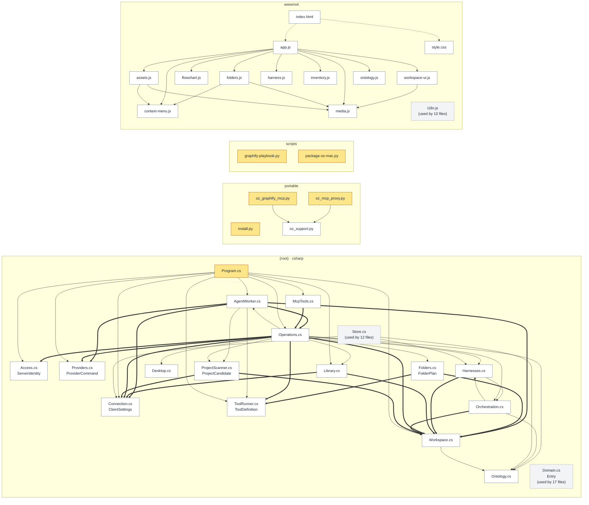
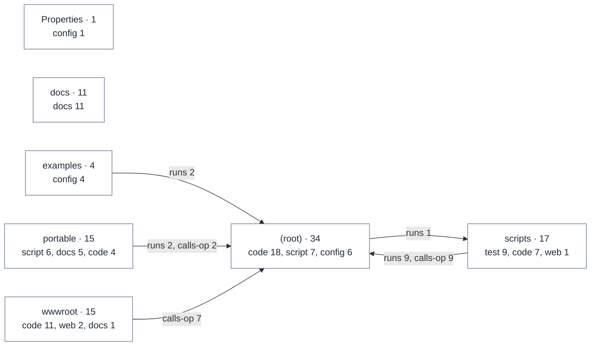

# Code map

Generated by HandOff247 0.3.0 from https://github.com/unkkyuist/PlayBookOS@7153e47 on 2026-11-10. Re-run to refresh; edit the notes file, not this page.

[← Back to start](README.md)

## Dependency map

Thick arrow = constructor injection or inheritance, thin = type/module use, dotted = loads. Grey dashed boxes are shared foundations used almost everywhere; their incoming arrows are omitted.

Mermaid source: diagrams/code.mmd

## Folder overview

Mermaid source: diagrams/areas.mmd

## Shared foundations

- [Domain.cs](https://github.com/unkkyuist/PlayBookOS/blob/7153e47ec28a0b1933c24404db08a43a468b6c14/Domain.cs) — used by 17 files
- [Store.cs](https://github.com/unkkyuist/PlayBookOS/blob/7153e47ec28a0b1933c24404db08a43a468b6c14/Store.cs) — used by 12 files
- [wwwroot/i18n.js](https://github.com/unkkyuist/PlayBookOS/blob/7153e47ec28a0b1933c24404db08a43a468b6c14/wwwroot/i18n.js) — used by 10 files

## Components

### (root)

| File | lines | Summary | Depends on | Used by |
|---|---|---|---|---|
| [Access.cs](https://github.com/unkkyuist/PlayBookOS/blob/7153e47ec28a0b1933c24404db08a43a468b6c14/Access.cs) | 61 |  | Domain.cs | Operations.cs, Program.cs |
| [AgentWorker.cs](https://github.com/unkkyuist/PlayBookOS/blob/7153e47ec28a0b1933c24404db08a43a468b6c14/AgentWorker.cs) | 196 |  | Connection.cs, Domain.cs, Operations.cs, ProjectScanner.cs, Providers.cs, Store.cs … and 2 more | Operations.cs, Program.cs |
| [Connection.cs](https://github.com/unkkyuist/PlayBookOS/blob/7153e47ec28a0b1933c24404db08a43a468b6c14/Connection.cs) | 78 |  | Domain.cs | AgentWorker.cs, Library.cs, Operations.cs, Program.cs, ProjectScanner.cs, Store.cs |
| [Desktop.cs](https://github.com/unkkyuist/PlayBookOS/blob/7153e47ec28a0b1933c24404db08a43a468b6c14/Desktop.cs) | 20 |  | Domain.cs | Operations.cs |
| [Domain.cs](https://github.com/unkkyuist/PlayBookOS/blob/7153e47ec28a0b1933c24404db08a43a468b6c14/Domain.cs) | 23 |  |  | Access.cs, AgentWorker.cs, Connection.cs, Desktop.cs, Folders.cs, Harnesses.cs … and 11 more |
| [Folders.cs](https://github.com/unkkyuist/PlayBookOS/blob/7153e47ec28a0b1933c24404db08a43a468b6c14/Folders.cs) | 259 |  | Domain.cs, Store.cs, ToolRunner.cs, Workspace.cs | Operations.cs |
| [Harnesses.cs](https://github.com/unkkyuist/PlayBookOS/blob/7153e47ec28a0b1933c24404db08a43a468b6c14/Harnesses.cs) | 181 |  | Domain.cs, Orchestration.cs, Store.cs, Workspace.cs | Operations.cs, Orchestration.cs, Store.cs |
| [Library.cs](https://github.com/unkkyuist/PlayBookOS/blob/7153e47ec28a0b1933c24404db08a43a468b6c14/Library.cs) | 108 |  | Connection.cs, Domain.cs, Operations.cs, Store.cs, Workspace.cs | Operations.cs, Program.cs |
| [McpTools.cs](https://github.com/unkkyuist/PlayBookOS/blob/7153e47ec28a0b1933c24404db08a43a468b6c14/McpTools.cs) | 102 |  | Domain.cs, Operations.cs | Program.cs |
| [Ontology.cs](https://github.com/unkkyuist/PlayBookOS/blob/7153e47ec28a0b1933c24404db08a43a468b6c14/Ontology.cs) | 505 |  | Domain.cs, Store.cs | Operations.cs, Orchestration.cs, Store.cs, Workspace.cs |
| [Operations.cs](https://github.com/unkkyuist/PlayBookOS/blob/7153e47ec28a0b1933c24404db08a43a468b6c14/Operations.cs) | 113 | The single place new features plug into. AGENTS.md: use this shared Operations service for CLI/GUI/MCP features and do not add a second data authority. | Access.cs, AgentWorker.cs, Connection.cs, Desktop.cs, Domain.cs, Folders.cs … and 9 more | AgentWorker.cs, Library.cs, McpTools.cs, Program.cs, app.js, assets.js … and 16 more |
| [Orchestration.cs](https://github.com/unkkyuist/PlayBookOS/blob/7153e47ec28a0b1933c24404db08a43a468b6c14/Orchestration.cs) | 196 |  | Domain.cs, Harnesses.cs, Ontology.cs, Store.cs, Workspace.cs | Harnesses.cs, Operations.cs |
| [Program.cs](https://github.com/unkkyuist/PlayBookOS/blob/7153e47ec28a0b1933c24404db08a43a468b6c14/Program.cs) | 111 |  | Access.cs, AgentWorker.cs, Connection.cs, Domain.cs, Library.cs, McpTools.cs … and 5 more |  |
| [ProjectScanner.cs](https://github.com/unkkyuist/PlayBookOS/blob/7153e47ec28a0b1933c24404db08a43a468b6c14/ProjectScanner.cs) | 84 |  | Connection.cs, Domain.cs, Store.cs, Workspace.cs | AgentWorker.cs, Operations.cs |
| [Providers.cs](https://github.com/unkkyuist/PlayBookOS/blob/7153e47ec28a0b1933c24404db08a43a468b6c14/Providers.cs) | 124 |  | Domain.cs, Store.cs | AgentWorker.cs, Operations.cs, Program.cs |
| [START_GRAPHIFY.cmd](https://github.com/unkkyuist/PlayBookOS/blob/7153e47ec28a0b1933c24404db08a43a468b6c14/START_GRAPHIFY.cmd) | 5 |  | graphify.ps1 |  |
| [START_PLAYBOOK.cmd](https://github.com/unkkyuist/PlayBookOS/blob/7153e47ec28a0b1933c24404db08a43a468b6c14/START_PLAYBOOK.cmd) | 3 |  | playbook.ps1 |  |
| [Start-PlayBook-Desktop.ps1](https://github.com/unkkyuist/PlayBookOS/blob/7153e47ec28a0b1933c24404db08a43a468b6c14/Start-PlayBook-Desktop.ps1) | 34 | For the desktop shortcut: starts the server if it is not running, then opens the UI. | PlayBook.csproj |  |
| [Store.cs](https://github.com/unkkyuist/PlayBookOS/blob/7153e47ec28a0b1933c24404db08a43a468b6c14/Store.cs) | 183 | All record changes must pass validation here and write an audit event in the same transaction (AGENTS.md). | Connection.cs, Domain.cs, Harnesses.cs, Ontology.cs | AgentWorker.cs, Folders.cs, Harnesses.cs, Library.cs, Ontology.cs, Operations.cs … and 6 more |
| [ToolRunner.cs](https://github.com/unkkyuist/PlayBookOS/blob/7153e47ec28a0b1933c24404db08a43a468b6c14/ToolRunner.cs) | 132 |  | Domain.cs, Store.cs | AgentWorker.cs, Folders.cs, Operations.cs, Program.cs |
| [Workspace.cs](https://github.com/unkkyuist/PlayBookOS/blob/7153e47ec28a0b1933c24404db08a43a468b6c14/Workspace.cs) | 264 |  | Domain.cs, Ontology.cs, Store.cs | AgentWorker.cs, Folders.cs, Harnesses.cs, Library.cs, Operations.cs, Orchestration.cs … and 2 more |
| [graphify.ps1](https://github.com/unkkyuist/PlayBookOS/blob/7153e47ec28a0b1933c24404db08a43a468b6c14/graphify.ps1) | 6 |  | graphify-playbook.py | START_GRAPHIFY.cmd |
| [playbook-harness.ps1](https://github.com/unkkyuist/PlayBookOS/blob/7153e47ec28a0b1933c24404db08a43a468b6c14/playbook-harness.ps1) | 12 |  | PlayBook.csproj |  |
| [playbook.ps1](https://github.com/unkkyuist/PlayBookOS/blob/7153e47ec28a0b1933c24404db08a43a468b6c14/playbook.ps1) | 10 |  | PlayBook.csproj | START_PLAYBOOK.cmd |
| [playbook.sh](https://github.com/unkkyuist/PlayBookOS/blob/7153e47ec28a0b1933c24404db08a43a468b6c14/playbook.sh) | 9 |  | PlayBook.csproj |  |

### portable

| File | lines | Summary | Depends on | Used by |
|---|---|---|---|---|
| [INSTALL_PLAYBOOK.cmd](https://github.com/unkkyuist/PlayBookOS/blob/7153e47ec28a0b1933c24404db08a43a468b6c14/portable/INSTALL_PLAYBOOK.cmd) | 3 |  | Install-PlayBook.ps1 |  |
| [Install-PlayBook.ps1](https://github.com/unkkyuist/PlayBookOS/blob/7153e47ec28a0b1933c24404db08a43a468b6c14/portable/Install-PlayBook.ps1) | 81 |  | PlayBook.csproj, Start-PlayBook.ps1 | INSTALL_PLAYBOOK.cmd |
| [START_PLAYBOOK.cmd](https://github.com/unkkyuist/PlayBookOS/blob/7153e47ec28a0b1933c24404db08a43a468b6c14/portable/START_PLAYBOOK.cmd) | 3 |  | Start-PlayBook.ps1 |  |
| [STOP_PLAYBOOK.cmd](https://github.com/unkkyuist/PlayBookOS/blob/7153e47ec28a0b1933c24404db08a43a468b6c14/portable/STOP_PLAYBOOK.cmd) | 3 |  | Stop-PlayBook.ps1 |  |
| [Start-PlayBook.ps1](https://github.com/unkkyuist/PlayBookOS/blob/7153e47ec28a0b1933c24404db08a43a468b6c14/portable/Start-PlayBook.ps1) | 40 |  | PlayBook.csproj | Install-PlayBook.ps1, START_PLAYBOOK.cmd |
| [Stop-PlayBook.ps1](https://github.com/unkkyuist/PlayBookOS/blob/7153e47ec28a0b1933c24404db08a43a468b6c14/portable/Stop-PlayBook.ps1) | 11 |  |  | STOP_PLAYBOOK.cmd |
| [install.py](https://github.com/unkkyuist/PlayBookOS/blob/7153e47ec28a0b1933c24404db08a43a468b6c14/portable/oz/install.py) | 445 | Oz's offline Mac installer and launch/repair/diagnostic actions. | Operations.cs |  |
| [oz_graphify_mcp.py](https://github.com/unkkyuist/PlayBookOS/blob/7153e47ec28a0b1933c24404db08a43a468b6c14/portable/oz/oz_graphify_mcp.py) | 149 | Project-aware Graphify MCP. | Operations.cs, oz_support.py |  |
| [oz_mcp_proxy.py](https://github.com/unkkyuist/PlayBookOS/blob/7153e47ec28a0b1933c24404db08a43a468b6c14/portable/oz/oz_mcp_proxy.py) | 141 | Transparent stdio MCP proxy. | oz_support.py |  |
| [oz_support.py](https://github.com/unkkyuist/PlayBookOS/blob/7153e47ec28a0b1933c24404db08a43a468b6c14/portable/oz/oz_support.py) | 201 | Bounded, content-free local audit journal and opt-in troubleshooting exports. |  | oz_graphify_mcp.py, oz_mcp_proxy.py |

### scripts

| File | lines | Summary | Depends on | Used by |
|---|---|---|---|---|
| [central-smoke.py](https://github.com/unkkyuist/PlayBookOS/blob/7153e47ec28a0b1933c24404db08a43a468b6c14/scripts/central-smoke.py) | 184 | Isolated recursive scanning, authentication, queue/lease and two real device-client processes. | PlayBook.csproj |  |
| [check-package.py](https://github.com/unkkyuist/PlayBookOS/blob/7153e47ec28a0b1933c24404db08a43a468b6c14/scripts/check-package.py) | 77 | Install the Windows package into an isolated folder and exercise its own launcher. | Operations.cs, PlayBook.csproj |  |
| [harness-provider.py](https://github.com/unkkyuist/PlayBookOS/blob/7153e47ec28a0b1933c24404db08a43a468b6c14/scripts/fixtures/harness-provider.py) | 34 | A deterministic provider process for harness wiring tests; never calls a model. |  |  |
| [provider.py](https://github.com/unkkyuist/PlayBookOS/blob/7153e47ec28a0b1933c24404db08a43a468b6c14/scripts/fixtures/provider.py) | 28 | Deterministic CLI fixture; not a real model/authentication test. |  |  |
| [folders-smoke.py](https://github.com/unkkyuist/PlayBookOS/blob/7153e47ec28a0b1933c24404db08a43a468b6c14/scripts/folders-smoke.py) | 83 | Real, isolated filesystem + SQLite tests for folder organization. | Operations.cs, PlayBook.csproj |  |
| [graphify-playbook.py](https://github.com/unkkyuist/PlayBookOS/blob/7153e47ec28a0b1933c24404db08a43a468b6c14/scripts/graphify-playbook.py) | 398 | Local Graphify companion using PlayBook's existing tool and ontology APIs. | Operations.cs, PlayBook.csproj | graphify.ps1 |
| [graphify-smoke.py](https://github.com/unkkyuist/PlayBookOS/blob/7153e47ec28a0b1933c24404db08a43a468b6c14/scripts/graphify-smoke.py) | 157 | Real Graphify/PlayBook integration checks, using an isolated ledger and source. | Operations.cs |  |
| [index.html](https://github.com/unkkyuist/PlayBookOS/blob/7153e47ec28a0b1933c24404db08a43a468b6c14/scripts/graphify/index.html) | 32 | Graphify · PlayBook |  |  |
| [harness-smoke.py](https://github.com/unkkyuist/PlayBookOS/blob/7153e47ec28a0b1933c24404db08a43a468b6c14/scripts/harness-smoke.py) | 216 | Harness proposal/trial/adoption tests on isolated SQLite and real worker/provider processes. | Operations.cs, PlayBook.csproj |  |
| [ontology-smoke.py](https://github.com/unkkyuist/PlayBookOS/blob/7153e47ec28a0b1933c24404db08a43a468b6c14/scripts/ontology-smoke.py) | 541 | Ontology integration checks using a temporary DB, local fixture and real transports. | Operations.cs, PlayBook.csproj |  |
| [oz-logging-smoke.py](https://github.com/unkkyuist/PlayBookOS/blob/7153e47ec28a0b1933c24404db08a43a468b6c14/scripts/oz-logging-smoke.py) | 139 | Real-process failure/privacy/concurrency tests for Oz's content-free audit boundary. |  |  |
| [oz-package-smoke.py](https://github.com/unkkyuist/PlayBookOS/blob/7153e47ec28a0b1933c24404db08a43a468b6c14/scripts/oz-package-smoke.py) | 243 | Audit real Mac payloads and exercise their installer/MCP logic on Windows. | Operations.cs, PlayBook.csproj |  |
| [package-oz-mac.py](https://github.com/unkkyuist/PlayBookOS/blob/7153e47ec28a0b1933c24404db08a43a468b6c14/scripts/package-oz-mac.py) | 197 | Build offline Mac handoff ZIPs from explicit native runtime directories. |  |  |
| [package.py](https://github.com/unkkyuist/PlayBookOS/blob/7153e47ec28a0b1933c24404db08a43a468b6c14/scripts/package.py) | 44 | Package an explicit self-contained publish directory, without any live data. |  |  |
| [prepare-public-source.py](https://github.com/unkkyuist/PlayBookOS/blob/7153e47ec28a0b1933c24404db08a43a468b6c14/scripts/prepare-public-source.py) | 27 | Copy an explicit public source snapshot; never copy the private local Git history. |  |  |
| [real-provider-smoke.py](https://github.com/unkkyuist/PlayBookOS/blob/7153e47ec28a0b1933c24404db08a43a468b6c14/scripts/real-provider-smoke.py) | 82 | Explicit, small read-only smoke against installed, already signed-in Codex and Claude. | Operations.cs, PlayBook.csproj |  |
| [smoke.py](https://github.com/unkkyuist/PlayBookOS/blob/7153e47ec28a0b1933c24404db08a43a468b6c14/scripts/smoke.py) | 173 | End-to-end tests against a fresh SQLite database, real CLI, HTTP and MCP transports. | Operations.cs, PlayBook.csproj |  |

### wwwroot

| File | lines | Summary | Depends on | Used by |
|---|---|---|---|---|
| [app.js](https://github.com/unkkyuist/PlayBookOS/blob/7153e47ec28a0b1933c24404db08a43a468b6c14/wwwroot/app.js) | 91 |  | Operations.cs, assets.js, context-menu.js, flowchart.js, folders.js, harness.js … and 5 more | index.html |
| [assets.js](https://github.com/unkkyuist/PlayBookOS/blob/7153e47ec28a0b1933c24404db08a43a468b6c14/wwwroot/assets.js) | 118 |  | Operations.cs, context-menu.js, i18n.js, media.js | app.js |
| [context-menu.js](https://github.com/unkkyuist/PlayBookOS/blob/7153e47ec28a0b1933c24404db08a43a468b6c14/wwwroot/context-menu.js) | 39 |  | i18n.js | app.js, assets.js, folders.js |
| [flowchart.js](https://github.com/unkkyuist/PlayBookOS/blob/7153e47ec28a0b1933c24404db08a43a468b6c14/wwwroot/flowchart.js) | 50 |  | i18n.js | app.js |
| [folders.js](https://github.com/unkkyuist/PlayBookOS/blob/7153e47ec28a0b1933c24404db08a43a468b6c14/wwwroot/folders.js) | 103 |  | Operations.cs, context-menu.js, i18n.js, media.js | app.js |
| [harness.js](https://github.com/unkkyuist/PlayBookOS/blob/7153e47ec28a0b1933c24404db08a43a468b6c14/wwwroot/harness.js) | 71 |  | Operations.cs, i18n.js | app.js |
| [i18n.js](https://github.com/unkkyuist/PlayBookOS/blob/7153e47ec28a0b1933c24404db08a43a468b6c14/wwwroot/i18n.js) | 259 |  |  | app.js, assets.js, context-menu.js, flowchart.js, folders.js, harness.js … and 4 more |
| [index.html](https://github.com/unkkyuist/PlayBookOS/blob/7153e47ec28a0b1933c24404db08a43a468b6c14/wwwroot/index.html) | 9 | Project PlayBook | app.js, style.css |  |
| [inventory.js](https://github.com/unkkyuist/PlayBookOS/blob/7153e47ec28a0b1933c24404db08a43a468b6c14/wwwroot/inventory.js) | 45 |  | i18n.js | app.js |
| [media.js](https://github.com/unkkyuist/PlayBookOS/blob/7153e47ec28a0b1933c24404db08a43a468b6c14/wwwroot/media.js) | 112 |  | Operations.cs, i18n.js | app.js, assets.js, folders.js, workspace-ui.js |
| [ontology.js](https://github.com/unkkyuist/PlayBookOS/blob/7153e47ec28a0b1933c24404db08a43a468b6c14/wwwroot/ontology.js) | 246 |  | Operations.cs, i18n.js | app.js |
| [style.css](https://github.com/unkkyuist/PlayBookOS/blob/7153e47ec28a0b1933c24404db08a43a468b6c14/wwwroot/style.css) | 47 |  |  | index.html |
| [workspace-ui.js](https://github.com/unkkyuist/PlayBookOS/blob/7153e47ec28a0b1933c24404db08a43a468b6c14/wwwroot/workspace-ui.js) | 149 |  | Operations.cs, i18n.js, media.js | app.js |

