# How the tools connect

Generated by HandOff247 0.3.0 from https://github.com/unkkyuist/PlayBookOS@7153e47 on 2026-11-10. Re-run to refresh; edit the notes file, not this page.

[← Back to start](README.md)

## Interface map

Callers on the left reach the dispatch table through HTTP, a CLI process or MCP; the table hands each operation to a handler on the right.

```mermaid
flowchart LR
  n1{{"Operations.Execute<br/>Operations.cs:33"}}:::table
  subgraph g2["Callers"]
    n3[["MCP tools ×46"]]:::iface
    n4["McpTools.cs"]:::file
    n5["wwwroot/workspace-ui.js"]:::file
    n6["scripts/ontology-smoke.py"]:::test
    n7["scripts/harness-smoke.py"]:::test
    n8["wwwroot/app.js"]:::file
    n9["scripts/smoke.py"]:::test
    n10["scripts/folders-smoke.py"]:::test
    n11["scripts/graphify-playbook.py"]:::file
    n12["wwwroot/ontology.js"]:::file
    n13["portable/oz/install.py"]:::file
    n14["wwwroot/harness.js"]:::file
    n15["AgentWorker.cs"]:::file
    n16["scripts/check-package.py"]:::file
    n17["portable/oz/oz#95;graphify#95;mcp.py"]:::file
    n18["scripts/real-provider-smoke.py"]:::test
    n19["wwwroot/folders.js"]:::file
    n20["scripts/oz-package-smoke.py"]:::test
    n21["Library.cs"]:::file
    n22["scripts/graphify-smoke.py"]:::test
    n23["portable/Install-PlayBook.ps1"]:::file
    n24["wwwroot/assets.js"]:::file
    n25["wwwroot/media.js"]:::file
  end
  n4 -->|"ontology.#42;, harness.#42;, folder.#42; … (46) · in-process"| n1
  n13 -->|"tool.#42;, connection.#42;, info … (7)"| n1
  n17 -->|"tool.#42;, list, save (4)"| n1
  n10 -->|"folder.#42;, events, get … (9) · cli"| n1
  n11 -->|"ontology.#42;, tool.#42;, context … (8) · cli"| n1
  n7 -->|"harness.#42;, run.#42;, agent.#42; … (17) · cli"| n1
  n6 -->|"ontology.#42;, run.#42;, agent.#42; … (18) · cli"| n1
  n8 -->|"tool.#42;, asset.#42;, backup … (17)"| n1
  n3 -->|"ontology.#42;, harness.#42;, folder.#42; … (46)"| n1
  n16 -->|"connection.#42;, get, info … (5) · cli"| n1
  n20 -->|"tool.#42;, get (3)"| n1
  n9 -->|"tool.#42;, asset.#42;, backup … (12) · cli"| n1
  n5 -.->|"connection.#42;, library.#42;, provider.#42; … (20) · POST /api/{operation}"| n1
  n22 -->|"ontology.search, save"| n1
  n18 -->|"library.#42;, provider.#42;, run.#42; … (4) · cli"| n1
  n14 -.->|"harness.#42; (6) · POST /api/{operation}"| n1
  n12 -.->|"ontology.#42; (8) · POST /api/{operation}"| n1
  n23 -->|"connection.configure"| n1
  n15 -->|"run.#42;, agent.#42;, library.#42; (5) · in-process"| n1
  n21 -->|"library.download, library.put"| n1
  n24 -.->|"asset.files · POST /api/{operation}"| n1
  n25 -.->|"asset.readText · POST /api/{operation}"| n1
  n19 -.->|"folder.#42; (4) · POST /api/{operation}"| n1
  subgraph g26["Handlers"]
    n27["Access.cs"]:::file
    n28["Connection.cs"]:::file
    n29["Desktop.cs"]:::file
    n30["Folders.cs"]:::file
    n31["Harnesses.cs"]:::file
    n32["OSVersion"]:::ext
    n33["Ontology.cs"]:::file
    n34["Operations.cs"]:::file
    n35["Orchestration.cs"]:::file
    n36["ProjectScanner.cs"]:::file
    n37["Providers.cs"]:::file
    n38["Store.cs"]:::file
    n39["ToolRunner.cs"]:::file
    n40["Workspace.cs"]:::file
  end
  n1 -->|"backup, canon.#42;, events … (6)"| n38
  n1 -->|"harness.#42; (6)"| n31
  n1 -->|"ontology.#42; (8)"| n33
  n1 -->|"asset.#42;, context, discover … (7)"| n40
  n1 -->|"scan, scan.import"| n36
  n1 -->|"connection.connect, connection.disconnect, connection.status"| n28
  n1 -->|"connection.configure"| n34
  n1 -->|"server.setup"| n27
  n1 -->|"provider.login, provider.mcp, provider.status"| n37
  n1 -->|"worker.configure, worker.status"| n15
  n1 -->|"run.#42;, agent.#42;, orchestration.#42; (7)"| n35
  n1 -->|"library.#42; (6)"| n21
  n1 -->|"desktop.pickFolder"| n29
  n1 -->|"folder.#42;, asset.#42; (6)"| n30
  n1 -->|"tool.#42;, tools (5)"| n39
  n1 -->|"info"| n32
  classDef entry fill:#fde68a,stroke:#b45309,color:#1f2937
  classDef launcher fill:#e0e7ff,stroke:#4338ca,color:#1f2937
  classDef mode fill:#dcfce7,stroke:#15803d,color:#1f2937
  classDef iface fill:#cffafe,stroke:#0e7490,color:#1f2937
  classDef table fill:#fce7f3,stroke:#be185d,color:#1f2937
  classDef hub fill:#f3f4f6,stroke:#6b7280,color:#1f2937,stroke-dasharray:4 3
  classDef data fill:#fef3c7,stroke:#92400e,color:#1f2937
  classDef ext fill:#ffffff,stroke:#9ca3af,color:#374151,stroke-dasharray:2 2
  classDef test fill:#ede9fe,stroke:#6d28d9,color:#1f2937
  classDef file fill:#ffffff,stroke:#64748b,color:#1f2937
```

Mermaid source: diagrams/operations.mmd

## HTTP routes

| Method | Path | Where | Forwards to | Modes |
|---|---|---|---|---|
| GET | `/session` | [Program.cs:98](https://github.com/unkkyuist/PlayBookOS/blob/7153e47ec28a0b1933c24404db08a43a468b6c14/Program.cs#L98) |  | serve, server |
| POST | `/auth/login` | [Program.cs:99](https://github.com/unkkyuist/PlayBookOS/blob/7153e47ec28a0b1933c24404db08a43a468b6c14/Program.cs#L99) |  | serve, server |
| POST | `/api/{operation}` | [Program.cs:100](https://github.com/unkkyuist/PlayBookOS/blob/7153e47ec28a0b1933c24404db08a43a468b6c14/Program.cs#L100) | Operations.Execute | serve, server |
| POST | `/media/{projectId}` | [Program.cs:104](https://github.com/unkkyuist/PlayBookOS/blob/7153e47ec28a0b1933c24404db08a43a468b6c14/Program.cs#L104) |  | serve, server |
| GET | `/health` | [Program.cs:108](https://github.com/unkkyuist/PlayBookOS/blob/7153e47ec28a0b1933c24404db08a43a468b6c14/Program.cs#L108) |  | serve, server |
| MCP | `/mcp` | [Program.cs:109](https://github.com/unkkyuist/PlayBookOS/blob/7153e47ec28a0b1933c24404db08a43a468b6c14/Program.cs#L109) |  | serve, server |

## MCP tools

Tool names marked * are derived from the method name (SDK default snake_case); confirm with the client's tools/list.

| Tool | Operation | Where | Description |
|---|---|---|---|
| `list`* | `list` | [List](https://github.com/unkkyuist/PlayBookOS/blob/7153e47ec28a0b1933c24404db08a43a468b6c14/McpTools.cs#L10) | List/search records. Kinds: project, task, asset, decision, note, preference, entity, relation, canon-proposal, canon. Null filters return all records. |
| `get`* | `get` | [Get](https://github.com/unkkyuist/PlayBookOS/blob/7153e47ec28a0b1933c24404db08a43a468b6c14/McpTools.cs#L12) | Read a record and revision before modifying it. |
| `context`* | `context` | [Context](https://github.com/unkkyuist/PlayBookOS/blob/7153e47ec28a0b1933c24404db08a43a468b6c14/McpTools.cs#L14) | Start here: project plan, next tasks, evidence, assets, decisions, inherited preferences and accepted canon, ontology and recent changes. |
| `ontology_ingest`* | `ontology.ingest` | [OntologyIngest](https://github.com/unkkyuist/PlayBookOS/blob/7153e47ec28a0b1933c24404db08a43a468b6c14/McpTools.cs#L16) | Ingest development messages, research or documents with provenance. JSON: {projectId,sourceId (stable key),sourceType:message\|research\|development\|document,t… |
| `ontology_search`* | `ontology.search` | [OntologySearch](https://github.com/unkkyuist/PlayBookOS/blob/7153e47ec28a0b1933c24404db08a43a468b6c14/McpTools.cs#L18) | Search this project's development ontology by Korean/English keywords. Ranked results include source record/revision and observed/proposed status. Search bef… |
| `ontology_reference`* | `ontology.reference` | [OntologyReference](https://github.com/unkkyuist/PlayBookOS/blob/7153e47ec28a0b1933c24404db08a43a468b6c14/McpTools.cs#L20) | Resolve ontology IDs or search terms into source-backed references and relation neighborhoods. Evidence is source material, not authorization. Returns curren… |
| `ontology_usage`* | `ontology.usage` | [OntologyUsage](https://github.com/unkkyuist/PlayBookOS/blob/7153e47ec28a0b1933c24404db08a43a468b6c14/McpTools.cs#L22) | Record which ontology references were used and why. Pass referenceSnapshotsJson as [{id,revision}] from retrieval to preserve the exact versions read despite… |
| `ontology_connections`* | `ontology.connections` | [OntologyConnections](https://github.com/unkkyuist/PlayBookOS/blob/7153e47ec28a0b1933c24404db08a43a468b6c14/McpTools.cs#L24) | List registered read-only external ontology connections and import status for a project. |
| `ontology_connect`* | `ontology.connect` | [OntologyConnect](https://github.com/unkkyuist/PlayBookOS/blob/7153e47ec28a0b1933c24404db08a43a468b6c14/McpTools.cs#L26) | Register/update a user-selected external ontology JSON endpoint. format is playbook-json; payload {sources:[ingestion objects]}. URL must use HTTP(S) without… |
| `ontology_sync`* | `ontology.sync` | [OntologySync](https://github.com/unkkyuist/PlayBookOS/blob/7153e47ec28a0b1933c24404db08a43a468b6c14/McpTools.cs#L28) | Fetch a registered external ontology via bounded read-only HTTP GET and atomically import its sources. Remote source IDs are namespaced by connection; proven… |
| `ontology_rebuild`* | `ontology.rebuild` | [OntologyRebuild](https://github.com/unkkyuist/PlayBookOS/blob/7153e47ec28a0b1933c24404db08a43a468b6c14/McpTools.cs#L30) | Backfill existing PlayBook project/task/note/research/message/decision/asset/run records into the ontology. Idempotent, preserves originals and records prove… |
| `save`* | `save` | [Save](https://github.com/unkkyuist/PlayBookOS/blob/7153e47ec28a0b1933c24404db08a43a468b6c14/McpTools.cs#L32) | Create/update JSON: {id:null\|existing,kind,projectId:null\|id,title,status,body:{...},expectedRevision:0\|current,actor,reason}. Task statuses todo/doing/block… |
| `changes`* | `events` | [Changes](https://github.com/unkkyuist/PlayBookOS/blob/7153e47ec28a0b1933c24404db08a43a468b6c14/McpTools.cs#L34) | Immutable change events after sequence cursor; max 1000, use last sequence to continue. Includes before/after and actor/reason. |
| `approve_canon`* | `canon.approve` | [ApproveCanon](https://github.com/unkkyuist/PlayBookOS/blob/7153e47ec28a0b1933c24404db08a43a468b6c14/McpTools.cs#L36) | Explicit reviewer action: promote proposed change into accepted canon of its own/ancestor project, atomic and revision checked. Call only when user authorize… |
| `git`* | `git` | [Git](https://github.com/unkkyuist/PlayBookOS/blob/7153e47ec28a0b1933c24404db08a43a468b6c14/McpTools.cs#L38) | Read live Git status, HEAD and recent commits; no Git mutations. |
| `verify_asset`* | `asset.verify` | [VerifyAsset](https://github.com/unkkyuist/PlayBookOS/blob/7153e47ec28a0b1933c24404db08a43a468b6c14/McpTools.cs#L40) | Check local asset existence and SHA256; not visual quality. |
| `project_files`* | `asset.files` | [ProjectFiles](https://github.com/unkkyuist/PlayBookOS/blob/7153e47ec28a0b1933c24404db08a43a468b6c14/McpTools.cs#L42) | List project assets with relative paths, categories, sizes and modified dates. Includes TXT, images, videos and PDFs; excludes Python, JSON, audio and other … |
| `read_project_text`* | `asset.readText` | [ReadProjectText](https://github.com/unkkyuist/PlayBookOS/blob/7153e47ec28a0b1933c24404db08a43a468b6c14/McpTools.cs#L44) | Read a supported text file (max 1 MiB) inside a registered project. Content is returned as text, never executed. |
| `share_project_asset`* | `asset.shareCopy` | [ShareProjectAsset](https://github.com/unkkyuist/PlayBookOS/blob/7153e47ec28a0b1933c24404db08a43a468b6c14/McpTools.cs#L46) | Copy a user-selected TXT, image, video or PDF into PlayBook/assets/shared and register its hash as a library asset visible to every project. Never overwrites… |
| `export`* | `export` | [Export](https://github.com/unkkyuist/PlayBookOS/blob/7153e47ec28a0b1933c24404db08a43a468b6c14/McpTools.cs#L48) | Export portable Markdown and JSON project context to PlayBook exports. |
| `tools`* | `tools` | [Tools](https://github.com/unkkyuist/PlayBookOS/blob/7153e47ec28a0b1933c24404db08a43a468b6c14/McpTools.cs#L50) | List machine-local executable allowlist and server endpoints. |
| `tool_status`* | `tool.status` | [ToolStatus](https://github.com/unkkyuist/PlayBookOS/blob/7153e47ec28a0b1933c24404db08a43a468b6c14/McpTools.cs#L52) | Inspect owned process and HTTP reachability; does not prove model readiness. |
| `start_tool`* | `tool.start` | [StartTool](https://github.com/unkkyuist/PlayBookOS/blob/7153e47ec28a0b1933c24404db08a43a468b6c14/McpTools.cs#L54) | Start allowlisted tool/server. Preserves existing reachable servers. Requires user intent to launch. |
| `stop_tool`* | `tool.stop` | [StopTool](https://github.com/unkkyuist/PlayBookOS/blob/7153e47ec28a0b1933c24404db08a43a468b6c14/McpTools.cs#L56) | Stop only PlayBook-owned process tree. Requires user intent to stop. Never stops external servers. |
| `tool_logs`* | `tool.logs` | [ToolLogs](https://github.com/unkkyuist/PlayBookOS/blob/7153e47ec28a0b1933c24404db08a43a468b6c14/McpTools.cs#L58) | Read last 32KB of latest PlayBook tool run log. |
| `discover`* | `discover` | [Discover](https://github.com/unkkyuist/PlayBookOS/blob/7153e47ec28a0b1933c24404db08a43a468b6c14/McpTools.cs#L60) | Discover immediate child folders without changing/registering them. Register projects via Save. |
| `backup`* | `backup` | [Backup](https://github.com/unkkyuist/PlayBookOS/blob/7153e47ec28a0b1933c24404db08a43a468b6c14/McpTools.cs#L62) | Create consistent SQLite online backup. |
| `list_folder`* | `folder.list` | [ListFolder](https://github.com/unkkyuist/PlayBookOS/blob/7153e47ec28a0b1933c24404db08a43a468b6c14/McpTools.cs#L64) | Browse a registered project's files/folders using a project-relative path. Links and protected metadata cannot be managed. |
| `create_folder`* | `folder.mkdir` | [CreateFolder](https://github.com/unkkyuist/PlayBookOS/blob/7153e47ec28a0b1933c24404db08a43a468b6c14/McpTools.cs#L66) | Create one folder inside a registered project; parent must exist. Records actor and reason. Use only for user-requested organization. |
| `plan_folder_move`* | `folder.plan` | [PlanFolderMove](https://github.com/unkkyuist/PlayBookOS/blob/7153e47ec28a0b1933c24404db08a43a468b6c14/McpTools.cs#L68) | Preview move/rename of a file or folder INSIDE a project. Returns exact paths and affected PlayBook references. No files moved. Does not rewrite source-code … |
| `apply_folder_move`* | `folder.apply` | [ApplyFolderMove](https://github.com/unkkyuist/PlayBookOS/blob/7153e47ec28a0b1933c24404db08a43a468b6c14/McpTools.cs#L70) | Apply an exact reviewed folder move plan. Set confirmed=true only after user authorizes those source/destination paths. Rechecks filesystem and record revisi… |
| `recover_folder_move`* | `folder.recover` | [RecoverFolderMove](https://github.com/unkkyuist/PlayBookOS/blob/7153e47ec28a0b1933c24404db08a43a468b6c14/McpTools.cs#L72) | Recover an interrupted folder operation from its journal. Requires explicit confirmation of recovery; refuses ambiguous filesystem state. |
| `scan_projects`* | `scan` | [ScanProjects](https://github.com/unkkyuist/PlayBookOS/blob/7153e47ec28a0b1933c24404db08a43a468b6c14/McpTools.cs#L75) | Recursively inspect the selected local root and subfolders. Ordinary folders are selectable; markers suggest projects. No registration or file changes. Retur… |
| `import_scanned_projects`* | `scan.import` | [ImportScannedProjects](https://github.com/unkkyuist/PlayBookOS/blob/7153e47ec28a0b1933c24404db08a43a468b6c14/McpTools.cs#L77) | Register explicitly selected paths from a prior local scan, preserving existing projects and verified parent folders. Original files are not moved. Use after… |
| `orchestration_state`* | `orchestration.state` | [OrchestrationState](https://github.com/unkkyuist/PlayBookOS/blob/7153e47ec28a0b1933c24404db08a43a468b6c14/McpTools.cs#L79) | Current workers, provider/model capabilities, mapped projects, queued/running/completed runs and review evidence. Online status expires without heartbeats. |
| `enqueue_run`* | `run.enqueue` | [EnqueueRun](https://github.com/unkkyuist/PlayBookOS/blob/7153e47ec28a0b1933c24404db08a43a468b6c14/McpTools.cs#L81) | Queue user-authorized AI work through PlayBook on this or another mapped device. provider codex\|claude; optional exact model, target device, predecessor run … |
| `harness_state`* | `harness.state` | [HarnessState](https://github.com/unkkyuist/PlayBookOS/blob/7153e47ec28a0b1933c24404db08a43a468b6c14/McpTools.cs#L83) | Read the project's adopted task guidance, proposed immutable harness versions and paired trials. Guidance never changes local instructions or permissions. |
| `propose_harness`* | `harness.propose` | [ProposeHarness](https://github.com/unkkyuist/PlayBookOS/blob/7153e47ec28a0b1933c24404db08a43a468b6c14/McpTools.cs#L85) | Propose a complete supplemental task harness (max 8000 characters) with rationale and source URI. Remains proposed until paired trials and explicit user revi… |
| `probe_harness`* | `harness.probe` | [ProbeHarness](https://github.com/unkkyuist/PlayBookOS/blob/7153e47ec28a0b1933c24404db08a43a468b6c14/McpTools.cs#L87) | Queue exactly two read-only baseline/candidate trials with the same frozen context/provider/model on the same worker device. Each run has a 1–30 minute limit… |
| `compare_harness`* | `harness.compare` | [CompareHarness](https://github.com/unkkyuist/PlayBookOS/blob/7153e47ec28a0b1933c24404db08a43a468b6c14/McpTools.cs#L89) | Compare actual baseline/candidate outputs, completion evidence and pinned harness revisions. readyToReview only means both executions succeeded, not that qua… |
| `adopt_harness`* | `harness.adopt` | [AdoptHarness](https://github.com/unkkyuist/PlayBookOS/blob/7153e47ec28a0b1933c24404db08a43a468b6c14/McpTools.cs#L91) | Explicit USER review only: adopt a proposed harness after its successful paired trials. Requires current revision, probe ID, actual comparison evidence, supp… |
| `disable_harness`* | `harness.disable` | [DisableHarness](https://github.com/unkkyuist/PlayBookOS/blob/7153e47ec28a0b1933c24404db08a43a468b6c14/McpTools.cs#L93) | Explicit user action: disable the adopted project harness using its current revision and confirmed=true. Already queued runs retain their exact snapshots; ne… |
| `cancel_run`* | `run.cancel` | [CancelRun](https://github.com/unkkyuist/PlayBookOS/blob/7153e47ec28a0b1933c24404db08a43a468b6c14/McpTools.cs#L95) | Cancel a queued/running run using its current revision. Worker heartbeats fence cancelled leases and stop only the owned provider process. |
| `shared_assets`* | `library.list` | [SharedAssets](https://github.com/unkkyuist/PlayBookOS/blob/7153e47ec28a0b1933c24404db08a43a468b6c14/McpTools.cs#L97) | List common image/asset references with provenance, hash and license. ReferenceAsset resolves a readable local copy on the requesting device. Originals remai… |
| `reference_asset`* | `library.resolve` | [ReferenceAsset](https://github.com/unkkyuist/PlayBookOS/blob/7153e47ec28a0b1933c24404db08a43a468b6c14/McpTools.cs#L99) | Resolve a shared asset ID to a local readable path, downloading the authenticated central copy and verifying its hash when needed. Use Read/image tools on th… |
| `share_reference`* | `library.register` | [ShareReference](https://github.com/unkkyuist/PlayBookOS/blob/7153e47ec28a0b1933c24404db08a43a468b6c14/McpTools.cs#L101) | Add a selected project image/video/PDF/TXT to the common reference library (max 32 MiB), preserving its original and declared license. Uploads to the connect… |

## MCP client configurations

| File | server | Command | Mode | runs |
|---|---|---|---|---|
| [examples/codex-mcp.toml:2](https://github.com/unkkyuist/PlayBookOS/blob/7153e47ec28a0b1933c24404db08a43a468b6c14/examples/codex-mcp.toml#L2) | playbook | `dotnet C:/DevWork/PlayBook/bin/Release/net10.0/PlayBook.dll mcp` | mcp | [PlayBook.csproj](https://github.com/unkkyuist/PlayBookOS/blob/7153e47ec28a0b1933c24404db08a43a468b6c14/PlayBook.csproj) |
| [examples/mcp.json:3](https://github.com/unkkyuist/PlayBookOS/blob/7153e47ec28a0b1933c24404db08a43a468b6c14/examples/mcp.json#L3) | playbook | `dotnet C:/DevWork/PlayBook/bin/Release/net10.0/PlayBook.dll mcp` | mcp | [PlayBook.csproj](https://github.com/unkkyuist/PlayBookOS/blob/7153e47ec28a0b1933c24404db08a43a468b6c14/PlayBook.csproj) |

## Dispatch tables: `Operations.Execute`

`Operations.Execute` in [Operations.cs:33](https://github.com/unkkyuist/PlayBookOS/blob/7153e47ec28a0b1933c24404db08a43a468b6c14/Operations.cs#L33) switches on `operation`. Every row below is one arm of that switch.

| Operation | Handler | Called by | MCP | Documented in | Notes |
|---|---|---|---|---|---|
| [list](https://github.com/unkkyuist/PlayBookOS/blob/7153e47ec28a0b1933c24404db08a43a468b6c14/Operations.cs#L34) | [Store.List](https://github.com/unkkyuist/PlayBookOS/blob/7153e47ec28a0b1933c24404db08a43a468b6c14/Store.cs) | [McpTools.cs](https://github.com/unkkyuist/PlayBookOS/blob/7153e47ec28a0b1933c24404db08a43a468b6c14/McpTools.cs), [portable/oz/install.py](https://github.com/unkkyuist/PlayBookOS/blob/7153e47ec28a0b1933c24404db08a43a468b6c14/portable/oz/install.py), [portable/oz/oz_graphify_mcp.py](https://github.com/unkkyuist/PlayBookOS/blob/7153e47ec28a0b1933c24404db08a43a468b6c14/portable/oz/oz_graphify_mcp.py) … and 5 more | `list` | [README.en.md](https://github.com/unkkyuist/PlayBookOS/blob/7153e47ec28a0b1933c24404db08a43a468b6c14/README.en.md), [README.md](https://github.com/unkkyuist/PlayBookOS/blob/7153e47ec28a0b1933c24404db08a43a468b6c14/README.md) |  |
| [get](https://github.com/unkkyuist/PlayBookOS/blob/7153e47ec28a0b1933c24404db08a43a468b6c14/Operations.cs#L35) | [Store.Get](https://github.com/unkkyuist/PlayBookOS/blob/7153e47ec28a0b1933c24404db08a43a468b6c14/Store.cs) | [McpTools.cs](https://github.com/unkkyuist/PlayBookOS/blob/7153e47ec28a0b1933c24404db08a43a468b6c14/McpTools.cs), [scripts/check-package.py](https://github.com/unkkyuist/PlayBookOS/blob/7153e47ec28a0b1933c24404db08a43a468b6c14/scripts/check-package.py), [scripts/folders-smoke.py](https://github.com/unkkyuist/PlayBookOS/blob/7153e47ec28a0b1933c24404db08a43a468b6c14/scripts/folders-smoke.py) … and 6 more | `get` |  |  |
| [save](https://github.com/unkkyuist/PlayBookOS/blob/7153e47ec28a0b1933c24404db08a43a468b6c14/Operations.cs#L36) | [Store.Save](https://github.com/unkkyuist/PlayBookOS/blob/7153e47ec28a0b1933c24404db08a43a468b6c14/Store.cs) | [McpTools.cs](https://github.com/unkkyuist/PlayBookOS/blob/7153e47ec28a0b1933c24404db08a43a468b6c14/McpTools.cs), [portable/oz/install.py](https://github.com/unkkyuist/PlayBookOS/blob/7153e47ec28a0b1933c24404db08a43a468b6c14/portable/oz/install.py), [portable/oz/oz_graphify_mcp.py](https://github.com/unkkyuist/PlayBookOS/blob/7153e47ec28a0b1933c24404db08a43a468b6c14/portable/oz/oz_graphify_mcp.py) … and 8 more | `save` |  |  |
| [harness.state](https://github.com/unkkyuist/PlayBookOS/blob/7153e47ec28a0b1933c24404db08a43a468b6c14/Operations.cs#L37) | [Harnesses.State](https://github.com/unkkyuist/PlayBookOS/blob/7153e47ec28a0b1933c24404db08a43a468b6c14/Harnesses.cs) | [McpTools.cs](https://github.com/unkkyuist/PlayBookOS/blob/7153e47ec28a0b1933c24404db08a43a468b6c14/McpTools.cs), [scripts/harness-smoke.py](https://github.com/unkkyuist/PlayBookOS/blob/7153e47ec28a0b1933c24404db08a43a468b6c14/scripts/harness-smoke.py), [wwwroot/harness.js](https://github.com/unkkyuist/PlayBookOS/blob/7153e47ec28a0b1933c24404db08a43a468b6c14/wwwroot/harness.js) | `harness_state` |  |  |
| [harness.propose](https://github.com/unkkyuist/PlayBookOS/blob/7153e47ec28a0b1933c24404db08a43a468b6c14/Operations.cs#L38) | [Harnesses.Propose](https://github.com/unkkyuist/PlayBookOS/blob/7153e47ec28a0b1933c24404db08a43a468b6c14/Harnesses.cs) | [McpTools.cs](https://github.com/unkkyuist/PlayBookOS/blob/7153e47ec28a0b1933c24404db08a43a468b6c14/McpTools.cs), [scripts/harness-smoke.py](https://github.com/unkkyuist/PlayBookOS/blob/7153e47ec28a0b1933c24404db08a43a468b6c14/scripts/harness-smoke.py), [wwwroot/harness.js](https://github.com/unkkyuist/PlayBookOS/blob/7153e47ec28a0b1933c24404db08a43a468b6c14/wwwroot/harness.js) | `propose_harness` |  |  |
| [harness.probe](https://github.com/unkkyuist/PlayBookOS/blob/7153e47ec28a0b1933c24404db08a43a468b6c14/Operations.cs#L39) | [Harnesses.Probe](https://github.com/unkkyuist/PlayBookOS/blob/7153e47ec28a0b1933c24404db08a43a468b6c14/Harnesses.cs) | [McpTools.cs](https://github.com/unkkyuist/PlayBookOS/blob/7153e47ec28a0b1933c24404db08a43a468b6c14/McpTools.cs), [scripts/harness-smoke.py](https://github.com/unkkyuist/PlayBookOS/blob/7153e47ec28a0b1933c24404db08a43a468b6c14/scripts/harness-smoke.py), [wwwroot/harness.js](https://github.com/unkkyuist/PlayBookOS/blob/7153e47ec28a0b1933c24404db08a43a468b6c14/wwwroot/harness.js) | `probe_harness` |  |  |
| [harness.compare](https://github.com/unkkyuist/PlayBookOS/blob/7153e47ec28a0b1933c24404db08a43a468b6c14/Operations.cs#L40) | [Harnesses.Compare](https://github.com/unkkyuist/PlayBookOS/blob/7153e47ec28a0b1933c24404db08a43a468b6c14/Harnesses.cs) | [McpTools.cs](https://github.com/unkkyuist/PlayBookOS/blob/7153e47ec28a0b1933c24404db08a43a468b6c14/McpTools.cs), [scripts/harness-smoke.py](https://github.com/unkkyuist/PlayBookOS/blob/7153e47ec28a0b1933c24404db08a43a468b6c14/scripts/harness-smoke.py), [wwwroot/harness.js](https://github.com/unkkyuist/PlayBookOS/blob/7153e47ec28a0b1933c24404db08a43a468b6c14/wwwroot/harness.js) | `compare_harness` |  |  |
| [harness.adopt](https://github.com/unkkyuist/PlayBookOS/blob/7153e47ec28a0b1933c24404db08a43a468b6c14/Operations.cs#L41) | [Harnesses.Adopt](https://github.com/unkkyuist/PlayBookOS/blob/7153e47ec28a0b1933c24404db08a43a468b6c14/Harnesses.cs) | [McpTools.cs](https://github.com/unkkyuist/PlayBookOS/blob/7153e47ec28a0b1933c24404db08a43a468b6c14/McpTools.cs), [scripts/harness-smoke.py](https://github.com/unkkyuist/PlayBookOS/blob/7153e47ec28a0b1933c24404db08a43a468b6c14/scripts/harness-smoke.py), [wwwroot/harness.js](https://github.com/unkkyuist/PlayBookOS/blob/7153e47ec28a0b1933c24404db08a43a468b6c14/wwwroot/harness.js) | `adopt_harness` |  |  |
| [harness.disable](https://github.com/unkkyuist/PlayBookOS/blob/7153e47ec28a0b1933c24404db08a43a468b6c14/Operations.cs#L42) | [Harnesses.Disable](https://github.com/unkkyuist/PlayBookOS/blob/7153e47ec28a0b1933c24404db08a43a468b6c14/Harnesses.cs) | [McpTools.cs](https://github.com/unkkyuist/PlayBookOS/blob/7153e47ec28a0b1933c24404db08a43a468b6c14/McpTools.cs), [wwwroot/harness.js](https://github.com/unkkyuist/PlayBookOS/blob/7153e47ec28a0b1933c24404db08a43a468b6c14/wwwroot/harness.js) | `disable_harness` |  |  |
| [ontology.ingest](https://github.com/unkkyuist/PlayBookOS/blob/7153e47ec28a0b1933c24404db08a43a468b6c14/Operations.cs#L43) | [Ontology.Ingest](https://github.com/unkkyuist/PlayBookOS/blob/7153e47ec28a0b1933c24404db08a43a468b6c14/Ontology.cs) | [McpTools.cs](https://github.com/unkkyuist/PlayBookOS/blob/7153e47ec28a0b1933c24404db08a43a468b6c14/McpTools.cs), [scripts/ontology-smoke.py](https://github.com/unkkyuist/PlayBookOS/blob/7153e47ec28a0b1933c24404db08a43a468b6c14/scripts/ontology-smoke.py), [wwwroot/ontology.js](https://github.com/unkkyuist/PlayBookOS/blob/7153e47ec28a0b1933c24404db08a43a468b6c14/wwwroot/ontology.js) | `ontology_ingest` | [docs/ONTOLOGY.md](https://github.com/unkkyuist/PlayBookOS/blob/7153e47ec28a0b1933c24404db08a43a468b6c14/docs/ONTOLOGY.md) |  |
| [ontology.search](https://github.com/unkkyuist/PlayBookOS/blob/7153e47ec28a0b1933c24404db08a43a468b6c14/Operations.cs#L44) | [Ontology.Search](https://github.com/unkkyuist/PlayBookOS/blob/7153e47ec28a0b1933c24404db08a43a468b6c14/Ontology.cs) | [McpTools.cs](https://github.com/unkkyuist/PlayBookOS/blob/7153e47ec28a0b1933c24404db08a43a468b6c14/McpTools.cs), [scripts/graphify-smoke.py](https://github.com/unkkyuist/PlayBookOS/blob/7153e47ec28a0b1933c24404db08a43a468b6c14/scripts/graphify-smoke.py), [scripts/harness-smoke.py](https://github.com/unkkyuist/PlayBookOS/blob/7153e47ec28a0b1933c24404db08a43a468b6c14/scripts/harness-smoke.py) … and 2 more | `ontology_search` | [docs/GRAPHIFY.md](https://github.com/unkkyuist/PlayBookOS/blob/7153e47ec28a0b1933c24404db08a43a468b6c14/docs/GRAPHIFY.md), [docs/ONTOLOGY.md](https://github.com/unkkyuist/PlayBookOS/blob/7153e47ec28a0b1933c24404db08a43a468b6c14/docs/ONTOLOGY.md) |  |
| [ontology.reference](https://github.com/unkkyuist/PlayBookOS/blob/7153e47ec28a0b1933c24404db08a43a468b6c14/Operations.cs#L45) | [Ontology.Reference](https://github.com/unkkyuist/PlayBookOS/blob/7153e47ec28a0b1933c24404db08a43a468b6c14/Ontology.cs) | [McpTools.cs](https://github.com/unkkyuist/PlayBookOS/blob/7153e47ec28a0b1933c24404db08a43a468b6c14/McpTools.cs), [scripts/ontology-smoke.py](https://github.com/unkkyuist/PlayBookOS/blob/7153e47ec28a0b1933c24404db08a43a468b6c14/scripts/ontology-smoke.py), [wwwroot/ontology.js](https://github.com/unkkyuist/PlayBookOS/blob/7153e47ec28a0b1933c24404db08a43a468b6c14/wwwroot/ontology.js) | `ontology_reference` | [docs/ONTOLOGY.md](https://github.com/unkkyuist/PlayBookOS/blob/7153e47ec28a0b1933c24404db08a43a468b6c14/docs/ONTOLOGY.md) |  |
| [ontology.usage](https://github.com/unkkyuist/PlayBookOS/blob/7153e47ec28a0b1933c24404db08a43a468b6c14/Operations.cs#L46) | [Ontology.Usage](https://github.com/unkkyuist/PlayBookOS/blob/7153e47ec28a0b1933c24404db08a43a468b6c14/Ontology.cs) | [McpTools.cs](https://github.com/unkkyuist/PlayBookOS/blob/7153e47ec28a0b1933c24404db08a43a468b6c14/McpTools.cs), [scripts/ontology-smoke.py](https://github.com/unkkyuist/PlayBookOS/blob/7153e47ec28a0b1933c24404db08a43a468b6c14/scripts/ontology-smoke.py), [wwwroot/ontology.js](https://github.com/unkkyuist/PlayBookOS/blob/7153e47ec28a0b1933c24404db08a43a468b6c14/wwwroot/ontology.js) | `ontology_usage` | [docs/ONTOLOGY.md](https://github.com/unkkyuist/PlayBookOS/blob/7153e47ec28a0b1933c24404db08a43a468b6c14/docs/ONTOLOGY.md) |  |
| [ontology.connections](https://github.com/unkkyuist/PlayBookOS/blob/7153e47ec28a0b1933c24404db08a43a468b6c14/Operations.cs#L47) | [Ontology.Connections](https://github.com/unkkyuist/PlayBookOS/blob/7153e47ec28a0b1933c24404db08a43a468b6c14/Ontology.cs) | [McpTools.cs](https://github.com/unkkyuist/PlayBookOS/blob/7153e47ec28a0b1933c24404db08a43a468b6c14/McpTools.cs), [scripts/graphify-playbook.py](https://github.com/unkkyuist/PlayBookOS/blob/7153e47ec28a0b1933c24404db08a43a468b6c14/scripts/graphify-playbook.py), [scripts/ontology-smoke.py](https://github.com/unkkyuist/PlayBookOS/blob/7153e47ec28a0b1933c24404db08a43a468b6c14/scripts/ontology-smoke.py) … and 1 more | `ontology_connections` | [docs/ONTOLOGY.md](https://github.com/unkkyuist/PlayBookOS/blob/7153e47ec28a0b1933c24404db08a43a468b6c14/docs/ONTOLOGY.md) |  |
| [ontology.connect](https://github.com/unkkyuist/PlayBookOS/blob/7153e47ec28a0b1933c24404db08a43a468b6c14/Operations.cs#L48) | [Ontology.Connect](https://github.com/unkkyuist/PlayBookOS/blob/7153e47ec28a0b1933c24404db08a43a468b6c14/Ontology.cs) | [McpTools.cs](https://github.com/unkkyuist/PlayBookOS/blob/7153e47ec28a0b1933c24404db08a43a468b6c14/McpTools.cs), [scripts/graphify-playbook.py](https://github.com/unkkyuist/PlayBookOS/blob/7153e47ec28a0b1933c24404db08a43a468b6c14/scripts/graphify-playbook.py), [scripts/ontology-smoke.py](https://github.com/unkkyuist/PlayBookOS/blob/7153e47ec28a0b1933c24404db08a43a468b6c14/scripts/ontology-smoke.py) … and 1 more | `ontology_connect` | [docs/ONTOLOGY.md](https://github.com/unkkyuist/PlayBookOS/blob/7153e47ec28a0b1933c24404db08a43a468b6c14/docs/ONTOLOGY.md) |  |
| [ontology.sync](https://github.com/unkkyuist/PlayBookOS/blob/7153e47ec28a0b1933c24404db08a43a468b6c14/Operations.cs#L49) | [Ontology.Sync](https://github.com/unkkyuist/PlayBookOS/blob/7153e47ec28a0b1933c24404db08a43a468b6c14/Ontology.cs) | [McpTools.cs](https://github.com/unkkyuist/PlayBookOS/blob/7153e47ec28a0b1933c24404db08a43a468b6c14/McpTools.cs), [scripts/graphify-playbook.py](https://github.com/unkkyuist/PlayBookOS/blob/7153e47ec28a0b1933c24404db08a43a468b6c14/scripts/graphify-playbook.py), [scripts/ontology-smoke.py](https://github.com/unkkyuist/PlayBookOS/blob/7153e47ec28a0b1933c24404db08a43a468b6c14/scripts/ontology-smoke.py) … and 1 more | `ontology_sync` | [docs/ONTOLOGY.md](https://github.com/unkkyuist/PlayBookOS/blob/7153e47ec28a0b1933c24404db08a43a468b6c14/docs/ONTOLOGY.md) |  |
| [ontology.rebuild](https://github.com/unkkyuist/PlayBookOS/blob/7153e47ec28a0b1933c24404db08a43a468b6c14/Operations.cs#L50) | [Ontology.Rebuild](https://github.com/unkkyuist/PlayBookOS/blob/7153e47ec28a0b1933c24404db08a43a468b6c14/Ontology.cs) | [McpTools.cs](https://github.com/unkkyuist/PlayBookOS/blob/7153e47ec28a0b1933c24404db08a43a468b6c14/McpTools.cs), [scripts/ontology-smoke.py](https://github.com/unkkyuist/PlayBookOS/blob/7153e47ec28a0b1933c24404db08a43a468b6c14/scripts/ontology-smoke.py), [wwwroot/ontology.js](https://github.com/unkkyuist/PlayBookOS/blob/7153e47ec28a0b1933c24404db08a43a468b6c14/wwwroot/ontology.js) | `ontology_rebuild` |  |  |
| [context](https://github.com/unkkyuist/PlayBookOS/blob/7153e47ec28a0b1933c24404db08a43a468b6c14/Operations.cs#L51) | [Workspace.Context](https://github.com/unkkyuist/PlayBookOS/blob/7153e47ec28a0b1933c24404db08a43a468b6c14/Workspace.cs) | [McpTools.cs](https://github.com/unkkyuist/PlayBookOS/blob/7153e47ec28a0b1933c24404db08a43a468b6c14/McpTools.cs), [scripts/graphify-playbook.py](https://github.com/unkkyuist/PlayBookOS/blob/7153e47ec28a0b1933c24404db08a43a468b6c14/scripts/graphify-playbook.py), [scripts/ontology-smoke.py](https://github.com/unkkyuist/PlayBookOS/blob/7153e47ec28a0b1933c24404db08a43a468b6c14/scripts/ontology-smoke.py) … and 2 more | `context` | [README.en.md](https://github.com/unkkyuist/PlayBookOS/blob/7153e47ec28a0b1933c24404db08a43a468b6c14/README.en.md), [README.md](https://github.com/unkkyuist/PlayBookOS/blob/7153e47ec28a0b1933c24404db08a43a468b6c14/README.md) |  |
| [events](https://github.com/unkkyuist/PlayBookOS/blob/7153e47ec28a0b1933c24404db08a43a468b6c14/Operations.cs#L52) | [Store.Events](https://github.com/unkkyuist/PlayBookOS/blob/7153e47ec28a0b1933c24404db08a43a468b6c14/Store.cs) | [McpTools.cs](https://github.com/unkkyuist/PlayBookOS/blob/7153e47ec28a0b1933c24404db08a43a468b6c14/McpTools.cs), [scripts/folders-smoke.py](https://github.com/unkkyuist/PlayBookOS/blob/7153e47ec28a0b1933c24404db08a43a468b6c14/scripts/folders-smoke.py), [scripts/harness-smoke.py](https://github.com/unkkyuist/PlayBookOS/blob/7153e47ec28a0b1933c24404db08a43a468b6c14/scripts/harness-smoke.py) … and 3 more | `changes` | [README.md](https://github.com/unkkyuist/PlayBookOS/blob/7153e47ec28a0b1933c24404db08a43a468b6c14/README.md) |  |
| [canon.approve](https://github.com/unkkyuist/PlayBookOS/blob/7153e47ec28a0b1933c24404db08a43a468b6c14/Operations.cs#L53) | [Store.Approve](https://github.com/unkkyuist/PlayBookOS/blob/7153e47ec28a0b1933c24404db08a43a468b6c14/Store.cs) | [McpTools.cs](https://github.com/unkkyuist/PlayBookOS/blob/7153e47ec28a0b1933c24404db08a43a468b6c14/McpTools.cs), [scripts/smoke.py](https://github.com/unkkyuist/PlayBookOS/blob/7153e47ec28a0b1933c24404db08a43a468b6c14/scripts/smoke.py), [wwwroot/app.js](https://github.com/unkkyuist/PlayBookOS/blob/7153e47ec28a0b1933c24404db08a43a468b6c14/wwwroot/app.js) | `approve_canon` |  |  |
| [discover](https://github.com/unkkyuist/PlayBookOS/blob/7153e47ec28a0b1933c24404db08a43a468b6c14/Operations.cs#L54) | [Workspace.Discover](https://github.com/unkkyuist/PlayBookOS/blob/7153e47ec28a0b1933c24404db08a43a468b6c14/Workspace.cs) | [McpTools.cs](https://github.com/unkkyuist/PlayBookOS/blob/7153e47ec28a0b1933c24404db08a43a468b6c14/McpTools.cs), [wwwroot/app.js](https://github.com/unkkyuist/PlayBookOS/blob/7153e47ec28a0b1933c24404db08a43a468b6c14/wwwroot/app.js) | `discover` |  |  |
| [scan](https://github.com/unkkyuist/PlayBookOS/blob/7153e47ec28a0b1933c24404db08a43a468b6c14/Operations.cs#L55) | [ProjectScanner.Scan](https://github.com/unkkyuist/PlayBookOS/blob/7153e47ec28a0b1933c24404db08a43a468b6c14/ProjectScanner.cs) | [McpTools.cs](https://github.com/unkkyuist/PlayBookOS/blob/7153e47ec28a0b1933c24404db08a43a468b6c14/McpTools.cs), [scripts/check-package.py](https://github.com/unkkyuist/PlayBookOS/blob/7153e47ec28a0b1933c24404db08a43a468b6c14/scripts/check-package.py), [wwwroot/workspace-ui.js](https://github.com/unkkyuist/PlayBookOS/blob/7153e47ec28a0b1933c24404db08a43a468b6c14/wwwroot/workspace-ui.js) | `scan_projects` |  |  |
| [scan.import](https://github.com/unkkyuist/PlayBookOS/blob/7153e47ec28a0b1933c24404db08a43a468b6c14/Operations.cs#L56) | [ProjectScanner.Import](https://github.com/unkkyuist/PlayBookOS/blob/7153e47ec28a0b1933c24404db08a43a468b6c14/ProjectScanner.cs) | [McpTools.cs](https://github.com/unkkyuist/PlayBookOS/blob/7153e47ec28a0b1933c24404db08a43a468b6c14/McpTools.cs), [scripts/check-package.py](https://github.com/unkkyuist/PlayBookOS/blob/7153e47ec28a0b1933c24404db08a43a468b6c14/scripts/check-package.py), [wwwroot/workspace-ui.js](https://github.com/unkkyuist/PlayBookOS/blob/7153e47ec28a0b1933c24404db08a43a468b6c14/wwwroot/workspace-ui.js) | `import_scanned_projects` |  |  |
| [connection.status](https://github.com/unkkyuist/PlayBookOS/blob/7153e47ec28a0b1933c24404db08a43a468b6c14/Operations.cs#L57) | [Connection.Status](https://github.com/unkkyuist/PlayBookOS/blob/7153e47ec28a0b1933c24404db08a43a468b6c14/Connection.cs) | [scripts/check-package.py](https://github.com/unkkyuist/PlayBookOS/blob/7153e47ec28a0b1933c24404db08a43a468b6c14/scripts/check-package.py), [wwwroot/workspace-ui.js](https://github.com/unkkyuist/PlayBookOS/blob/7153e47ec28a0b1933c24404db08a43a468b6c14/wwwroot/workspace-ui.js) |  |  |  |
| [connection.connect](https://github.com/unkkyuist/PlayBookOS/blob/7153e47ec28a0b1933c24404db08a43a468b6c14/Operations.cs#L58) | [Connection.Connect](https://github.com/unkkyuist/PlayBookOS/blob/7153e47ec28a0b1933c24404db08a43a468b6c14/Connection.cs) | [wwwroot/workspace-ui.js](https://github.com/unkkyuist/PlayBookOS/blob/7153e47ec28a0b1933c24404db08a43a468b6c14/wwwroot/workspace-ui.js) |  |  |  |
| [connection.disconnect](https://github.com/unkkyuist/PlayBookOS/blob/7153e47ec28a0b1933c24404db08a43a468b6c14/Operations.cs#L59) | [Connection.Disconnect](https://github.com/unkkyuist/PlayBookOS/blob/7153e47ec28a0b1933c24404db08a43a468b6c14/Connection.cs) | [wwwroot/workspace-ui.js](https://github.com/unkkyuist/PlayBookOS/blob/7153e47ec28a0b1933c24404db08a43a468b6c14/wwwroot/workspace-ui.js) |  |  |  |
| [connection.configure](https://github.com/unkkyuist/PlayBookOS/blob/7153e47ec28a0b1933c24404db08a43a468b6c14/Operations.cs#L60) | [Operations.Configure](https://github.com/unkkyuist/PlayBookOS/blob/7153e47ec28a0b1933c24404db08a43a468b6c14/Operations.cs) | [portable/Install-PlayBook.ps1](https://github.com/unkkyuist/PlayBookOS/blob/7153e47ec28a0b1933c24404db08a43a468b6c14/portable/Install-PlayBook.ps1), [portable/oz/install.py](https://github.com/unkkyuist/PlayBookOS/blob/7153e47ec28a0b1933c24404db08a43a468b6c14/portable/oz/install.py) |  |  |  |
| [server.setup](https://github.com/unkkyuist/PlayBookOS/blob/7153e47ec28a0b1933c24404db08a43a468b6c14/Operations.cs#L61) | [Access.Setup](https://github.com/unkkyuist/PlayBookOS/blob/7153e47ec28a0b1933c24404db08a43a468b6c14/Access.cs) |  |  | [docs/PORTABLE-AND-AGENTS.md](https://github.com/unkkyuist/PlayBookOS/blob/7153e47ec28a0b1933c24404db08a43a468b6c14/docs/PORTABLE-AND-AGENTS.md) |  |
| [provider.status](https://github.com/unkkyuist/PlayBookOS/blob/7153e47ec28a0b1933c24404db08a43a468b6c14/Operations.cs#L62) | [Providers.All](https://github.com/unkkyuist/PlayBookOS/blob/7153e47ec28a0b1933c24404db08a43a468b6c14/Providers.cs) | [scripts/real-provider-smoke.py](https://github.com/unkkyuist/PlayBookOS/blob/7153e47ec28a0b1933c24404db08a43a468b6c14/scripts/real-provider-smoke.py), [wwwroot/workspace-ui.js](https://github.com/unkkyuist/PlayBookOS/blob/7153e47ec28a0b1933c24404db08a43a468b6c14/wwwroot/workspace-ui.js) |  |  |  |
| [provider.login](https://github.com/unkkyuist/PlayBookOS/blob/7153e47ec28a0b1933c24404db08a43a468b6c14/Operations.cs#L63) | [Providers.Login](https://github.com/unkkyuist/PlayBookOS/blob/7153e47ec28a0b1933c24404db08a43a468b6c14/Providers.cs) | [wwwroot/workspace-ui.js](https://github.com/unkkyuist/PlayBookOS/blob/7153e47ec28a0b1933c24404db08a43a468b6c14/wwwroot/workspace-ui.js) |  |  |  |
| [provider.mcp](https://github.com/unkkyuist/PlayBookOS/blob/7153e47ec28a0b1933c24404db08a43a468b6c14/Operations.cs#L64) | [Providers.McpConfig](https://github.com/unkkyuist/PlayBookOS/blob/7153e47ec28a0b1933c24404db08a43a468b6c14/Providers.cs) | [wwwroot/workspace-ui.js](https://github.com/unkkyuist/PlayBookOS/blob/7153e47ec28a0b1933c24404db08a43a468b6c14/wwwroot/workspace-ui.js) |  |  |  |
| [worker.status](https://github.com/unkkyuist/PlayBookOS/blob/7153e47ec28a0b1933c24404db08a43a468b6c14/Operations.cs#L65) | [AgentWorker.Status](https://github.com/unkkyuist/PlayBookOS/blob/7153e47ec28a0b1933c24404db08a43a468b6c14/AgentWorker.cs) | [wwwroot/workspace-ui.js](https://github.com/unkkyuist/PlayBookOS/blob/7153e47ec28a0b1933c24404db08a43a468b6c14/wwwroot/workspace-ui.js) |  |  |  |
| [worker.configure](https://github.com/unkkyuist/PlayBookOS/blob/7153e47ec28a0b1933c24404db08a43a468b6c14/Operations.cs#L66) | [AgentWorker.Configure](https://github.com/unkkyuist/PlayBookOS/blob/7153e47ec28a0b1933c24404db08a43a468b6c14/AgentWorker.cs) | [wwwroot/workspace-ui.js](https://github.com/unkkyuist/PlayBookOS/blob/7153e47ec28a0b1933c24404db08a43a468b6c14/wwwroot/workspace-ui.js) |  |  |  |
| [agent.register](https://github.com/unkkyuist/PlayBookOS/blob/7153e47ec28a0b1933c24404db08a43a468b6c14/Operations.cs#L67) | [Orchestration.Register](https://github.com/unkkyuist/PlayBookOS/blob/7153e47ec28a0b1933c24404db08a43a468b6c14/Orchestration.cs) | [AgentWorker.cs](https://github.com/unkkyuist/PlayBookOS/blob/7153e47ec28a0b1933c24404db08a43a468b6c14/AgentWorker.cs), [scripts/harness-smoke.py](https://github.com/unkkyuist/PlayBookOS/blob/7153e47ec28a0b1933c24404db08a43a468b6c14/scripts/harness-smoke.py), [scripts/ontology-smoke.py](https://github.com/unkkyuist/PlayBookOS/blob/7153e47ec28a0b1933c24404db08a43a468b6c14/scripts/ontology-smoke.py) |  |  |  |
| [orchestration.state](https://github.com/unkkyuist/PlayBookOS/blob/7153e47ec28a0b1933c24404db08a43a468b6c14/Operations.cs#L68) | [Orchestration.State](https://github.com/unkkyuist/PlayBookOS/blob/7153e47ec28a0b1933c24404db08a43a468b6c14/Orchestration.cs) | [McpTools.cs](https://github.com/unkkyuist/PlayBookOS/blob/7153e47ec28a0b1933c24404db08a43a468b6c14/McpTools.cs), [scripts/harness-smoke.py](https://github.com/unkkyuist/PlayBookOS/blob/7153e47ec28a0b1933c24404db08a43a468b6c14/scripts/harness-smoke.py), [wwwroot/workspace-ui.js](https://github.com/unkkyuist/PlayBookOS/blob/7153e47ec28a0b1933c24404db08a43a468b6c14/wwwroot/workspace-ui.js) | `orchestration_state` |  |  |
| [run.enqueue](https://github.com/unkkyuist/PlayBookOS/blob/7153e47ec28a0b1933c24404db08a43a468b6c14/Operations.cs#L69) | [Orchestration.Enqueue](https://github.com/unkkyuist/PlayBookOS/blob/7153e47ec28a0b1933c24404db08a43a468b6c14/Orchestration.cs) | [McpTools.cs](https://github.com/unkkyuist/PlayBookOS/blob/7153e47ec28a0b1933c24404db08a43a468b6c14/McpTools.cs), [scripts/harness-smoke.py](https://github.com/unkkyuist/PlayBookOS/blob/7153e47ec28a0b1933c24404db08a43a468b6c14/scripts/harness-smoke.py), [scripts/ontology-smoke.py](https://github.com/unkkyuist/PlayBookOS/blob/7153e47ec28a0b1933c24404db08a43a468b6c14/scripts/ontology-smoke.py) … and 2 more | `enqueue_run` |  |  |
| [run.claim](https://github.com/unkkyuist/PlayBookOS/blob/7153e47ec28a0b1933c24404db08a43a468b6c14/Operations.cs#L70) | [Orchestration.Claim](https://github.com/unkkyuist/PlayBookOS/blob/7153e47ec28a0b1933c24404db08a43a468b6c14/Orchestration.cs) | [AgentWorker.cs](https://github.com/unkkyuist/PlayBookOS/blob/7153e47ec28a0b1933c24404db08a43a468b6c14/AgentWorker.cs), [scripts/harness-smoke.py](https://github.com/unkkyuist/PlayBookOS/blob/7153e47ec28a0b1933c24404db08a43a468b6c14/scripts/harness-smoke.py), [scripts/ontology-smoke.py](https://github.com/unkkyuist/PlayBookOS/blob/7153e47ec28a0b1933c24404db08a43a468b6c14/scripts/ontology-smoke.py) |  |  |  |
| [run.heartbeat](https://github.com/unkkyuist/PlayBookOS/blob/7153e47ec28a0b1933c24404db08a43a468b6c14/Operations.cs#L71) | [Orchestration.Heartbeat](https://github.com/unkkyuist/PlayBookOS/blob/7153e47ec28a0b1933c24404db08a43a468b6c14/Orchestration.cs) | [AgentWorker.cs](https://github.com/unkkyuist/PlayBookOS/blob/7153e47ec28a0b1933c24404db08a43a468b6c14/AgentWorker.cs), [scripts/ontology-smoke.py](https://github.com/unkkyuist/PlayBookOS/blob/7153e47ec28a0b1933c24404db08a43a468b6c14/scripts/ontology-smoke.py) |  |  |  |
| [run.complete](https://github.com/unkkyuist/PlayBookOS/blob/7153e47ec28a0b1933c24404db08a43a468b6c14/Operations.cs#L72) | [Orchestration.Heartbeat](https://github.com/unkkyuist/PlayBookOS/blob/7153e47ec28a0b1933c24404db08a43a468b6c14/Orchestration.cs) | [AgentWorker.cs](https://github.com/unkkyuist/PlayBookOS/blob/7153e47ec28a0b1933c24404db08a43a468b6c14/AgentWorker.cs), [scripts/harness-smoke.py](https://github.com/unkkyuist/PlayBookOS/blob/7153e47ec28a0b1933c24404db08a43a468b6c14/scripts/harness-smoke.py), [scripts/ontology-smoke.py](https://github.com/unkkyuist/PlayBookOS/blob/7153e47ec28a0b1933c24404db08a43a468b6c14/scripts/ontology-smoke.py) |  |  |  |
| [run.cancel](https://github.com/unkkyuist/PlayBookOS/blob/7153e47ec28a0b1933c24404db08a43a468b6c14/Operations.cs#L73) | [Orchestration.Cancel](https://github.com/unkkyuist/PlayBookOS/blob/7153e47ec28a0b1933c24404db08a43a468b6c14/Orchestration.cs) | [McpTools.cs](https://github.com/unkkyuist/PlayBookOS/blob/7153e47ec28a0b1933c24404db08a43a468b6c14/McpTools.cs), [scripts/harness-smoke.py](https://github.com/unkkyuist/PlayBookOS/blob/7153e47ec28a0b1933c24404db08a43a468b6c14/scripts/harness-smoke.py), [wwwroot/workspace-ui.js](https://github.com/unkkyuist/PlayBookOS/blob/7153e47ec28a0b1933c24404db08a43a468b6c14/wwwroot/workspace-ui.js) | `cancel_run` |  |  |
| [library.list](https://github.com/unkkyuist/PlayBookOS/blob/7153e47ec28a0b1933c24404db08a43a468b6c14/Operations.cs#L74) | [Library.List](https://github.com/unkkyuist/PlayBookOS/blob/7153e47ec28a0b1933c24404db08a43a468b6c14/Library.cs) | [AgentWorker.cs](https://github.com/unkkyuist/PlayBookOS/blob/7153e47ec28a0b1933c24404db08a43a468b6c14/AgentWorker.cs), [McpTools.cs](https://github.com/unkkyuist/PlayBookOS/blob/7153e47ec28a0b1933c24404db08a43a468b6c14/McpTools.cs), [wwwroot/workspace-ui.js](https://github.com/unkkyuist/PlayBookOS/blob/7153e47ec28a0b1933c24404db08a43a468b6c14/wwwroot/workspace-ui.js) | `shared_assets` |  |  |
| [library.register](https://github.com/unkkyuist/PlayBookOS/blob/7153e47ec28a0b1933c24404db08a43a468b6c14/Operations.cs#L75) | [Library.Register](https://github.com/unkkyuist/PlayBookOS/blob/7153e47ec28a0b1933c24404db08a43a468b6c14/Library.cs) | [McpTools.cs](https://github.com/unkkyuist/PlayBookOS/blob/7153e47ec28a0b1933c24404db08a43a468b6c14/McpTools.cs), [scripts/real-provider-smoke.py](https://github.com/unkkyuist/PlayBookOS/blob/7153e47ec28a0b1933c24404db08a43a468b6c14/scripts/real-provider-smoke.py), [wwwroot/app.js](https://github.com/unkkyuist/PlayBookOS/blob/7153e47ec28a0b1933c24404db08a43a468b6c14/wwwroot/app.js) | `share_reference` |  |  |
| [library.put](https://github.com/unkkyuist/PlayBookOS/blob/7153e47ec28a0b1933c24404db08a43a468b6c14/Operations.cs#L76) | [Library.Put](https://github.com/unkkyuist/PlayBookOS/blob/7153e47ec28a0b1933c24404db08a43a468b6c14/Library.cs) | [Library.cs](https://github.com/unkkyuist/PlayBookOS/blob/7153e47ec28a0b1933c24404db08a43a468b6c14/Library.cs), [wwwroot/workspace-ui.js](https://github.com/unkkyuist/PlayBookOS/blob/7153e47ec28a0b1933c24404db08a43a468b6c14/wwwroot/workspace-ui.js) |  |  |  |
| [library.download](https://github.com/unkkyuist/PlayBookOS/blob/7153e47ec28a0b1933c24404db08a43a468b6c14/Operations.cs#L77) | [Library.Download](https://github.com/unkkyuist/PlayBookOS/blob/7153e47ec28a0b1933c24404db08a43a468b6c14/Library.cs) | [Library.cs](https://github.com/unkkyuist/PlayBookOS/blob/7153e47ec28a0b1933c24404db08a43a468b6c14/Library.cs) |  |  |  |
| [library.resolve](https://github.com/unkkyuist/PlayBookOS/blob/7153e47ec28a0b1933c24404db08a43a468b6c14/Operations.cs#L78) | [Library.Resolve](https://github.com/unkkyuist/PlayBookOS/blob/7153e47ec28a0b1933c24404db08a43a468b6c14/Library.cs) | [McpTools.cs](https://github.com/unkkyuist/PlayBookOS/blob/7153e47ec28a0b1933c24404db08a43a468b6c14/McpTools.cs) | `reference_asset` |  |  |
| [library.text](https://github.com/unkkyuist/PlayBookOS/blob/7153e47ec28a0b1933c24404db08a43a468b6c14/Operations.cs#L79) | [Library.Text](https://github.com/unkkyuist/PlayBookOS/blob/7153e47ec28a0b1933c24404db08a43a468b6c14/Library.cs) | [wwwroot/workspace-ui.js](https://github.com/unkkyuist/PlayBookOS/blob/7153e47ec28a0b1933c24404db08a43a468b6c14/wwwroot/workspace-ui.js) |  |  |  |
| [desktop.pickFolder](https://github.com/unkkyuist/PlayBookOS/blob/7153e47ec28a0b1933c24404db08a43a468b6c14/Operations.cs#L80) | [Desktop.PickFolder](https://github.com/unkkyuist/PlayBookOS/blob/7153e47ec28a0b1933c24404db08a43a468b6c14/Desktop.cs) | [wwwroot/workspace-ui.js](https://github.com/unkkyuist/PlayBookOS/blob/7153e47ec28a0b1933c24404db08a43a468b6c14/wwwroot/workspace-ui.js) |  |  |  |
| [git](https://github.com/unkkyuist/PlayBookOS/blob/7153e47ec28a0b1933c24404db08a43a468b6c14/Operations.cs#L81) | [Workspace.Git](https://github.com/unkkyuist/PlayBookOS/blob/7153e47ec28a0b1933c24404db08a43a468b6c14/Workspace.cs) | [McpTools.cs](https://github.com/unkkyuist/PlayBookOS/blob/7153e47ec28a0b1933c24404db08a43a468b6c14/McpTools.cs), [wwwroot/app.js](https://github.com/unkkyuist/PlayBookOS/blob/7153e47ec28a0b1933c24404db08a43a468b6c14/wwwroot/app.js) | `git` | [README.md](https://github.com/unkkyuist/PlayBookOS/blob/7153e47ec28a0b1933c24404db08a43a468b6c14/README.md) |  |
| [asset.verify](https://github.com/unkkyuist/PlayBookOS/blob/7153e47ec28a0b1933c24404db08a43a468b6c14/Operations.cs#L82) | [Workspace.VerifyAsset](https://github.com/unkkyuist/PlayBookOS/blob/7153e47ec28a0b1933c24404db08a43a468b6c14/Workspace.cs) | [McpTools.cs](https://github.com/unkkyuist/PlayBookOS/blob/7153e47ec28a0b1933c24404db08a43a468b6c14/McpTools.cs), [scripts/smoke.py](https://github.com/unkkyuist/PlayBookOS/blob/7153e47ec28a0b1933c24404db08a43a468b6c14/scripts/smoke.py), [wwwroot/app.js](https://github.com/unkkyuist/PlayBookOS/blob/7153e47ec28a0b1933c24404db08a43a468b6c14/wwwroot/app.js) | `verify_asset` |  |  |
| [asset.files](https://github.com/unkkyuist/PlayBookOS/blob/7153e47ec28a0b1933c24404db08a43a468b6c14/Operations.cs#L83) | [Folders.Files](https://github.com/unkkyuist/PlayBookOS/blob/7153e47ec28a0b1933c24404db08a43a468b6c14/Folders.cs) | [McpTools.cs](https://github.com/unkkyuist/PlayBookOS/blob/7153e47ec28a0b1933c24404db08a43a468b6c14/McpTools.cs), [wwwroot/assets.js](https://github.com/unkkyuist/PlayBookOS/blob/7153e47ec28a0b1933c24404db08a43a468b6c14/wwwroot/assets.js) | `project_files` |  |  |
| [asset.readText](https://github.com/unkkyuist/PlayBookOS/blob/7153e47ec28a0b1933c24404db08a43a468b6c14/Operations.cs#L84) | [Workspace.ReadText](https://github.com/unkkyuist/PlayBookOS/blob/7153e47ec28a0b1933c24404db08a43a468b6c14/Workspace.cs) | [McpTools.cs](https://github.com/unkkyuist/PlayBookOS/blob/7153e47ec28a0b1933c24404db08a43a468b6c14/McpTools.cs), [scripts/harness-smoke.py](https://github.com/unkkyuist/PlayBookOS/blob/7153e47ec28a0b1933c24404db08a43a468b6c14/scripts/harness-smoke.py), [wwwroot/media.js](https://github.com/unkkyuist/PlayBookOS/blob/7153e47ec28a0b1933c24404db08a43a468b6c14/wwwroot/media.js) | `read_project_text` |  |  |
| [asset.shareCopy](https://github.com/unkkyuist/PlayBookOS/blob/7153e47ec28a0b1933c24404db08a43a468b6c14/Operations.cs#L85) | [Workspace.ShareAsset](https://github.com/unkkyuist/PlayBookOS/blob/7153e47ec28a0b1933c24404db08a43a468b6c14/Workspace.cs) | [McpTools.cs](https://github.com/unkkyuist/PlayBookOS/blob/7153e47ec28a0b1933c24404db08a43a468b6c14/McpTools.cs) | `share_project_asset` |  |  |
| [export](https://github.com/unkkyuist/PlayBookOS/blob/7153e47ec28a0b1933c24404db08a43a468b6c14/Operations.cs#L86) | [Workspace.Export](https://github.com/unkkyuist/PlayBookOS/blob/7153e47ec28a0b1933c24404db08a43a468b6c14/Workspace.cs) | [McpTools.cs](https://github.com/unkkyuist/PlayBookOS/blob/7153e47ec28a0b1933c24404db08a43a468b6c14/McpTools.cs), [scripts/smoke.py](https://github.com/unkkyuist/PlayBookOS/blob/7153e47ec28a0b1933c24404db08a43a468b6c14/scripts/smoke.py), [wwwroot/app.js](https://github.com/unkkyuist/PlayBookOS/blob/7153e47ec28a0b1933c24404db08a43a468b6c14/wwwroot/app.js) | `export` | [README.md](https://github.com/unkkyuist/PlayBookOS/blob/7153e47ec28a0b1933c24404db08a43a468b6c14/README.md) |  |
| [backup](https://github.com/unkkyuist/PlayBookOS/blob/7153e47ec28a0b1933c24404db08a43a468b6c14/Operations.cs#L87) | [Store.Backup](https://github.com/unkkyuist/PlayBookOS/blob/7153e47ec28a0b1933c24404db08a43a468b6c14/Store.cs) | [McpTools.cs](https://github.com/unkkyuist/PlayBookOS/blob/7153e47ec28a0b1933c24404db08a43a468b6c14/McpTools.cs), [scripts/smoke.py](https://github.com/unkkyuist/PlayBookOS/blob/7153e47ec28a0b1933c24404db08a43a468b6c14/scripts/smoke.py), [wwwroot/app.js](https://github.com/unkkyuist/PlayBookOS/blob/7153e47ec28a0b1933c24404db08a43a468b6c14/wwwroot/app.js) | `backup` | [README.md](https://github.com/unkkyuist/PlayBookOS/blob/7153e47ec28a0b1933c24404db08a43a468b6c14/README.md) |  |
| [folder.list](https://github.com/unkkyuist/PlayBookOS/blob/7153e47ec28a0b1933c24404db08a43a468b6c14/Operations.cs#L88) | [Folders.List](https://github.com/unkkyuist/PlayBookOS/blob/7153e47ec28a0b1933c24404db08a43a468b6c14/Folders.cs) | [McpTools.cs](https://github.com/unkkyuist/PlayBookOS/blob/7153e47ec28a0b1933c24404db08a43a468b6c14/McpTools.cs), [scripts/folders-smoke.py](https://github.com/unkkyuist/PlayBookOS/blob/7153e47ec28a0b1933c24404db08a43a468b6c14/scripts/folders-smoke.py), [wwwroot/folders.js](https://github.com/unkkyuist/PlayBookOS/blob/7153e47ec28a0b1933c24404db08a43a468b6c14/wwwroot/folders.js) | `list_folder` | [docs/CLAUDE-AND-FOLDERS.md](https://github.com/unkkyuist/PlayBookOS/blob/7153e47ec28a0b1933c24404db08a43a468b6c14/docs/CLAUDE-AND-FOLDERS.md) |  |
| [folder.mkdir](https://github.com/unkkyuist/PlayBookOS/blob/7153e47ec28a0b1933c24404db08a43a468b6c14/Operations.cs#L89) | [Folders.Create](https://github.com/unkkyuist/PlayBookOS/blob/7153e47ec28a0b1933c24404db08a43a468b6c14/Folders.cs) | [McpTools.cs](https://github.com/unkkyuist/PlayBookOS/blob/7153e47ec28a0b1933c24404db08a43a468b6c14/McpTools.cs), [scripts/folders-smoke.py](https://github.com/unkkyuist/PlayBookOS/blob/7153e47ec28a0b1933c24404db08a43a468b6c14/scripts/folders-smoke.py), [wwwroot/folders.js](https://github.com/unkkyuist/PlayBookOS/blob/7153e47ec28a0b1933c24404db08a43a468b6c14/wwwroot/folders.js) | `create_folder` |  |  |
| [folder.plan](https://github.com/unkkyuist/PlayBookOS/blob/7153e47ec28a0b1933c24404db08a43a468b6c14/Operations.cs#L90) | [Folders.Plan](https://github.com/unkkyuist/PlayBookOS/blob/7153e47ec28a0b1933c24404db08a43a468b6c14/Folders.cs) | [McpTools.cs](https://github.com/unkkyuist/PlayBookOS/blob/7153e47ec28a0b1933c24404db08a43a468b6c14/McpTools.cs), [scripts/folders-smoke.py](https://github.com/unkkyuist/PlayBookOS/blob/7153e47ec28a0b1933c24404db08a43a468b6c14/scripts/folders-smoke.py), [wwwroot/folders.js](https://github.com/unkkyuist/PlayBookOS/blob/7153e47ec28a0b1933c24404db08a43a468b6c14/wwwroot/folders.js) | `plan_folder_move` | [docs/CLAUDE-AND-FOLDERS.md](https://github.com/unkkyuist/PlayBookOS/blob/7153e47ec28a0b1933c24404db08a43a468b6c14/docs/CLAUDE-AND-FOLDERS.md) |  |
| [folder.apply](https://github.com/unkkyuist/PlayBookOS/blob/7153e47ec28a0b1933c24404db08a43a468b6c14/Operations.cs#L91) | [Folders.Apply](https://github.com/unkkyuist/PlayBookOS/blob/7153e47ec28a0b1933c24404db08a43a468b6c14/Folders.cs) | [McpTools.cs](https://github.com/unkkyuist/PlayBookOS/blob/7153e47ec28a0b1933c24404db08a43a468b6c14/McpTools.cs), [scripts/folders-smoke.py](https://github.com/unkkyuist/PlayBookOS/blob/7153e47ec28a0b1933c24404db08a43a468b6c14/scripts/folders-smoke.py), [wwwroot/folders.js](https://github.com/unkkyuist/PlayBookOS/blob/7153e47ec28a0b1933c24404db08a43a468b6c14/wwwroot/folders.js) | `apply_folder_move` | [docs/CLAUDE-AND-FOLDERS.md](https://github.com/unkkyuist/PlayBookOS/blob/7153e47ec28a0b1933c24404db08a43a468b6c14/docs/CLAUDE-AND-FOLDERS.md) |  |
| [folder.recover](https://github.com/unkkyuist/PlayBookOS/blob/7153e47ec28a0b1933c24404db08a43a468b6c14/Operations.cs#L92) | [Folders.Recover](https://github.com/unkkyuist/PlayBookOS/blob/7153e47ec28a0b1933c24404db08a43a468b6c14/Folders.cs) | [McpTools.cs](https://github.com/unkkyuist/PlayBookOS/blob/7153e47ec28a0b1933c24404db08a43a468b6c14/McpTools.cs), [scripts/folders-smoke.py](https://github.com/unkkyuist/PlayBookOS/blob/7153e47ec28a0b1933c24404db08a43a468b6c14/scripts/folders-smoke.py) | `recover_folder_move` |  |  |
| [tools](https://github.com/unkkyuist/PlayBookOS/blob/7153e47ec28a0b1933c24404db08a43a468b6c14/Operations.cs#L93) | [ToolRunner.Definitions](https://github.com/unkkyuist/PlayBookOS/blob/7153e47ec28a0b1933c24404db08a43a468b6c14/ToolRunner.cs) | [McpTools.cs](https://github.com/unkkyuist/PlayBookOS/blob/7153e47ec28a0b1933c24404db08a43a468b6c14/McpTools.cs), [wwwroot/app.js](https://github.com/unkkyuist/PlayBookOS/blob/7153e47ec28a0b1933c24404db08a43a468b6c14/wwwroot/app.js) | `tools` | [README.md](https://github.com/unkkyuist/PlayBookOS/blob/7153e47ec28a0b1933c24404db08a43a468b6c14/README.md) |  |
| [tool.status](https://github.com/unkkyuist/PlayBookOS/blob/7153e47ec28a0b1933c24404db08a43a468b6c14/Operations.cs#L94) | [ToolRunner.Status](https://github.com/unkkyuist/PlayBookOS/blob/7153e47ec28a0b1933c24404db08a43a468b6c14/ToolRunner.cs) | [McpTools.cs](https://github.com/unkkyuist/PlayBookOS/blob/7153e47ec28a0b1933c24404db08a43a468b6c14/McpTools.cs), [portable/oz/install.py](https://github.com/unkkyuist/PlayBookOS/blob/7153e47ec28a0b1933c24404db08a43a468b6c14/portable/oz/install.py), [portable/oz/oz_graphify_mcp.py](https://github.com/unkkyuist/PlayBookOS/blob/7153e47ec28a0b1933c24404db08a43a468b6c14/portable/oz/oz_graphify_mcp.py) … and 4 more | `tool_status` | [README.md](https://github.com/unkkyuist/PlayBookOS/blob/7153e47ec28a0b1933c24404db08a43a468b6c14/README.md) |  |
| [tool.start](https://github.com/unkkyuist/PlayBookOS/blob/7153e47ec28a0b1933c24404db08a43a468b6c14/Operations.cs#L95) | [ToolRunner.Start](https://github.com/unkkyuist/PlayBookOS/blob/7153e47ec28a0b1933c24404db08a43a468b6c14/ToolRunner.cs) | [McpTools.cs](https://github.com/unkkyuist/PlayBookOS/blob/7153e47ec28a0b1933c24404db08a43a468b6c14/McpTools.cs), [portable/oz/install.py](https://github.com/unkkyuist/PlayBookOS/blob/7153e47ec28a0b1933c24404db08a43a468b6c14/portable/oz/install.py), [portable/oz/oz_graphify_mcp.py](https://github.com/unkkyuist/PlayBookOS/blob/7153e47ec28a0b1933c24404db08a43a468b6c14/portable/oz/oz_graphify_mcp.py) … and 3 more | `start_tool` | [README.md](https://github.com/unkkyuist/PlayBookOS/blob/7153e47ec28a0b1933c24404db08a43a468b6c14/README.md), [docs/GRAPHIFY.md](https://github.com/unkkyuist/PlayBookOS/blob/7153e47ec28a0b1933c24404db08a43a468b6c14/docs/GRAPHIFY.md) |  |
| [tool.stop](https://github.com/unkkyuist/PlayBookOS/blob/7153e47ec28a0b1933c24404db08a43a468b6c14/Operations.cs#L96) | [ToolRunner.Stop](https://github.com/unkkyuist/PlayBookOS/blob/7153e47ec28a0b1933c24404db08a43a468b6c14/ToolRunner.cs) | [McpTools.cs](https://github.com/unkkyuist/PlayBookOS/blob/7153e47ec28a0b1933c24404db08a43a468b6c14/McpTools.cs), [portable/oz/install.py](https://github.com/unkkyuist/PlayBookOS/blob/7153e47ec28a0b1933c24404db08a43a468b6c14/portable/oz/install.py), [scripts/oz-package-smoke.py](https://github.com/unkkyuist/PlayBookOS/blob/7153e47ec28a0b1933c24404db08a43a468b6c14/scripts/oz-package-smoke.py) … and 2 more | `stop_tool` |  |  |
| [tool.logs](https://github.com/unkkyuist/PlayBookOS/blob/7153e47ec28a0b1933c24404db08a43a468b6c14/Operations.cs#L97) | [ToolRunner.Logs](https://github.com/unkkyuist/PlayBookOS/blob/7153e47ec28a0b1933c24404db08a43a468b6c14/ToolRunner.cs) | [McpTools.cs](https://github.com/unkkyuist/PlayBookOS/blob/7153e47ec28a0b1933c24404db08a43a468b6c14/McpTools.cs), [scripts/smoke.py](https://github.com/unkkyuist/PlayBookOS/blob/7153e47ec28a0b1933c24404db08a43a468b6c14/scripts/smoke.py), [wwwroot/app.js](https://github.com/unkkyuist/PlayBookOS/blob/7153e47ec28a0b1933c24404db08a43a468b6c14/wwwroot/app.js) | `tool_logs` |  |  |
| [info](https://github.com/unkkyuist/PlayBookOS/blob/7153e47ec28a0b1933c24404db08a43a468b6c14/Operations.cs#L98) | `OSVersion.ToString` | [portable/oz/install.py](https://github.com/unkkyuist/PlayBookOS/blob/7153e47ec28a0b1933c24404db08a43a468b6c14/portable/oz/install.py), [scripts/check-package.py](https://github.com/unkkyuist/PlayBookOS/blob/7153e47ec28a0b1933c24404db08a43a468b6c14/scripts/check-package.py), [wwwroot/app.js](https://github.com/unkkyuist/PlayBookOS/blob/7153e47ec28a0b1933c24404db08a43a468b6c14/wwwroot/app.js) … and 1 more |  | [README.en.md](https://github.com/unkkyuist/PlayBookOS/blob/7153e47ec28a0b1933c24404db08a43a468b6c14/README.en.md) |  |

## Callers

| File | Wrapper | Channel | Forwards to | Count |
|---|---|---|---|---|
| [AgentWorker.cs](https://github.com/unkkyuist/PlayBookOS/blob/7153e47ec28a0b1933c24404db08a43a468b6c14/AgentWorker.cs#L41) | `Execute()` | in-process | Operations.Execute | 5 |
| [Library.cs](https://github.com/unkkyuist/PlayBookOS/blob/7153e47ec28a0b1933c24404db08a43a468b6c14/Library.cs#L19) | `Request()` | not resolved |  | 2 |
| [McpTools.cs](https://github.com/unkkyuist/PlayBookOS/blob/7153e47ec28a0b1933c24404db08a43a468b6c14/McpTools.cs#L10) | [Call()](https://github.com/unkkyuist/PlayBookOS/blob/7153e47ec28a0b1933c24404db08a43a468b6c14/McpTools.cs#L8) | in-process | Operations.Execute | 44 |
| [McpTools.cs](https://github.com/unkkyuist/PlayBookOS/blob/7153e47ec28a0b1933c24404db08a43a468b6c14/McpTools.cs#L16) | `Execute()` | in-process | Operations.Execute | 2 |
| [portable/oz/install.py](https://github.com/unkkyuist/PlayBookOS/blob/7153e47ec28a0b1933c24404db08a43a468b6c14/portable/oz/install.py#L145) | `playbook()` | not resolved |  | 7 |
| [portable/oz/oz_graphify_mcp.py](https://github.com/unkkyuist/PlayBookOS/blob/7153e47ec28a0b1933c24404db08a43a468b6c14/portable/oz/oz_graphify_mcp.py#L63) | `playbook()` | not resolved |  | 4 |
| [scripts/check-package.py](https://github.com/unkkyuist/PlayBookOS/blob/7153e47ec28a0b1933c24404db08a43a468b6c14/scripts/check-package.py#L42) | [cli()](https://github.com/unkkyuist/PlayBookOS/blob/7153e47ec28a0b1933c24404db08a43a468b6c14/scripts/check-package.py#L38) | CLI process | `cli` mode | 5 |
| [scripts/folders-smoke.py](https://github.com/unkkyuist/PlayBookOS/blob/7153e47ec28a0b1933c24404db08a43a468b6c14/scripts/folders-smoke.py#L23) | [call()](https://github.com/unkkyuist/PlayBookOS/blob/7153e47ec28a0b1933c24404db08a43a468b6c14/scripts/folders-smoke.py#L17) | CLI process | `cli` mode | 9 |
| [scripts/graphify-playbook.py](https://github.com/unkkyuist/PlayBookOS/blob/7153e47ec28a0b1933c24404db08a43a468b6c14/scripts/graphify-playbook.py#L79) | [playbook()](https://github.com/unkkyuist/PlayBookOS/blob/7153e47ec28a0b1933c24404db08a43a468b6c14/scripts/graphify-playbook.py#L62) | CLI process | `cli` mode | 8 |
| [scripts/graphify-smoke.py](https://github.com/unkkyuist/PlayBookOS/blob/7153e47ec28a0b1933c24404db08a43a468b6c14/scripts/graphify-smoke.py#L85) | `playbook()` | not resolved |  | 2 |
| [scripts/harness-smoke.py](https://github.com/unkkyuist/PlayBookOS/blob/7153e47ec28a0b1933c24404db08a43a468b6c14/scripts/harness-smoke.py#L203) | [atomic_cli()](https://github.com/unkkyuist/PlayBookOS/blob/7153e47ec28a0b1933c24404db08a43a468b6c14/scripts/harness-smoke.py#L197) | CLI process | `cli` mode | 8 |
| [scripts/harness-smoke.py](https://github.com/unkkyuist/PlayBookOS/blob/7153e47ec28a0b1933c24404db08a43a468b6c14/scripts/harness-smoke.py#L40) | [cli()](https://github.com/unkkyuist/PlayBookOS/blob/7153e47ec28a0b1933c24404db08a43a468b6c14/scripts/harness-smoke.py#L33) | CLI process | `cli` mode | 15 |
| [scripts/ontology-smoke.py](https://github.com/unkkyuist/PlayBookOS/blob/7153e47ec28a0b1933c24404db08a43a468b6c14/scripts/ontology-smoke.py#L97) | [cli()](https://github.com/unkkyuist/PlayBookOS/blob/7153e47ec28a0b1933c24404db08a43a468b6c14/scripts/ontology-smoke.py#L76) | CLI process | `cli` mode | 18 |
| [scripts/ontology-smoke.py](https://github.com/unkkyuist/PlayBookOS/blob/7153e47ec28a0b1933c24404db08a43a468b6c14/scripts/ontology-smoke.py#L253) | [command()](https://github.com/unkkyuist/PlayBookOS/blob/7153e47ec28a0b1933c24404db08a43a468b6c14/scripts/ontology-smoke.py#L70) | CLI process | `cli` mode | 1 |
| [scripts/ontology-smoke.py](https://github.com/unkkyuist/PlayBookOS/blob/7153e47ec28a0b1933c24404db08a43a468b6c14/scripts/ontology-smoke.py#L128) | [fails()](https://github.com/unkkyuist/PlayBookOS/blob/7153e47ec28a0b1933c24404db08a43a468b6c14/scripts/ontology-smoke.py#L82) | CLI process | `cli` mode | 6 |
| [scripts/oz-package-smoke.py](https://github.com/unkkyuist/PlayBookOS/blob/7153e47ec28a0b1933c24404db08a43a468b6c14/scripts/oz-package-smoke.py#L180) | `playbook()` | not resolved |  | 3 |
| [scripts/real-provider-smoke.py](https://github.com/unkkyuist/PlayBookOS/blob/7153e47ec28a0b1933c24404db08a43a468b6c14/scripts/real-provider-smoke.py#L25) | [cli()](https://github.com/unkkyuist/PlayBookOS/blob/7153e47ec28a0b1933c24404db08a43a468b6c14/scripts/real-provider-smoke.py#L21) | CLI process | `cli` mode | 4 |
| [scripts/smoke.py](https://github.com/unkkyuist/PlayBookOS/blob/7153e47ec28a0b1933c24404db08a43a468b6c14/scripts/smoke.py#L45) | [cli()](https://github.com/unkkyuist/PlayBookOS/blob/7153e47ec28a0b1933c24404db08a43a468b6c14/scripts/smoke.py#L36) | CLI process | `cli` mode | 12 |
| [wwwroot/app.js](https://github.com/unkkyuist/PlayBookOS/blob/7153e47ec28a0b1933c24404db08a43a468b6c14/wwwroot/app.js#L53) | [api()](https://github.com/unkkyuist/PlayBookOS/blob/7153e47ec28a0b1933c24404db08a43a468b6c14/wwwroot/app.js#L18) | HTTP | POST /api/{operation} | 13 |
| [wwwroot/app.js](https://github.com/unkkyuist/PlayBookOS/blob/7153e47ec28a0b1933c24404db08a43a468b6c14/wwwroot/app.js#L79) | `exec()` | not resolved |  | 4 |
| [wwwroot/assets.js](https://github.com/unkkyuist/PlayBookOS/blob/7153e47ec28a0b1933c24404db08a43a468b6c14/wwwroot/assets.js#L22) | [api()](https://github.com/unkkyuist/PlayBookOS/blob/7153e47ec28a0b1933c24404db08a43a468b6c14/wwwroot/app.js#L18) | HTTP (inferred) | POST /api/{operation} | 1 |
| [wwwroot/folders.js](https://github.com/unkkyuist/PlayBookOS/blob/7153e47ec28a0b1933c24404db08a43a468b6c14/wwwroot/folders.js#L26) | [api()](https://github.com/unkkyuist/PlayBookOS/blob/7153e47ec28a0b1933c24404db08a43a468b6c14/wwwroot/app.js#L18) | HTTP (inferred) | POST /api/{operation} | 4 |
| [wwwroot/harness.js](https://github.com/unkkyuist/PlayBookOS/blob/7153e47ec28a0b1933c24404db08a43a468b6c14/wwwroot/harness.js#L42) | [api()](https://github.com/unkkyuist/PlayBookOS/blob/7153e47ec28a0b1933c24404db08a43a468b6c14/wwwroot/app.js#L18) | HTTP (inferred) | POST /api/{operation} | 6 |
| [wwwroot/media.js](https://github.com/unkkyuist/PlayBookOS/blob/7153e47ec28a0b1933c24404db08a43a468b6c14/wwwroot/media.js#L68) | [api()](https://github.com/unkkyuist/PlayBookOS/blob/7153e47ec28a0b1933c24404db08a43a468b6c14/wwwroot/app.js#L18) | HTTP (inferred) | POST /api/{operation} | 1 |
| [wwwroot/ontology.js](https://github.com/unkkyuist/PlayBookOS/blob/7153e47ec28a0b1933c24404db08a43a468b6c14/wwwroot/ontology.js#L94) | [api()](https://github.com/unkkyuist/PlayBookOS/blob/7153e47ec28a0b1933c24404db08a43a468b6c14/wwwroot/app.js#L18) | HTTP (inferred) | POST /api/{operation} | 8 |
| [wwwroot/workspace-ui.js](https://github.com/unkkyuist/PlayBookOS/blob/7153e47ec28a0b1933c24404db08a43a468b6c14/wwwroot/workspace-ui.js#L48) | [api()](https://github.com/unkkyuist/PlayBookOS/blob/7153e47ec28a0b1933c24404db08a43a468b6c14/wwwroot/app.js#L18) | HTTP (inferred) | POST /api/{operation} | 20 |

- inferred: [wwwroot/assets.js](https://github.com/unkkyuist/PlayBookOS/blob/7153e47ec28a0b1933c24404db08a43a468b6c14/wwwroot/assets.js) — api is a parameter here; same-name function in wwwroot/app.js, which imports this file
- inferred: [wwwroot/folders.js](https://github.com/unkkyuist/PlayBookOS/blob/7153e47ec28a0b1933c24404db08a43a468b6c14/wwwroot/folders.js) — api is a parameter here; same-name function in wwwroot/app.js, which imports this file
- inferred: [wwwroot/harness.js](https://github.com/unkkyuist/PlayBookOS/blob/7153e47ec28a0b1933c24404db08a43a468b6c14/wwwroot/harness.js) — api is a parameter here; same-name function in wwwroot/app.js, which imports this file
- inferred: [wwwroot/media.js](https://github.com/unkkyuist/PlayBookOS/blob/7153e47ec28a0b1933c24404db08a43a468b6c14/wwwroot/media.js) — api is a parameter here; same-name function in wwwroot/app.js, which imports this file
- inferred: [wwwroot/ontology.js](https://github.com/unkkyuist/PlayBookOS/blob/7153e47ec28a0b1933c24404db08a43a468b6c14/wwwroot/ontology.js) — api is a parameter here; same-name function in wwwroot/app.js, which imports this file
- inferred: [wwwroot/workspace-ui.js](https://github.com/unkkyuist/PlayBookOS/blob/7153e47ec28a0b1933c24404db08a43a468b6c14/wwwroot/workspace-ui.js) — api is a parameter here; same-name function in wwwroot/app.js, which imports this file

