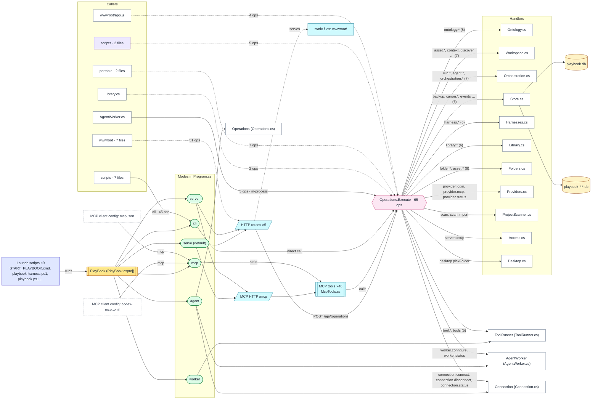

# Handoff: PlayBookOS

Generated by HandOff247 0.4.0 from https://github.com/unkkyuist/PlayBookOS@7153e47 on 2026-11-10. Re-run to refresh; edit the notes file, not this page.

> How to read this pack: everything without a 'Notes' label was found in the code and links to the line it came from. Notes were written by a person in `examples/playbookos.notes.md`. Dashed arrows are inferences — check them before relying on them.

> 75 comments and headings were written in another language; they are shown in English from the Translations table in `examples/playbookos.notes.md` and marked 'translated'. The originals are kept in handoff.json.

> Handover status: **11 of 14** checks ready — see [HANDOVER.md](HANDOVER.md).

## At a glance

| files | lines | languages | run modes | operations | HTTP routes | MCP tools | env vars |
|---|---|---|---|---|---|---|---|
| 97 | 9,665 | 8 | 6 | 65 | 6 | 46 | 8 |

Python 20 (3,559 lines) · C# 18 (2,740 lines) · JavaScript 11 (1,283 lines) · PowerShell 7 (194 lines) · Batch 5 (17 lines) · HTML 2 (41 lines) · Shell 1 (9 lines) · CSS 1 (47 lines)

## What this project is

> **Notes**
>
> PlayBook OS is a shared ledger for projects, references and AI work. The web UI, the JSON CLI and MCP (stdio and HTTP) all go through the same operations and the same SQLite records (README.en.md).
> It is a trusted-owner workspace service: there are no per-user roles or tenant isolation (README.en.md, "Verification and scope").

From [README.en.md](https://github.com/unkkyuist/PlayBookOS/blob/7153e47ec28a0b1933c24404db08a43a468b6c14/README.en.md): *Manage projects, shared references and AI work through one revisioned ledger.*

## System map

Launch scripts start the program; each mode exposes interfaces; every caller ends up in the dispatch table, which hands work to the handler files.

Mermaid source: diagrams/system.mmd

## Pages

- [HANDOVER.md](HANDOVER.md) — Handover checklist — what is ready, unfinished work, what exists only on one computer, accounts, people
- [RUNNING.md](RUNNING.md) — How it runs — launch chain, modes, environment variables, ports, build and tests
- [CONNECTIONS.md](CONNECTIONS.md) — How the tools connect — operations, HTTP routes, MCP tools, callers
- [CODEMAP.md](CODEMAP.md) — Code map — which file depends on which
- [FILES.md](FILES.md) — File cards — one card per file with comments, symbols and links
- [index.html](index.html) — Interactive viewer with a graph of everything found (open index.html in a browser)
- [wiki/index.md](wiki/index.md) — Wiki for AI assistants — one small page per file, operation, tool and run mode, all interlinked
- [llms.txt](llms.txt) — Entry point for AI assistants (llms.txt convention); llms-full.txt is the whole wiki in one file
- [ontology.json](ontology.json) — The ontology as data — every entity and relation, with the file and line it was observed at

## Suggested reading order

1. [README.en.md](https://github.com/unkkyuist/PlayBookOS/blob/7153e47ec28a0b1933c24404db08a43a468b6c14/README.en.md) — **what the project says about itself**
2. [Program.cs](https://github.com/unkkyuist/PlayBookOS/blob/7153e47ec28a0b1933c24404db08a43a468b6c14/Program.cs) — **entry point; picks the run mode**
3. [Operations.cs](https://github.com/unkkyuist/PlayBookOS/blob/7153e47ec28a0b1933c24404db08a43a468b6c14/Operations.cs) — **dispatch table: 65 operations**
4. [START_PLAYBOOK.cmd](https://github.com/unkkyuist/PlayBookOS/blob/7153e47ec28a0b1933c24404db08a43a468b6c14/START_PLAYBOOK.cmd) — **how people start it**
5. [playbook-harness.ps1](https://github.com/unkkyuist/PlayBookOS/blob/7153e47ec28a0b1933c24404db08a43a468b6c14/playbook-harness.ps1) — **how people start it**
6. [Domain.cs](https://github.com/unkkyuist/PlayBookOS/blob/7153e47ec28a0b1933c24404db08a43a468b6c14/Domain.cs) — **shared foundation used by 17 files**
7. [Store.cs](https://github.com/unkkyuist/PlayBookOS/blob/7153e47ec28a0b1933c24404db08a43a468b6c14/Store.cs) — **shared foundation used by 12 files**
8. [wwwroot/i18n.js](https://github.com/unkkyuist/PlayBookOS/blob/7153e47ec28a0b1933c24404db08a43a468b6c14/wwwroot/i18n.js) — **shared foundation used by 10 files**
9. [McpTools.cs](https://github.com/unkkyuist/PlayBookOS/blob/7153e47ec28a0b1933c24404db08a43a468b6c14/McpTools.cs) — **MCP tool definitions**
10. [Ontology.cs](https://github.com/unkkyuist/PlayBookOS/blob/7153e47ec28a0b1933c24404db08a43a468b6c14/Ontology.cs) — **handles 8 operations**
11. [Workspace.cs](https://github.com/unkkyuist/PlayBookOS/blob/7153e47ec28a0b1933c24404db08a43a468b6c14/Workspace.cs) — **handles 7 operations**
12. [Orchestration.cs](https://github.com/unkkyuist/PlayBookOS/blob/7153e47ec28a0b1933c24404db08a43a468b6c14/Orchestration.cs) — **handles 7 operations**

## Successor checklist

> **Notes**
>
> 1. Install the .NET 10 SDK, run `dotnet build -c Release`, then `dotnet bin/Release/net10.0/PlayBook.dll serve` and open http://127.0.0.1:7331.
> 2. Point every client (GUI, CLI, MCP) at the same `PLAYBOOK_HOME`, or they will each see a different database.
> 3. After any business-logic change run `python scripts/smoke.py` (plus folders/ontology/central smokes before a release).
> 4. Track work for this project in PlayBook itself under project ID `playbook` (AGENTS.md).

## Known issues and risks

> **Notes**
>
> - Every write must send `expectedRevision`; on conflict reread and merge instead of retrying blindly (README.en.md).
> - macOS runtime is unverified; cross-publishing does not count as evidence (AGENTS.md).
> - Real Claude model execution was not verified in v0.2.0; see docs/RELEASE-0.2.0.md.

## Credentials and accounts

> **Notes**
>
> The HTTP/MCP key lives in `PLAYBOOK_HOME/api-key` (created on first `serve`). Never commit `data/`, tool credentials, logs or API keys (AGENTS.md).
>
> <!-- The next five questions can only be answered by the person leaving, so the demo leaves them open:
>      the pack shows them as "to do" on its Handover page. -->

## Still undocumented

Write these in `examples/playbookos.notes.md` (run `handoff247 notes` to add the headings).

- [Program.cs](https://github.com/unkkyuist/PlayBookOS/blob/7153e47ec28a0b1933c24404db08a43a468b6c14/Program.cs)
- [START_PLAYBOOK.cmd](https://github.com/unkkyuist/PlayBookOS/blob/7153e47ec28a0b1933c24404db08a43a468b6c14/START_PLAYBOOK.cmd)
- [playbook-harness.ps1](https://github.com/unkkyuist/PlayBookOS/blob/7153e47ec28a0b1933c24404db08a43a468b6c14/playbook-harness.ps1)
- [Domain.cs](https://github.com/unkkyuist/PlayBookOS/blob/7153e47ec28a0b1933c24404db08a43a468b6c14/Domain.cs)
- [wwwroot/i18n.js](https://github.com/unkkyuist/PlayBookOS/blob/7153e47ec28a0b1933c24404db08a43a468b6c14/wwwroot/i18n.js)
- [McpTools.cs](https://github.com/unkkyuist/PlayBookOS/blob/7153e47ec28a0b1933c24404db08a43a468b6c14/McpTools.cs)
- [Ontology.cs](https://github.com/unkkyuist/PlayBookOS/blob/7153e47ec28a0b1933c24404db08a43a468b6c14/Ontology.cs)
- [Workspace.cs](https://github.com/unkkyuist/PlayBookOS/blob/7153e47ec28a0b1933c24404db08a43a468b6c14/Workspace.cs)
- [Orchestration.cs](https://github.com/unkkyuist/PlayBookOS/blob/7153e47ec28a0b1933c24404db08a43a468b6c14/Orchestration.cs)
- [Harnesses.cs](https://github.com/unkkyuist/PlayBookOS/blob/7153e47ec28a0b1933c24404db08a43a468b6c14/Harnesses.cs)
- [START_GRAPHIFY.cmd](https://github.com/unkkyuist/PlayBookOS/blob/7153e47ec28a0b1933c24404db08a43a468b6c14/START_GRAPHIFY.cmd)
- [Start-PlayBook-Desktop.ps1](https://github.com/unkkyuist/PlayBookOS/blob/7153e47ec28a0b1933c24404db08a43a468b6c14/Start-PlayBook-Desktop.ps1)
- [graphify.ps1](https://github.com/unkkyuist/PlayBookOS/blob/7153e47ec28a0b1933c24404db08a43a468b6c14/graphify.ps1)
- [playbook.ps1](https://github.com/unkkyuist/PlayBookOS/blob/7153e47ec28a0b1933c24404db08a43a468b6c14/playbook.ps1)
- [playbook.sh](https://github.com/unkkyuist/PlayBookOS/blob/7153e47ec28a0b1933c24404db08a43a468b6c14/playbook.sh)
- [portable/INSTALL_PLAYBOOK.cmd](https://github.com/unkkyuist/PlayBookOS/blob/7153e47ec28a0b1933c24404db08a43a468b6c14/portable/INSTALL_PLAYBOOK.cmd)
- [portable/Install-PlayBook.ps1](https://github.com/unkkyuist/PlayBookOS/blob/7153e47ec28a0b1933c24404db08a43a468b6c14/portable/Install-PlayBook.ps1)
- [portable/START_PLAYBOOK.cmd](https://github.com/unkkyuist/PlayBookOS/blob/7153e47ec28a0b1933c24404db08a43a468b6c14/portable/START_PLAYBOOK.cmd)
- [portable/STOP_PLAYBOOK.cmd](https://github.com/unkkyuist/PlayBookOS/blob/7153e47ec28a0b1933c24404db08a43a468b6c14/portable/STOP_PLAYBOOK.cmd)
- [portable/Start-PlayBook.ps1](https://github.com/unkkyuist/PlayBookOS/blob/7153e47ec28a0b1933c24404db08a43a468b6c14/portable/Start-PlayBook.ps1)

## Recent commits

- `7153e47` 2026-11-07 — Add project flowchart panel, curated Graphify specs and desktop launcher
- `f0a2812` 2026-10-29 — Add reviewed AI guidance workflow with paired trials
- `7813ce7` 2026-10-18 — Add reliable MCP audit logs and Oz support bundles
- `ca98380` 2026-10-18 — Add Graphify integration and Oz macOS Claude Code distribution
- `ec10b93` 2026-10-07 — Release PlayBook OS 0.2.0 with portable workspace and AI orchestration

