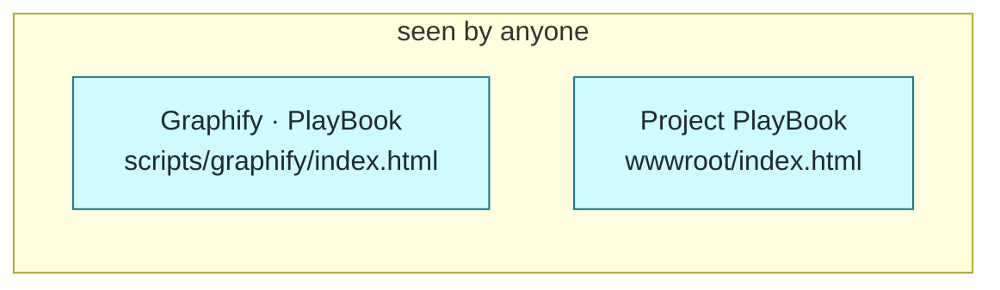

# Who uses it and what they see

Generated by HandOff247 0.6.0 from https://github.com/unkkyuist/PlayBookOS@7153e47 on 2026-11-14. Re-run to refresh; edit the notes file, not this page.

[← Back to start](README.md)

> The user types on this page are the kinds of user the analysed application tells apart. They are not access levels of this pack: every flow is open to you, and each one links to the flows of the other user types. Start from a user type, from the words on a screen, from an asset or table, or from a code file.

## User types

Found from role checks on routes and in templates. A route without one is listed under `anyone`.

| User type | Kind | Told apart at | Screens | Features |
|---|---|---|---|---|
| [`anyone`](wiki/users/anyone.md) | anyone (no role check found) | no role check found on these routes | `scripts/graphify/index.html`, `wwwroot/index.html` | 6 |

Screens grouped by who sees them. An arrow into a state is an action that sets it; an arrow out of a state is a screen that lists or tests it. Dashed arrows are inferences.

Mermaid source: diagrams/users.mmd

## Flows by user type

Per screen: what is on it, when it is shown, where it leads, what the code then does, and who picks the work up next.

### `anyone` — anyone (no role check found)

No role check was found on the routes below. A check made in middleware, a base class or the web server would not be seen.

#### Screen "Graphify · PlayBook" — [`scripts/graphify/index.html`](wiki/screens/scripts__graphify__index.html.md)

no route was found that opens it for this user type.

| On the screen | Where | Shown when | Leads to | What the code does | Then |
|---|---|---|---|---|---|
| "PlayBook 열기 ↗" (link) | [scripts/graphify/index.html:8](https://github.com/unkkyuist/PlayBookOS/blob/7153e47ec28a0b1933c24404db08a43a468b6c14/scripts/graphify/index.html#L8) |  | another site: `127.0.0.1:7331` |  |  |
| "코드 그래프 생성 / 갱신" (button) | [scripts/graphify/index.html:12](https://github.com/unkkyuist/PlayBookOS/blob/7153e47ec28a0b1933c24404db08a43a468b6c14/scripts/graphify/index.html#L12) |  | *not determined from the page; a script may handle it* |  |  |
| "전체 그래프 열기 ↗" (link) | [scripts/graphify/index.html:12](https://github.com/unkkyuist/PlayBookOS/blob/7153e47ec28a0b1933c24404db08a43a468b6c14/scripts/graphify/index.html#L12) |  | *not determined from the page; a script may handle it* |  |  |
| "온톨로지 요약 연결 / 갱신" (button) | [scripts/graphify/index.html:12](https://github.com/unkkyuist/PlayBookOS/blob/7153e47ec28a0b1933c24404db08a43a468b6c14/scripts/graphify/index.html#L12) |  | *not determined from the page; a script may handle it* |  |  |
| "분석 보고서" (link) | [scripts/graphify/index.html:12](https://github.com/unkkyuist/PlayBookOS/blob/7153e47ec28a0b1933c24404db08a43a468b6c14/scripts/graphify/index.html#L12) |  | *not determined from the page; a script may handle it* |  |  |
| "검색" (button) | [scripts/graphify/index.html:18](https://github.com/unkkyuist/PlayBookOS/blob/7153e47ec28a0b1933c24404db08a43a468b6c14/scripts/graphify/index.html#L18) |  | *not determined from the page; a script may handle it* |  |  |
| "Graphify 공식 저장소 ↗" (link) | [scripts/graphify/index.html:19](https://github.com/unkkyuist/PlayBookOS/blob/7153e47ec28a0b1933c24404db08a43a468b6c14/scripts/graphify/index.html#L19) |  | another site: `github.com` |  |  |

Fields: "PlayBook 프로젝트"; "전체 코드 그래프 검색".

#### Screen "Project PlayBook" — [`wwwroot/index.html`](wiki/screens/wwwroot__index.html.md)

no route was found that opens it for this user type.

| On the screen | Where | Shown when | Leads to | What the code does | Then |
|---|---|---|---|---|---|
| "PPLAYBOOKPROJECT OPERATING SYSTEM" (link) | [wwwroot/index.html:4](https://github.com/unkkyuist/PlayBookOS/blob/7153e47ec28a0b1933c24404db08a43a468b6c14/wwwroot/index.html#L4) |  | *not verified: points to '/'; no route was found* |  |  |
| "◫ &nbsp; 전체 프로젝트" (button) | [wwwroot/index.html:4](https://github.com/unkkyuist/PlayBookOS/blob/7153e47ec28a0b1933c24404db08a43a468b6c14/wwwroot/index.html#L4) |  | *not determined from the page; a script may handle it* |  |  |
| "⌘ &nbsp; 도구 · 서버" (button) | [wwwroot/index.html:4](https://github.com/unkkyuist/PlayBookOS/blob/7153e47ec28a0b1933c24404db08a43a468b6c14/wwwroot/index.html#L4) |  | *not determined from the page; a script may handle it* |  |  |
| "◇ &nbsp; 취향 · 개발 원칙" (button) | [wwwroot/index.html:4](https://github.com/unkkyuist/PlayBookOS/blob/7153e47ec28a0b1933c24404db08a43a468b6c14/wwwroot/index.html#L4) |  | *not determined from the page; a script may handle it* |  |  |
| "▣ &nbsp; 설치 · 폴더 선택" (button) | [wwwroot/index.html:4](https://github.com/unkkyuist/PlayBookOS/blob/7153e47ec28a0b1933c24404db08a43a468b6c14/wwwroot/index.html#L4) |  | *not determined from the page; a script may handle it* |  |  |
| "◎ &nbsp; AI 에이전트" (button) | [wwwroot/index.html:4](https://github.com/unkkyuist/PlayBookOS/blob/7153e47ec28a0b1933c24404db08a43a468b6c14/wwwroot/index.html#L4) |  | *not determined from the page; a script may handle it* |  |  |
| "▧ &nbsp; 공용 레퍼런스" (button) | [wwwroot/index.html:4](https://github.com/unkkyuist/PlayBookOS/blob/7153e47ec28a0b1933c24404db08a43a468b6c14/wwwroot/index.html#L4) |  | *not determined from the page; a script may handle it* |  |  |
| "＋" (button) | [wwwroot/index.html:4](https://github.com/unkkyuist/PlayBookOS/blob/7153e47ec28a0b1933c24404db08a43a468b6c14/wwwroot/index.html#L4) |  | *not determined from the page; a script may handle it* |  |  |
| "새로고침 ↻" (button) | [wwwroot/index.html:5](https://github.com/unkkyuist/PlayBookOS/blob/7153e47ec28a0b1933c24404db08a43a468b6c14/wwwroot/index.html#L5) |  | *not determined from the page; a script may handle it* |  |  |
| "로그아웃" (button) | [wwwroot/index.html:5](https://github.com/unkkyuist/PlayBookOS/blob/7153e47ec28a0b1933c24404db08a43a468b6c14/wwwroot/index.html#L5) |  | *not determined from the page; a script may handle it* |  |  |
| "백업" (button) | [wwwroot/index.html:5](https://github.com/unkkyuist/PlayBookOS/blob/7153e47ec28a0b1933c24404db08a43a468b6c14/wwwroot/index.html#L5) |  | *not determined from the page; a script may handle it* |  |  |
| "×" (button) | [wwwroot/index.html:7](https://github.com/unkkyuist/PlayBookOS/blob/7153e47ec28a0b1933c24404db08a43a468b6c14/wwwroot/index.html#L7) |  | *not determined from the page; a script may handle it* |  |  |
| "취소" (button) | [wwwroot/index.html:7](https://github.com/unkkyuist/PlayBookOS/blob/7153e47ec28a0b1933c24404db08a43a468b6c14/wwwroot/index.html#L7) |  | *not determined from the page; a script may handle it* |  |  |
| "기록 저장" (button) | [wwwroot/index.html:7](https://github.com/unkkyuist/PlayBookOS/blob/7153e47ec28a0b1933c24404db08a43a468b6c14/wwwroot/index.html#L7) |  | *not determined from the page; a script may handle it* |  |  |
| "×" (button) | [wwwroot/index.html:8](https://github.com/unkkyuist/PlayBookOS/blob/7153e47ec28a0b1933c24404db08a43a468b6c14/wwwroot/index.html#L8) |  | *not determined from the page; a script may handle it* |  |  |

Fields: "종류"; "상태"; "제목"; "작성자"; "변경 근거".

Actions that show no page of their own:

- [`GET /session`](wiki/features/GET-__session.md) — GET /session — [Program.cs:98](https://github.com/unkkyuist/PlayBookOS/blob/7153e47ec28a0b1933c24404db08a43a468b6c14/Program.cs#L98) — *handler not analysed*
- [`POST /auth/login`](wiki/features/POST-__auth__login.md) — POST /auth/login — [Program.cs:99](https://github.com/unkkyuist/PlayBookOS/blob/7153e47ec28a0b1933c24404db08a43a468b6c14/Program.cs#L99) — *handler not analysed*
- [`POST /api/{operation}`](wiki/features/POST-__api__-operation.md) — POST /api/{operation} — [Program.cs:100](https://github.com/unkkyuist/PlayBookOS/blob/7153e47ec28a0b1933c24404db08a43a468b6c14/Program.cs#L100) — *handler not analysed*
- [`POST /media/{projectId}`](wiki/features/POST-__media__-projectId.md) — POST /media/{projectId} — [Program.cs:104](https://github.com/unkkyuist/PlayBookOS/blob/7153e47ec28a0b1933c24404db08a43a468b6c14/Program.cs#L104) — *handler not analysed*
- [`GET /health`](wiki/features/GET-__health.md) — GET /health — [Program.cs:108](https://github.com/unkkyuist/PlayBookOS/blob/7153e47ec28a0b1933c24404db08a43a468b6c14/Program.cs#L108) — *handler not analysed*
- [`MCP /mcp`](wiki/features/MCP-__mcp.md) — MCP /mcp — [Program.cs:109](https://github.com/unkkyuist/PlayBookOS/blob/7153e47ec28a0b1933c24404db08a43a468b6c14/Program.cs#L109) — *handler not analysed*

## Features

One per route. Each links to its own page: started from, what the code does, branches, hand-overs, data, assets, what to check, what was not verified.

| Feature | Called | User types | Started from | Handler | What it does |
|---|---|---|---|---|---|
| [`GET /session`](wiki/features/GET-__session.md) | GET /session | [`anyone`](wiki/users/anyone.md) | `wwwroot/index.html` | [Program.cs:98](https://github.com/unkkyuist/PlayBookOS/blob/7153e47ec28a0b1933c24404db08a43a468b6c14/Program.cs#L98) | *handler not analysed* |
| [`POST /auth/login`](wiki/features/POST-__auth__login.md) | POST /auth/login | [`anyone`](wiki/users/anyone.md) | `wwwroot/index.html` | [Program.cs:99](https://github.com/unkkyuist/PlayBookOS/blob/7153e47ec28a0b1933c24404db08a43a468b6c14/Program.cs#L99) | *handler not analysed* |
| [`POST /api/{operation}`](wiki/features/POST-__api__-operation.md) | POST /api/{operation} | [`anyone`](wiki/users/anyone.md) | `wwwroot/index.html` | [Program.cs:100](https://github.com/unkkyuist/PlayBookOS/blob/7153e47ec28a0b1933c24404db08a43a468b6c14/Program.cs#L100) | *handler not analysed* |
| [`POST /media/{projectId}`](wiki/features/POST-__media__-projectId.md) | POST /media/{projectId} | [`anyone`](wiki/users/anyone.md) | `wwwroot/index.html` | [Program.cs:104](https://github.com/unkkyuist/PlayBookOS/blob/7153e47ec28a0b1933c24404db08a43a468b6c14/Program.cs#L104) | *handler not analysed* |
| [`GET /health`](wiki/features/GET-__health.md) | GET /health | [`anyone`](wiki/users/anyone.md) |  | [Program.cs:108](https://github.com/unkkyuist/PlayBookOS/blob/7153e47ec28a0b1933c24404db08a43a468b6c14/Program.cs#L108) | *handler not analysed* |
| [`MCP /mcp`](wiki/features/MCP-__mcp.md) | MCP /mcp | [`anyone`](wiki/users/anyone.md) |  | [Program.cs:109](https://github.com/unkkyuist/PlayBookOS/blob/7153e47ec28a0b1933c24404db08a43a468b6c14/Program.cs#L109) | *handler not analysed* |

## Words on the screens

Start here when someone describes a screen in their own words. The text is what the user reads; a text that comes from a locale file is listed with every language found.

| Text on the screen | Kind | Where | Seen by | Shown when | Leads to | Implemented at |
|---|---|---|---|---|---|---|
| "English" | choice | [wwwroot/index.html:5](https://github.com/unkkyuist/PlayBookOS/blob/7153e47ec28a0b1933c24404db08a43a468b6c14/wwwroot/index.html#L5) | [`anyone`](wiki/users/anyone.md) |  |  |  |
| "Graphify · PlayBook" | title | [scripts/graphify/index.html:4](https://github.com/unkkyuist/PlayBookOS/blob/7153e47ec28a0b1933c24404db08a43a468b6c14/scripts/graphify/index.html#L4) | [`anyone`](wiki/users/anyone.md) |  |  |  |
| "Graphify × PlayBook" | heading | [scripts/graphify/index.html:8](https://github.com/unkkyuist/PlayBookOS/blob/7153e47ec28a0b1933c24404db08a43a468b6c14/scripts/graphify/index.html#L8) | [`anyone`](wiki/users/anyone.md) |  |  |  |
| "Graphify 공식 저장소 ↗" | link | [scripts/graphify/index.html:19](https://github.com/unkkyuist/PlayBookOS/blob/7153e47ec28a0b1933c24404db08a43a468b6c14/scripts/graphify/index.html#L19) | [`anyone`](wiki/users/anyone.md) |  |  |  |
| "PlayBook 열기 ↗" | link | [scripts/graphify/index.html:8](https://github.com/unkkyuist/PlayBookOS/blob/7153e47ec28a0b1933c24404db08a43a468b6c14/scripts/graphify/index.html#L8) | [`anyone`](wiki/users/anyone.md) |  |  |  |
| "PlayBook 프로젝트" | field | [scripts/graphify/index.html:11](https://github.com/unkkyuist/PlayBookOS/blob/7153e47ec28a0b1933c24404db08a43a468b6c14/scripts/graphify/index.html#L11) | [`anyone`](wiki/users/anyone.md) |  |  |  |
| "PPLAYBOOKPROJECT OPERATING SYSTEM" | link | [wwwroot/index.html:4](https://github.com/unkkyuist/PlayBookOS/blob/7153e47ec28a0b1933c24404db08a43a468b6c14/wwwroot/index.html#L4) | [`anyone`](wiki/users/anyone.md) |  |  |  |
| "Project PlayBook" | title | [wwwroot/index.html:2](https://github.com/unkkyuist/PlayBookOS/blob/7153e47ec28a0b1933c24404db08a43a468b6c14/wwwroot/index.html#L2) | [`anyone`](wiki/users/anyone.md) |  |  |  |
| "×" | button | [wwwroot/index.html:7](https://github.com/unkkyuist/PlayBookOS/blob/7153e47ec28a0b1933c24404db08a43a468b6c14/wwwroot/index.html#L7) | [`anyone`](wiki/users/anyone.md) |  |  |  |
| "×" | button | [wwwroot/index.html:8](https://github.com/unkkyuist/PlayBookOS/blob/7153e47ec28a0b1933c24404db08a43a468b6c14/wwwroot/index.html#L8) | [`anyone`](wiki/users/anyone.md) |  |  |  |
| "⌘ &nbsp; 도구 · 서버" | button | [wwwroot/index.html:4](https://github.com/unkkyuist/PlayBookOS/blob/7153e47ec28a0b1933c24404db08a43a468b6c14/wwwroot/index.html#L4) | [`anyone`](wiki/users/anyone.md) |  |  |  |
| "▣ &nbsp; 설치 · 폴더 선택" | button | [wwwroot/index.html:4](https://github.com/unkkyuist/PlayBookOS/blob/7153e47ec28a0b1933c24404db08a43a468b6c14/wwwroot/index.html#L4) | [`anyone`](wiki/users/anyone.md) |  |  |  |
| "▧ &nbsp; 공용 레퍼런스" | button | [wwwroot/index.html:4](https://github.com/unkkyuist/PlayBookOS/blob/7153e47ec28a0b1933c24404db08a43a468b6c14/wwwroot/index.html#L4) | [`anyone`](wiki/users/anyone.md) |  |  |  |
| "◇ &nbsp; 취향 · 개발 원칙" | button | [wwwroot/index.html:4](https://github.com/unkkyuist/PlayBookOS/blob/7153e47ec28a0b1933c24404db08a43a468b6c14/wwwroot/index.html#L4) | [`anyone`](wiki/users/anyone.md) |  |  |  |
| "◎ &nbsp; AI 에이전트" | button | [wwwroot/index.html:4](https://github.com/unkkyuist/PlayBookOS/blob/7153e47ec28a0b1933c24404db08a43a468b6c14/wwwroot/index.html#L4) | [`anyone`](wiki/users/anyone.md) |  |  |  |
| "◫ &nbsp; 전체 프로젝트" | button | [wwwroot/index.html:4](https://github.com/unkkyuist/PlayBookOS/blob/7153e47ec28a0b1933c24404db08a43a468b6c14/wwwroot/index.html#L4) | [`anyone`](wiki/users/anyone.md) |  |  |  |
| "검색" | button | [scripts/graphify/index.html:18](https://github.com/unkkyuist/PlayBookOS/blob/7153e47ec28a0b1933c24404db08a43a468b6c14/scripts/graphify/index.html#L18) | [`anyone`](wiki/users/anyone.md) |  |  |  |
| "기록 저장" | button | [wwwroot/index.html:7](https://github.com/unkkyuist/PlayBookOS/blob/7153e47ec28a0b1933c24404db08a43a468b6c14/wwwroot/index.html#L7) | [`anyone`](wiki/users/anyone.md) |  |  |  |
| "로그아웃" | button | [wwwroot/index.html:5](https://github.com/unkkyuist/PlayBookOS/blob/7153e47ec28a0b1933c24404db08a43a468b6c14/wwwroot/index.html#L5) | [`anyone`](wiki/users/anyone.md) |  |  |  |
| "백업" | button | [wwwroot/index.html:5](https://github.com/unkkyuist/PlayBookOS/blob/7153e47ec28a0b1933c24404db08a43a468b6c14/wwwroot/index.html#L5) | [`anyone`](wiki/users/anyone.md) |  |  |  |
| "변경 근거" | field | [wwwroot/index.html:7](https://github.com/unkkyuist/PlayBookOS/blob/7153e47ec28a0b1933c24404db08a43a468b6c14/wwwroot/index.html#L7) | [`anyone`](wiki/users/anyone.md) |  |  |  |
| "분석 보고서" | link | [scripts/graphify/index.html:12](https://github.com/unkkyuist/PlayBookOS/blob/7153e47ec28a0b1933c24404db08a43a468b6c14/scripts/graphify/index.html#L12) | [`anyone`](wiki/users/anyone.md) |  |  |  |
| "상태" | field | [wwwroot/index.html:7](https://github.com/unkkyuist/PlayBookOS/blob/7153e47ec28a0b1933c24404db08a43a468b6c14/wwwroot/index.html#L7) | [`anyone`](wiki/users/anyone.md) |  |  |  |
| "새 기록" | heading | [wwwroot/index.html:7](https://github.com/unkkyuist/PlayBookOS/blob/7153e47ec28a0b1933c24404db08a43a468b6c14/wwwroot/index.html#L7) | [`anyone`](wiki/users/anyone.md) |  |  |  |
| "새로고침 ↻" | button | [wwwroot/index.html:5](https://github.com/unkkyuist/PlayBookOS/blob/7153e47ec28a0b1933c24404db08a43a468b6c14/wwwroot/index.html#L5) | [`anyone`](wiki/users/anyone.md) |  |  |  |
| "온톨로지 요약 연결 / 갱신" | button | [scripts/graphify/index.html:12](https://github.com/unkkyuist/PlayBookOS/blob/7153e47ec28a0b1933c24404db08a43a468b6c14/scripts/graphify/index.html#L12) | [`anyone`](wiki/users/anyone.md) |  |  |  |
| "작성자" | field | [wwwroot/index.html:7](https://github.com/unkkyuist/PlayBookOS/blob/7153e47ec28a0b1933c24404db08a43a468b6c14/wwwroot/index.html#L7) | [`anyone`](wiki/users/anyone.md) |  |  |  |
| "전체 그래프 열기 ↗" | link | [scripts/graphify/index.html:12](https://github.com/unkkyuist/PlayBookOS/blob/7153e47ec28a0b1933c24404db08a43a468b6c14/scripts/graphify/index.html#L12) | [`anyone`](wiki/users/anyone.md) |  |  |  |
| "전체 코드 그래프 검색" | field | [scripts/graphify/index.html:18](https://github.com/unkkyuist/PlayBookOS/blob/7153e47ec28a0b1933c24404db08a43a468b6c14/scripts/graphify/index.html#L18) | [`anyone`](wiki/users/anyone.md) |  |  |  |
| "제목" | field | [wwwroot/index.html:7](https://github.com/unkkyuist/PlayBookOS/blob/7153e47ec28a0b1933c24404db08a43a468b6c14/wwwroot/index.html#L7) | [`anyone`](wiki/users/anyone.md) |  |  |  |
| "종류" | field | [wwwroot/index.html:7](https://github.com/unkkyuist/PlayBookOS/blob/7153e47ec28a0b1933c24404db08a43a468b6c14/wwwroot/index.html#L7) | [`anyone`](wiki/users/anyone.md) |  |  |  |
| "추가 속성 JSON" | heading | [wwwroot/index.html:7](https://github.com/unkkyuist/PlayBookOS/blob/7153e47ec28a0b1933c24404db08a43a468b6c14/wwwroot/index.html#L7) | [`anyone`](wiki/users/anyone.md) |  |  |  |
| "취소" | button | [wwwroot/index.html:7](https://github.com/unkkyuist/PlayBookOS/blob/7153e47ec28a0b1933c24404db08a43a468b6c14/wwwroot/index.html#L7) | [`anyone`](wiki/users/anyone.md) |  |  |  |
| "코드 그래프 생성 / 갱신" | button | [scripts/graphify/index.html:12](https://github.com/unkkyuist/PlayBookOS/blob/7153e47ec28a0b1933c24404db08a43a468b6c14/scripts/graphify/index.html#L12) | [`anyone`](wiki/users/anyone.md) |  |  |  |
| "한국어" | choice | [wwwroot/index.html:5](https://github.com/unkkyuist/PlayBookOS/blob/7153e47ec28a0b1933c24404db08a43a468b6c14/wwwroot/index.html#L5) | [`anyone`](wiki/users/anyone.md) |  |  |  |
| "＋" | button | [wwwroot/index.html:4](https://github.com/unkkyuist/PlayBookOS/blob/7153e47ec28a0b1933c24404db08a43a468b6c14/wwwroot/index.html#L4) | [`anyone`](wiki/users/anyone.md) |  |  |  |

## Not verified by the analysis

What could not be connected is listed instead of guessed.

- GET /session: the handler was not analysed (only Python handlers are followed) — [Program.cs:98](https://github.com/unkkyuist/PlayBookOS/blob/7153e47ec28a0b1933c24404db08a43a468b6c14/Program.cs#L98)
- POST /auth/login: the handler was not analysed (only Python handlers are followed) — [Program.cs:99](https://github.com/unkkyuist/PlayBookOS/blob/7153e47ec28a0b1933c24404db08a43a468b6c14/Program.cs#L99)
- POST /api/{operation}: the handler was not analysed (only Python handlers are followed) — [Program.cs:100](https://github.com/unkkyuist/PlayBookOS/blob/7153e47ec28a0b1933c24404db08a43a468b6c14/Program.cs#L100)
- POST /media/{projectId}: the handler was not analysed (only Python handlers are followed) — [Program.cs:104](https://github.com/unkkyuist/PlayBookOS/blob/7153e47ec28a0b1933c24404db08a43a468b6c14/Program.cs#L104)
- GET /health: the handler was not analysed (only Python handlers are followed) — [Program.cs:108](https://github.com/unkkyuist/PlayBookOS/blob/7153e47ec28a0b1933c24404db08a43a468b6c14/Program.cs#L108)
- MCP /mcp: the handler was not analysed (only Python handlers are followed) — [Program.cs:109](https://github.com/unkkyuist/PlayBookOS/blob/7153e47ec28a0b1933c24404db08a43a468b6c14/Program.cs#L109)
- 'PPLAYBOOKPROJECT OPERATING SYSTEM' points to '/'; no route was found for it — [wwwroot/index.html:4](https://github.com/unkkyuist/PlayBookOS/blob/7153e47ec28a0b1933c24404db08a43a468b6c14/wwwroot/index.html#L4)

*This is what the code does and under which conditions, read without running it. It does not tell which condition applied to this user: check the live data, settings and logs at the points listed under `check`.*

